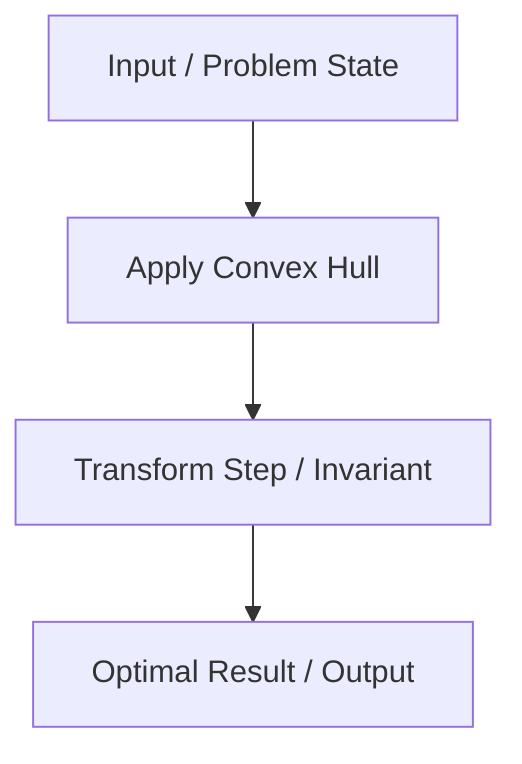

# Convex Hull

> **Category:** AdvancedAndRare · **Tier:** Competitive Programming (Advanced)

---

## 🔗 Resources & Visualizers
- **YouTube:** [Watch Convex Hull Visual Guide](https://www.youtube.com/results?search_query=Convex%20Hull%20algorithm%20visual%20explanation)
- **Blog / Editorial:** [CP-Algorithms / GeeksforGeeks Guide](https://www.google.com/search?q=Convex%20Hull%20algorithm%20tutorial%20CP%20algorithms)
- **Interactive Visualizer:** [VisuAlgo Interactive Simulation](https://visualgo.net/en)

---

## 🧠 Intuition & Mental Model
> [!TIP]
> **Core Concept:** The Convex Hull of a set of points is the smallest

The Convex Hull of a set of points is the smallest
convex polygon that enclains all given points.
It can be visualized as stretching a rubber band around the outermost points.
The hull contains only boundary points, ignoring inner ones.
Algorithm Explanation
We use Graham Scan:
Find the bottom-most (or left-most) point → start point.
Sort remaining points based on polar angle w.r.t start point.
Traverse sorted points and:
If last 3 points make a left turn → keep.
If they make a right turn → remove middle point.
Stack finally contains Convex Hull.
Left turn check is done using cross product (orientation test).

---

## 🎯 When to Use & Problem Triggers
- **Trigger 1:** When the brute-force enumeration takes quadratic time or higher and a linear/logarithmic invariant exists.
- **Trigger 2:** Common patterns involving **AdvancedAndRare**, subsegments, query sequences, or optimal substructures.
- **Trigger 3:** Constraints where $N \ge 10^5$ require $O(N)$ or $O(N \log N)$ performance.

---

## 📊 Visual Explanation & Dry Run



<details>
<summary>🔍 <strong>Step-by-Step Algorithm Walkthrough</strong> (Click to expand)</summary>

1. **Initialization:** Set up boundary pointers, state variables, or base auxiliary arrays.
2. **Iteration / Traversal:** Advance through the input elements while maintaining the algorithmic invariant.
3. **State Transition:** Update the current state, dynamic array, or accumulator in $O(1)$ or $O(\log N)$.
4. **Final Result:** Extract the optimal answer from the computed state or reconstructed solution.

</details>

---

## 💻 Algorithm Code (Java)

```java
import java.util.*;

class Point {
    int x, y;

    Point(int x, int y) {
        this.x = x;
        this.y = y;
    }
}

class ConvexHullGrahamScan {
    static int orientation(Point p, Point q, Point r) {
        int val = (q.y - p.y) * (r.x - q.x) - (q.x - p.x) * (r.y - q.y);
        if (val == 0) return 0;
        return (val > 0) ? 1 : 2;
    }

    public static List<Point> convexHull(Point[] points) {
        int n = points.length;
        if (n < 3) return Arrays.asList(points);

        int min = 0;
        for (int i = 1; i < n; i++) {
            if (points[i].y < points[min].y ||
                    (points[i].y == points[min].y &&
                            points[i].x < points[min].x)) {
                min = i;
            }
        }

        Point temp = points[0];
        points[0] = points[min];
        points[min] = temp;

        Point p0 = points[0];

        Arrays.sort(points, 1, n, (a, b) -> {
            int o = orientation(p0, a, b);
            if (o == 0)
                return (distance(p0, a) - distance(p0, b));
            return (o == 2) ? -1 : 1;
        });

        Stack<Point> stack = new Stack<>();
        stack.push(points[0]);
        stack.push(points[1]);
        stack.push(points[2]);

        for (int i = 3; i < n; i++) {
            while (stack.size() > 1 &&
                    orientation(nextTop(stack), stack.peek(), points[i]) != 2) {
                stack.pop();
            }

            stack.push(points[i]);
        }

        return stack;
    }

    static Point nextTop(Stack<Point> stack) {
        Point top = stack.pop();
        Point next = stack.peek();
        stack.push(top);
        return next;
    }

    static int distance(Point p1, Point p2) {
        return (p1.x - p2.x) * (p1.x - p2.x) +
                (p1.y - p2.y) * (p1.y - p2.y);
    }


    public static void main(String[] args) {
        Point[] points = {
                new Point(0, 3),
                new Point(2, 2),
                new Point(1, 1),
                new Point(2, 1),
                new Point(3, 0),
                new Point(0, 0),
                new Point(3, 3),
        };

        List<Point> hull = convexHull(points);

        System.out.println("Convex Hull Points:");
        for (Point p : hull)
            System.out.println(p.x + " " + p.y);
    }
}
```

---

## ⏱️ Complexity Analysis
- **Time Complexity (TC):** Typically `O(N)` or `O(N log N)` depending on auxiliary sorting or tree operations.
- **Space Complexity (SC):** Typically `O(1)` auxiliary space or `O(N)` for auxiliary arrays/tables.

---

## 🔄 Similar & Connected Algorithms
- **Related Category:** Explore other fundamental algorithms in [AdvancedAndRare](../).
- **Composite Patterns:** Often combined with Prefix Sums, Binary Search on Answer, or Dynamic Programming memoization.

---

## ⚔️ Practice Questions

### 🟡 LeetCode
- [ ] [Explore Convex Hull Problems on LeetCode](https://leetcode.com/problemset/?search=Convex%20Hull%20LeetCode) — `Practice`

### 🔵 CodeChef & Codeforces
- [ ] [Practice on Codeforces Problemset](https://codeforces.com/problemset) — `Catalog`
- [ ] [Practice on CodeChef Practice Portal](https://www.codechef.com/practice) — `Catalog`
