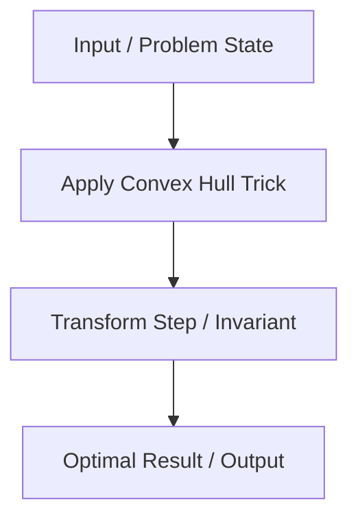

# Convex Hull Trick

> **Category:** AdvancedAndRare · **Tier:** Competitive Programming (Advanced)

---

## 🔗 Resources & Visualizers
- **YouTube:** [Watch Convex Hull Trick Visual Guide](https://www.youtube.com/results?search_query=Convex%20Hull%20Trick%20algorithm%20visual%20explanation)
- **Blog / Editorial:** [CP-Algorithms / GeeksforGeeks Guide](https://www.google.com/search?q=Convex%20Hull%20Trick%20algorithm%20tutorial%20CP%20algorithms)
- **Interactive Visualizer:** [VisuAlgo Interactive Simulation](https://visualgo.net/en)

---

## 🧠 Intuition & Mental Model
> [!TIP]
> **Core Concept:** Convex Hull Trick (CHT) is an optimization technique used in

Convex Hull Trick (CHT) is an optimization technique used in
Dynamic Programming to efficiently compute
minimum/maximum values of linear functions.
It maintains a set of lines
y=mx+c and answers queries like:
“What is the minimum (or maximum) value at a given x?”
Time improves from O(N²) to O(N) or O(N log N) depending on implementation.
Algorithm Explanation
We maintain a set of lines in order of slope.
When adding a new line:
If the previous line becomes useless (never gives better answer), remove it.
Use intersection comparison to check useless lines.
For query:
If queries are monotonic in x → move pointer forward.
Else → use binary search.
Key idea:
A line is useless if the intersection of (l1,l2) ≥ intersection of (l2,l3).

---

## 🎯 When to Use & Problem Triggers
- **Trigger 1:** When the brute-force enumeration takes quadratic time or higher and a linear/logarithmic invariant exists.
- **Trigger 2:** Common patterns involving **AdvancedAndRare**, subsegments, query sequences, or optimal substructures.
- **Trigger 3:** Constraints where $N \ge 10^5$ require $O(N)$ or $O(N \log N)$ performance.

---

## 📊 Visual Explanation & Dry Run



<details>
<summary>🔍 <strong>Step-by-Step Algorithm Walkthrough</strong> (Click to expand)</summary>

1. **Initialization:** Set up boundary pointers, state variables, or base auxiliary arrays.
2. **Iteration / Traversal:** Advance through the input elements while maintaining the algorithmic invariant.
3. **State Transition:** Update the current state, dynamic array, or accumulator in $O(1)$ or $O(\log N)$.
4. **Final Result:** Extract the optimal answer from the computed state or reconstructed solution.

</details>

---

## 💻 Algorithm Code (Java)

```java
import java.io.*;
import java.util.*;

class Main {

    static class Line {
        long m;
        long c;

        Line(long m, long c) {
            this.m = m;
            this.c = c;
        }

        long value(long x) {
            return m * x + c;
        }
    }

    static class CHT {
        Line[] hull;
        int size;

        CHT(int n) {
            hull = new Line[n];
            size = 0;
        }

        boolean isBad(Line l1, Line l2, Line l3) {
            return (l3.c - l1.c) * (l1.m - l2.m)
                    <= (l2.c - l1.c) * (l1.m - l3.m);
        }

        void add(long m, long c) {
            Line newLine = new Line(m, c);

            while (size >= 2 &&
                    isBad(hull[size - 2], hull[size - 1], newLine)) {

                size--;
            }

            hull[size++] = newLine;
        }

        long query(long x) {
            int low = 0, high = size - 1;

            while (low < high) {
                int mid = (low + high) / 2;

                if (hull[mid].value(x) <= hull[mid + 1].value(x))
                    high = mid;
                else
                    low = mid + 1;
            }

            return hull[low].value(x);
        }
    }

    public static void main(String[] args) throws Exception {
        PrintWriter out = new PrintWriter(System.out);

        CHT cht = new CHT(100);

        cht.add(5, 2);
        cht.add(3, 8);
        cht.add(1, 10);

        long result = cht.query(4);

        out.println(result);
        out.flush();
    }
}
```

---

## ⏱️ Complexity Analysis
- **Time Complexity (TC):** Typically `O(N)` or `O(N log N)` depending on auxiliary sorting or tree operations.
- **Space Complexity (SC):** Typically `O(1)` auxiliary space or `O(N)` for auxiliary arrays/tables.

---

## 🔄 Similar & Connected Algorithms
- **Related Category:** Explore other fundamental algorithms in [AdvancedAndRare](../).
- **Composite Patterns:** Often combined with Prefix Sums, Binary Search on Answer, or Dynamic Programming memoization.

---

## ⚔️ Practice Questions

### 🟡 LeetCode
- [ ] [Explore Convex Hull Trick Problems on LeetCode](https://leetcode.com/problemset/?search=Convex%20Hull%20Trick%20LeetCode) — `Practice`

### 🔵 CodeChef & Codeforces
- [ ] [Practice on Codeforces Problemset](https://codeforces.com/problemset) — `Catalog`
- [ ] [Practice on CodeChef Practice Portal](https://www.codechef.com/practice) — `Catalog`
