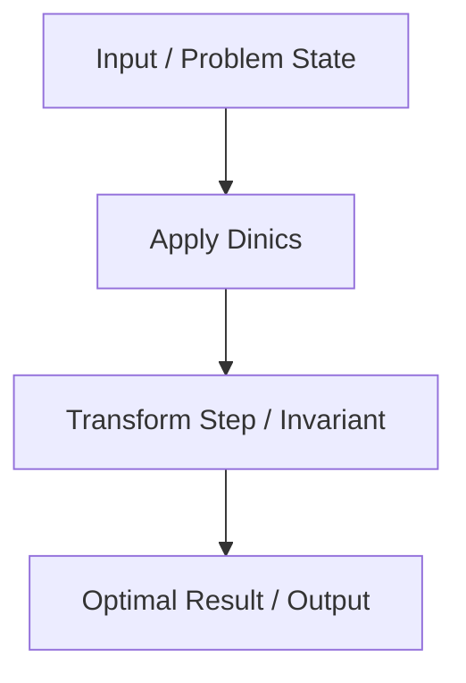

# Dinics

> **Category:** AdvancedAndRare · **Tier:** Competitive Programming (Advanced)

---

## 🔗 Resources & Visualizers
- **YouTube:** [Watch Dinics Visual Guide](https://www.youtube.com/results?search_query=Dinics%20algorithm%20visual%20explanation)
- **Blog / Editorial:** [CP-Algorithms / GeeksforGeeks Guide](https://www.google.com/search?q=Dinics%20algorithm%20tutorial%20CP%20algorithms)
- **Interactive Visualizer:** [VisuAlgo Interactive Simulation](https://visualgo.net/en)

---

## 🧠 Intuition & Mental Model
> [!TIP]
> **Core Concept:** Dinic’s Algorithm is a fast algorithm to compute the

Dinic’s Algorithm is a fast algorithm to compute the
maximum flow in a flow network.
It improves Ford–Fulkerson by using BFS to build level
graphs and DFS to send blocking flows, reducing unnecessary searches.
Algorithm Explanation
Use BFS from source to build a level graph (shortest distance to sink).
Use DFS on this level graph to push maximum possible flow (blocking flow).
Repeat BFS + DFS until sink becomes unreachable.

---

## 🎯 When to Use & Problem Triggers
- **Trigger 1:** When the brute-force enumeration takes quadratic time or higher and a linear/logarithmic invariant exists.
- **Trigger 2:** Common patterns involving **AdvancedAndRare**, subsegments, query sequences, or optimal substructures.
- **Trigger 3:** Constraints where $N \ge 10^5$ require $O(N)$ or $O(N \log N)$ performance.

---

## 📊 Visual Explanation & Dry Run



<details>
<summary>🔍 <strong>Step-by-Step Algorithm Walkthrough</strong> (Click to expand)</summary>

1. **Initialization:** Set up boundary pointers, state variables, or base auxiliary arrays.
2. **Iteration / Traversal:** Advance through the input elements while maintaining the algorithmic invariant.
3. **State Transition:** Update the current state, dynamic array, or accumulator in $O(1)$ or $O(\log N)$.
4. **Final Result:** Extract the optimal answer from the computed state or reconstructed solution.

</details>

---

## 💻 Algorithm Code (Java)

```java
import java.io.*;
import java.util.*;

class Main {

    static class Edge {
        int v;
        int flow;
        int cap;
        int rev;

        Edge(int v, int cap, int rev) {
            this.v = v;
            this.cap = cap;
            this.rev = rev;
            this.flow = 0;
        }
    }

    static int n;
    static ArrayList<Edge>[] g;
    static int[] level;
    static int[] it;

    static void addEdge(int u, int v, int cap) {
        g[u].add(new Edge(v, cap, g[v].size()));
        g[v].add(new Edge(u, cap, g[u].size() - 1));
    }

    static boolean bfs(int s, int t) {
        Arrays.fill(level, -1);
        Queue<Integer> q = new ArrayDeque<>();

        level[s] = 0;
        q.add(s);

        while (!q.isEmpty()) {
            int u = q.poll();

            for (Edge e : g[u]) {
                if (level[e.v] < 0 && e.flow < e.cap) {
                    level[e.v] = level[u] + 1;
                    q.add(e.v);
                }
            }
        }

        return level[t] >= 0;
    }

    static int dfs(int u, int t, int f) {
        if (u == t) return f;

        for (; it[u] < g[u].size(); it[u]++) {
            Edge e = g[u].get(it[u]);

            if (e.flow < e.cap && level[e.v] == level[u] + 1) {
                int pushed = dfs(
                        e.v,
                        t,
                        Math.min(f, e.cap - e.flow)
                );

                if (pushed > 0) {
                    e.flow += pushed;
                    g[e.v].get(e.rev).flow -= pushed;
                    return pushed;
                }
            }
        }

        return 0;
    }

    static int maxflow(int s, int t) {
        int flow = 0;

        while (bfs(s, t)) {
            Arrays.fill(it, 0);
            int pushed;

            while ((pushed = dfs(s, t, Integer.MAX_VALUE)) > 0) {
                flow += pushed;
            }
        }

        return flow;
    }

    public static void main(String[] args) {
        n = 4;
        g = new ArrayList[n];

        for (int i = 0; i < n; i++)
            g[i] = new ArrayList<>();

        level = new int[n];
        it = new int[n];


        addEdge(0, 1, 3);
        addEdge(0, 2, 2);
        addEdge(1, 2, 1);
        addEdge(1, 3, 2);
        addEdge(2, 3, 4);

        System.out.println(maxflow(0, 3));

    }
}
```

---

## ⏱️ Complexity Analysis
- **Time Complexity (TC):** Typically `O(N)` or `O(N log N)` depending on auxiliary sorting or tree operations.
- **Space Complexity (SC):** Typically `O(1)` auxiliary space or `O(N)` for auxiliary arrays/tables.

---

## 🔄 Similar & Connected Algorithms
- **Related Category:** Explore other fundamental algorithms in [AdvancedAndRare](../).
- **Composite Patterns:** Often combined with Prefix Sums, Binary Search on Answer, or Dynamic Programming memoization.

---

## ⚔️ Practice Questions

### 🟡 LeetCode
- [ ] [Explore Dinics Problems on LeetCode](https://leetcode.com/problemset/?search=Dinics%20LeetCode) — `Practice`

### 🔵 CodeChef & Codeforces
- [ ] [Practice on Codeforces Problemset](https://codeforces.com/problemset) — `Catalog`
- [ ] [Practice on CodeChef Practice Portal](https://www.codechef.com/practice) — `Catalog`
