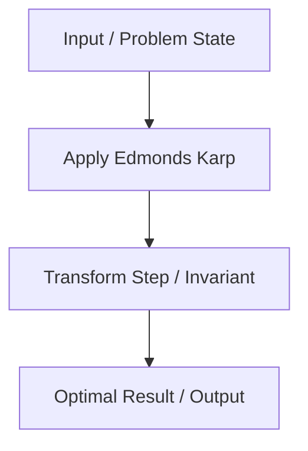

# Edmonds Karp

> **Category:** AdvancedAndRare · **Tier:** Competitive Programming (Advanced)

---

## 🔗 Resources & Visualizers
- **YouTube:** [Watch Edmonds Karp Visual Guide](https://www.youtube.com/results?search_query=Edmonds%20Karp%20algorithm%20visual%20explanation)
- **Blog / Editorial:** [CP-Algorithms / GeeksforGeeks Guide](https://www.google.com/search?q=Edmonds%20Karp%20algorithm%20tutorial%20CP%20algorithms)
- **Interactive Visualizer:** [VisuAlgo Interactive Simulation](https://visualgo.net/en)

---

## 🧠 Intuition & Mental Model
> [!TIP]
> **Core Concept:** Edmonds–Karp Algorithm is an implementation of the Ford–Fulkerson

Edmonds–Karp Algorithm is an implementation of the Ford–Fulkerson
method that uses BFS to find the shortest (in edges)
augmenting path in a flow network.
It guarantees polynomial time by always choosing the minimum-edge
path from source to sink.
Algorithm Explanation
Treat the graph as a residual graph
Repeatedly run BFS from source to sink to find an augmenting path
Push the minimum residual capacity along that path
Update residual capacities
Stop when no path exists

---

## 🎯 When to Use & Problem Triggers
- **Trigger 1:** When the brute-force enumeration takes quadratic time or higher and a linear/logarithmic invariant exists.
- **Trigger 2:** Common patterns involving **AdvancedAndRare**, subsegments, query sequences, or optimal substructures.
- **Trigger 3:** Constraints where $N \ge 10^5$ require $O(N)$ or $O(N \log N)$ performance.

---

## 📊 Visual Explanation & Dry Run



<details>
<summary>🔍 <strong>Step-by-Step Algorithm Walkthrough</strong> (Click to expand)</summary>

1. **Initialization:** Set up boundary pointers, state variables, or base auxiliary arrays.
2. **Iteration / Traversal:** Advance through the input elements while maintaining the algorithmic invariant.
3. **State Transition:** Update the current state, dynamic array, or accumulator in $O(1)$ or $O(\log N)$.
4. **Final Result:** Extract the optimal answer from the computed state or reconstructed solution.

</details>

---

## 💻 Algorithm Code (Java)

```java
import java.io.*;
import java.util.*;

class EdmondsKarp {

    static final int INF = Integer.MAX_VALUE;

    static boolean bfs(int[][] r, int s, int t, int[] p, int n) {
        boolean[] v = new boolean[n];

        Queue<Integer> q = new ArrayDeque<>();

        q.add(s);
        v[s] = true;
        p[s] = -1;

        while (!q.isEmpty()) {
            int u = q.poll();

            for (int i = 0; i < n; i++) {
                if (!v[i] && r[u][i] > 0) {
                    q.add(i);
                    p[i] = u;
                    v[i] = true;

                    if (i == t)
                        return true;
                }
            }
        }

        return false;
    }

    static int maxFlow(int[][] g, int s, int t, int n) {
        int[][] r = new int[n][n];

        for (int i = 0; i < n; i++)
            for (int j = 0; j < n; j++)
                r[i][j] = g[i][j];

        int[] p = new int[n];

        int mf = 0;

        while (bfs(r, s, t, p, n)) {
            int f = INF;

            for (int v = t; v != s; v = p[v])
                f = Math.min(f, r[p[v]][v]);

            for (int v = t; v != s; v = p[v]) {
                r[p[v]][v] -= f;
                r[v][p[v]] += f;
            }

            mf += f;
        }

        return mf;
    }

    public static void main(String[] args) {
        int[][] g = {
                {0, 16, 13, 0, 0, 0},
                {0, 0, 10, 12, 0, 0},
                {0, 4, 0, 0, 14, 0},
                {0, 0, 9, 0, 0, 20},
                {0, 0, 0, 7, 0, 4},
                {0, 0, 0, 0, 0, 0}
        };

        int s = 0, t = 5;

        System.out.println(maxFlow(g, s, t, g.length));
    }
}
```

---

## ⏱️ Complexity Analysis
- **Time Complexity (TC):** Typically `O(N)` or `O(N log N)` depending on auxiliary sorting or tree operations.
- **Space Complexity (SC):** Typically `O(1)` auxiliary space or `O(N)` for auxiliary arrays/tables.

---

## 🔄 Similar & Connected Algorithms
- **Related Category:** Explore other fundamental algorithms in [AdvancedAndRare](../).
- **Composite Patterns:** Often combined with Prefix Sums, Binary Search on Answer, or Dynamic Programming memoization.

---

## ⚔️ Practice Questions

### 🟡 LeetCode
- [ ] [Explore Edmonds Karp Problems on LeetCode](https://leetcode.com/problemset/?search=Edmonds%20Karp%20LeetCode) — `Practice`

### 🔵 CodeChef & Codeforces
- [ ] [Practice on Codeforces Problemset](https://codeforces.com/problemset) — `Catalog`
- [ ] [Practice on CodeChef Practice Portal](https://www.codechef.com/practice) — `Catalog`
