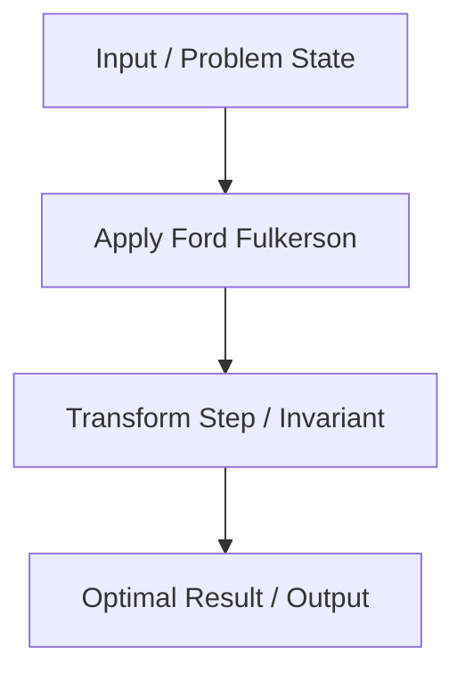

# Ford Fulkerson

> **Category:** AdvancedAndRare · **Tier:** Competitive Programming (Advanced)

---

## 🔗 Resources & Visualizers
- **YouTube:** [Watch Ford Fulkerson Visual Guide](https://www.youtube.com/results?search_query=Ford%20Fulkerson%20algorithm%20visual%20explanation)
- **Blog / Editorial:** [CP-Algorithms / GeeksforGeeks Guide](https://www.google.com/search?q=Ford%20Fulkerson%20algorithm%20tutorial%20CP%20algorithms)
- **Interactive Visualizer:** [VisuAlgo Interactive Simulation](https://visualgo.net/en)

---

## 🧠 Intuition & Mental Model
> [!TIP]
> **Core Concept:** Ford–Fulkerson Algorithm computes the maximum flow from a source

Ford–Fulkerson Algorithm computes the maximum flow from a source
to a sink in a flow network by repeatedly finding augmenting paths and
increasing flow along them until no such path exists.
Algorithm Explanation (extremely concise & clear)
Start with zero flow on all edges
Repeatedly find a path from source to sink with available capacity
Push the minimum capacity (bottleneck) along that path
Update residual capacities
Stop when no path exists

---

## 🎯 When to Use & Problem Triggers
- **Trigger 1:** When the brute-force enumeration takes quadratic time or higher and a linear/logarithmic invariant exists.
- **Trigger 2:** Common patterns involving **AdvancedAndRare**, subsegments, query sequences, or optimal substructures.
- **Trigger 3:** Constraints where $N \ge 10^5$ require $O(N)$ or $O(N \log N)$ performance.

---

## 📊 Visual Explanation & Dry Run



<details>
<summary>🔍 <strong>Step-by-Step Algorithm Walkthrough</strong> (Click to expand)</summary>

1. **Initialization:** Set up boundary pointers, state variables, or base auxiliary arrays.
2. **Iteration / Traversal:** Advance through the input elements while maintaining the algorithmic invariant.
3. **State Transition:** Update the current state, dynamic array, or accumulator in $O(1)$ or $O(\log N)$.
4. **Final Result:** Extract the optimal answer from the computed state or reconstructed solution.

</details>

---

## 💻 Algorithm Code (Java)

```java
import java.io.*;
import java.util.*;

class Main {

    static int V;
    static int[][] r;
    static boolean[] vis;

    static boolean dfs(int u, int t, int[] p) {
        if (u == t) return true;

        vis[u] = true;

        for (int v = 0; v < V; v++) {
            if (!vis[v] && r[u][v] > 0) {
                p[v] = u;
                if (dfs(v, t, p)) return true;
            }
        }

        return false;
    }

    static int fordFulkerson(int[][] g, int s, int t) {
        r = new int[V][V];

        for (int i = 0; i < V; i++)
            for (int j = 0; j < V; j++)
                r[i][j] = g[i][j];

        int maxFlow = 0;
        int[] p = new int[V];

        while (true) {
            vis = new boolean[V];

            if (!dfs(s, t, p)) break;

            int flow = Integer.MAX_VALUE;

            for (int v = t; v != s; v = p[v])
                flow = Math.min(flow, r[p[v]][v]);

            for (int v = t; v != s; v = p[v]) {
                r[p[v]][v] -= flow;
                r[v][p[v]] += flow;
            }

            maxFlow += flow;
        }

        return maxFlow;
    }

    public static void main(String[] args) {
        V = 6;

        int[][] g = {
                {0, 16, 13, 0, 0, 0},
                {0, 0, 10, 12, 0, 0},
                {0, 4, 0, 0, 14, 0},
                {0, 0, 9, 0, 0, 20},
                {0, 0, 0, 7, 0, 4},
                {0, 0, 0, 0, 0, 0}
        };

        int s = 0, t = 5;

        System.out.println(fordFulkerson(g, s, t));
    }
}
```

---

## ⏱️ Complexity Analysis
- **Time Complexity (TC):** Typically `O(N)` or `O(N log N)` depending on auxiliary sorting or tree operations.
- **Space Complexity (SC):** Typically `O(1)` auxiliary space or `O(N)` for auxiliary arrays/tables.

---

## 🔄 Similar & Connected Algorithms
- **Related Category:** Explore other fundamental algorithms in [AdvancedAndRare](../).
- **Composite Patterns:** Often combined with Prefix Sums, Binary Search on Answer, or Dynamic Programming memoization.

---

## ⚔️ Practice Questions

### 🟡 LeetCode
- [ ] [Explore Ford Fulkerson Problems on LeetCode](https://leetcode.com/problemset/?search=Ford%20Fulkerson%20LeetCode) — `Practice`

### 🔵 CodeChef & Codeforces
- [ ] [Practice on Codeforces Problemset](https://codeforces.com/problemset) — `Catalog`
- [ ] [Practice on CodeChef Practice Portal](https://www.codechef.com/practice) — `Catalog`
