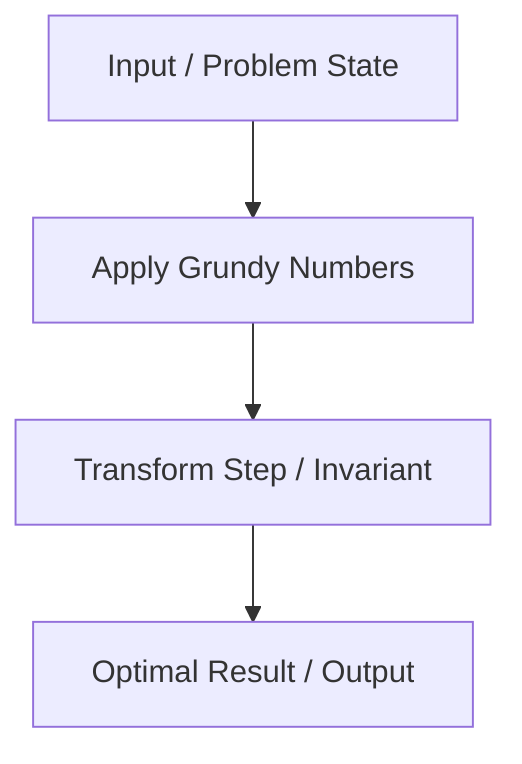

# Grundy Numbers

> **Category:** AdvancedAndRare · **Tier:** Competitive Programming (Advanced)

---

## 🔗 Resources & Visualizers
- **YouTube:** [Watch Grundy Numbers Visual Guide](https://www.youtube.com/results?search_query=Grundy%20Numbers%20algorithm%20visual%20explanation)
- **Blog / Editorial:** [CP-Algorithms / GeeksforGeeks Guide](https://www.google.com/search?q=Grundy%20Numbers%20algorithm%20tutorial%20CP%20algorithms)
- **Interactive Visualizer:** [VisuAlgo Interactive Simulation](https://visualgo.net/en)

---

## 🧠 Intuition & Mental Model
> [!TIP]
> **Core Concept:** The Grundy Number Algorithm (based on Sprague–Grundy Theorem)

The Grundy Number Algorithm (based on Sprague–Grundy Theorem)
assigns a non-negative integer (Grundy value) to every position of
an impartial game.
Each position’s Grundy number equals the mex (minimum excluded value)
of all reachable positions.
If the Grundy number is 0 → losing position, otherwise winning position.
Algorithm Explanation
For every game state:
If no moves possible → Grundy = 0
Recursively compute Grundy of all reachable states
Collect those values
Compute mex of collected values
That mex is the Grundy number of current state
For multiple piles → XOR all Grundy values.

---

## 🎯 When to Use & Problem Triggers
- **Trigger 1:** When the brute-force enumeration takes quadratic time or higher and a linear/logarithmic invariant exists.
- **Trigger 2:** Common patterns involving **AdvancedAndRare**, subsegments, query sequences, or optimal substructures.
- **Trigger 3:** Constraints where $N \ge 10^5$ require $O(N)$ or $O(N \log N)$ performance.

---

## 📊 Visual Explanation & Dry Run



<details>
<summary>🔍 <strong>Step-by-Step Algorithm Walkthrough</strong> (Click to expand)</summary>

1. **Initialization:** Set up boundary pointers, state variables, or base auxiliary arrays.
2. **Iteration / Traversal:** Advance through the input elements while maintaining the algorithmic invariant.
3. **State Transition:** Update the current state, dynamic array, or accumulator in $O(1)$ or $O(\log N)$.
4. **Final Result:** Extract the optimal answer from the computed state or reconstructed solution.

</details>

---

## 💻 Algorithm Code (Java)

```java
import java.io.*;
import java.util.*;

class Main {

    static int[] dp;

    static int mex(HashSet<Integer> set) {
        int mex = 0;
        while (set.contains(mex))
            mex++;
        return mex;
    }

    static int grundy(int n) {
        if (n == 0) return 0;

        if (dp[n] != -1) return dp[n];

        HashSet<Integer> set = new HashSet<>();

        if (n >= 1)
            set.add(grundy(n - 1));

        if (n >= 2)
            set.add(grundy(n - 2));

        return dp[n] = mex(set);
    }

    public static void main(String[] args) throws Exception {
        PrintWriter out = new PrintWriter(System.out);

        int n = 4;

        dp = new int[n + 1];
        Arrays.fill(dp, -1);

        int result = grundy(n);

        out.println("Grundy Number = " + result);

        if (result == 0)
            out.println("Losing Position");
        else
            out.println("Winning Position");

        out.flush();
    }
}
```

---

## ⏱️ Complexity Analysis
- **Time Complexity (TC):** Typically `O(N)` or `O(N log N)` depending on auxiliary sorting or tree operations.
- **Space Complexity (SC):** Typically `O(1)` auxiliary space or `O(N)` for auxiliary arrays/tables.

---

## 🔄 Similar & Connected Algorithms
- **Related Category:** Explore other fundamental algorithms in [AdvancedAndRare](../).
- **Composite Patterns:** Often combined with Prefix Sums, Binary Search on Answer, or Dynamic Programming memoization.

---

## ⚔️ Practice Questions

### 🟡 LeetCode
- [ ] [Explore Grundy Numbers Problems on LeetCode](https://leetcode.com/problemset/?search=Grundy%20Numbers%20LeetCode) — `Practice`

### 🔵 CodeChef & Codeforces
- [ ] [Practice on Codeforces Problemset](https://codeforces.com/problemset) — `Catalog`
- [ ] [Practice on CodeChef Practice Portal](https://www.codechef.com/practice) — `Catalog`
