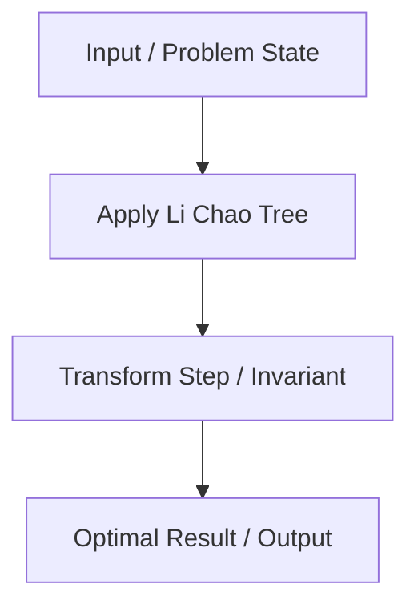

# Li Chao Tree

> **Category:** AdvancedAndRare · **Tier:** Competitive Programming (Advanced)

---

## 🔗 Resources & Visualizers
- **YouTube:** [Watch Li Chao Tree Visual Guide](https://www.youtube.com/results?search_query=Li%20Chao%20Tree%20algorithm%20visual%20explanation)
- **Blog / Editorial:** [CP-Algorithms / GeeksforGeeks Guide](https://www.google.com/search?q=Li%20Chao%20Tree%20algorithm%20tutorial%20CP%20algorithms)
- **Interactive Visualizer:** [VisuAlgo Interactive Simulation](https://visualgo.net/en)

---

## 🧠 Intuition & Mental Model
> [!TIP]
> **Core Concept:** Li Chao Tree is a data structure used to maintain a dynamic

Li Chao Tree is a data structure used to maintain a dynamic
set of linear functions (lines) and efficiently query the minimum or
maximum value at any x-coordinate.
It works in O(log C) per operation, where C is the coordinate range.
It is mainly used in DP optimizations (Convex Hull Trick alternative).
Algorithm Explanation
Each node represents an x-interval [l, r].
Store one line per node.
When inserting a new line:
Compare both lines at the midpoint.
Keep the better line at mid.
Push the worse line to left or right child.
Query:
Traverse down comparing stored line value and child result.
Recursively ensure best line survives in correct segment.

---

## 🎯 When to Use & Problem Triggers
- **Trigger 1:** When the brute-force enumeration takes quadratic time or higher and a linear/logarithmic invariant exists.
- **Trigger 2:** Common patterns involving **AdvancedAndRare**, subsegments, query sequences, or optimal substructures.
- **Trigger 3:** Constraints where $N \ge 10^5$ require $O(N)$ or $O(N \log N)$ performance.

---

## 📊 Visual Explanation & Dry Run



<details>
<summary>🔍 <strong>Step-by-Step Algorithm Walkthrough</strong> (Click to expand)</summary>

1. **Initialization:** Set up boundary pointers, state variables, or base auxiliary arrays.
2. **Iteration / Traversal:** Advance through the input elements while maintaining the algorithmic invariant.
3. **State Transition:** Update the current state, dynamic array, or accumulator in $O(1)$ or $O(\log N)$.
4. **Final Result:** Extract the optimal answer from the computed state or reconstructed solution.

</details>

---

## 💻 Algorithm Code (Java)

```java
import java.io.*;
import java.util.*;

class Main {

    static class Line {
        long m, b;

        Line(long m, long b) {
            this.m = m;
            this.b = b;
        }

        long value(long x) {
            return m * x + b;
        }
    }

    static class Node {
        Line line;
        Node left;
        Node right;

        Node(Line line) {
            this.line = line;
        }
    }

    static class LiChao {
        long l, r;
        Node root;

        LiChao(long l, long r) {
            this.l = l;
            this.r = r;
        }

        void addLine(Line newLine) {
            root = insert(root, l, r, newLine);
        }

        Node insert(Node node, long l, long r, Line newLine) {
            if (node == null) {
                return new Node(newLine);
            }

            long mid = (l + r) >> 1;

            boolean leftBetter = newLine.value(l) < node.line.value(l);

            boolean midBetter = newLine.value(mid) < node.line.value(mid);

            if (midBetter) {
                Line temp = node.line;
                node.line = newLine;
                newLine = temp;
            }

            if (r - l == 1) return node;

            if (leftBetter != midBetter) {
                node.left = insert(node.left, l, mid, newLine);
            } else {
                node.right = insert(node.right, mid, r, newLine);
            }

            return node;
        }

        long query(long x) {
            return query(root, l, r, x);
        }

        long query(Node node, long l, long r, long x) {
            if (node == null) return Long.MAX_VALUE;

            long res = node.line.value(x);

            if (r - l == 1) return res;

            long mid = (l + r) >> 1;

            if (x < mid && node.left != null) {
                return Math.min(res, query(node.left, l, mid, x));
            } else if (x >= mid && node.right != null) {
                return Math.min(res, query(node.right, mid, r, x));
            }

            return res;
        }
    }

    public static void main(String[] args) throws Exception {
        PrintWriter out = new PrintWriter(System.out);

        LiChao tree = new LiChao(-10, 10);

        tree.addLine(new Line(2, 3));
        tree.addLine(new Line(-1, 4));

        long x = 2;
        long ans = tree.query(x);

        out.println("Minimum value at x = " + x + " is: " + ans);
        out.flush();
    }
}
```

---

## ⏱️ Complexity Analysis
- **Time Complexity (TC):** Typically `O(N)` or `O(N log N)` depending on auxiliary sorting or tree operations.
- **Space Complexity (SC):** Typically `O(1)` auxiliary space or `O(N)` for auxiliary arrays/tables.

---

## 🔄 Similar & Connected Algorithms
- **Related Category:** Explore other fundamental algorithms in [AdvancedAndRare](../).
- **Composite Patterns:** Often combined with Prefix Sums, Binary Search on Answer, or Dynamic Programming memoization.

---

## ⚔️ Practice Questions

### 🟡 LeetCode
- [ ] [Explore Li Chao Tree Problems on LeetCode](https://leetcode.com/problemset/?search=Li%20Chao%20Tree%20LeetCode) — `Practice`

### 🔵 CodeChef & Codeforces
- [ ] [Practice on Codeforces Problemset](https://codeforces.com/problemset) — `Catalog`
- [ ] [Practice on CodeChef Practice Portal](https://www.codechef.com/practice) — `Catalog`
