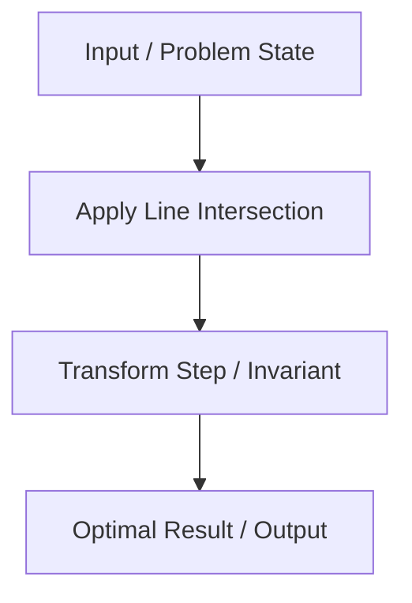

# Line Intersection

> **Category:** AdvancedAndRare · **Tier:** Competitive Programming (Advanced)

---

## 🔗 Resources & Visualizers
- **YouTube:** [Watch Line Intersection Visual Guide](https://www.youtube.com/results?search_query=Line%20Intersection%20algorithm%20visual%20explanation)
- **Blog / Editorial:** [CP-Algorithms / GeeksforGeeks Guide](https://www.google.com/search?q=Line%20Intersection%20algorithm%20tutorial%20CP%20algorithms)
- **Interactive Visualizer:** [VisuAlgo Interactive Simulation](https://visualgo.net/en)

---

## 🧠 Intuition & Mental Model
> [!TIP]
> **Core Concept:** Line Intersection Algorithm determines whether two line segments

Line Intersection Algorithm determines whether two line segments
intersect in a 2D plane.
It uses orientation (cross product concept)
to check relative positions of points.
Works for both general and collinear edge cases.
Algorithm Explanation
For two segments P1Q1 and P2Q2, compute orientations:
o1 = orientation(P1, Q1, P2)
o2 = orientation(P1, Q1, Q2)
o3 = orientation(P2, Q2, P1)
o4 = orientation(P2, Q2, Q1)
If o1 ≠ o2 AND o3 ≠ o4 → segments intersect (General Case)
If orientations are 0 → check if the point lies on the segment (Collinear Case)

---

## 🎯 When to Use & Problem Triggers
- **Trigger 1:** When the brute-force enumeration takes quadratic time or higher and a linear/logarithmic invariant exists.
- **Trigger 2:** Common patterns involving **AdvancedAndRare**, subsegments, query sequences, or optimal substructures.
- **Trigger 3:** Constraints where $N \ge 10^5$ require $O(N)$ or $O(N \log N)$ performance.

---

## 📊 Visual Explanation & Dry Run



<details>
<summary>🔍 <strong>Step-by-Step Algorithm Walkthrough</strong> (Click to expand)</summary>

1. **Initialization:** Set up boundary pointers, state variables, or base auxiliary arrays.
2. **Iteration / Traversal:** Advance through the input elements while maintaining the algorithmic invariant.
3. **State Transition:** Update the current state, dynamic array, or accumulator in $O(1)$ or $O(\log N)$.
4. **Final Result:** Extract the optimal answer from the computed state or reconstructed solution.

</details>

---

## 💻 Algorithm Code (Java)

```java
class LineIntersection {

    static class Point {
        int x;
        int y;

        Point(int x, int y) {
            this.x = x;
            this.y = y;
        }
    }

    static int orientation(Point p, Point q, Point r) {
        int val = (q.y - p.y) * (r.x - q.x) -
                (q.x - p.x) * (r.y - q.y);

        if (val == 0) return 0;

        return (val > 0) ? 1 : 2;
    }

    static boolean onSegment(Point p, Point q, Point r) {
        if (q.x <= Math.max(p.x, r.x) &&
                q.x >= Math.min(p.x, r.x) &&
                q.y <= Math.max(p.y, r.y) &&
                q.y >= Math.min(p.y, r.y)
        ) {
            return true;
        }

        return false;
    }

    static boolean doIntersect(Point p1, Point q1, Point p2, Point q2) {
        int o1 = orientation(p1, q1, p2);
        int o2 = orientation(p1, q1, q2);
        int o3 = orientation(p2, q2, p1);
        int o4 = orientation(p2, q2, q1);

        if (o1 != o2 && o3 != o4) return true;

        if (o1 == 0 && onSegment(p1, p2, q1)) return true;
        if (o2 == 0 && onSegment(p1, q2, q1)) return true;
        if (o3 == 0 && onSegment(p2, p1, q2)) return true;
        if (o4 == 0 && onSegment(p2, q1, q2)) return true;

        return false;
    }


    public static void main(String[] args) {
        Point p1 = new Point(1, 1);
        Point q1 = new Point(4, 4);

        Point p2 = new Point(1, 4);
        Point q2 = new Point(4, 1);

        if (doIntersect(p1, q1, p2, q2))
            System.out.println("Lines Intersect");
        else
            System.out.println("Lines do not Intersect");
    }
}
```

---

## ⏱️ Complexity Analysis
- **Time Complexity (TC):** Typically `O(N)` or `O(N log N)` depending on auxiliary sorting or tree operations.
- **Space Complexity (SC):** Typically `O(1)` auxiliary space or `O(N)` for auxiliary arrays/tables.

---

## 🔄 Similar & Connected Algorithms
- **Related Category:** Explore other fundamental algorithms in [AdvancedAndRare](../).
- **Composite Patterns:** Often combined with Prefix Sums, Binary Search on Answer, or Dynamic Programming memoization.

---

## ⚔️ Practice Questions

### 🟡 LeetCode
- [ ] [Explore Line Intersection Problems on LeetCode](https://leetcode.com/problemset/?search=Line%20Intersection%20LeetCode) — `Practice`

### 🔵 CodeChef & Codeforces
- [ ] [Practice on Codeforces Problemset](https://codeforces.com/problemset) — `Catalog`
- [ ] [Practice on CodeChef Practice Portal](https://www.codechef.com/practice) — `Catalog`
