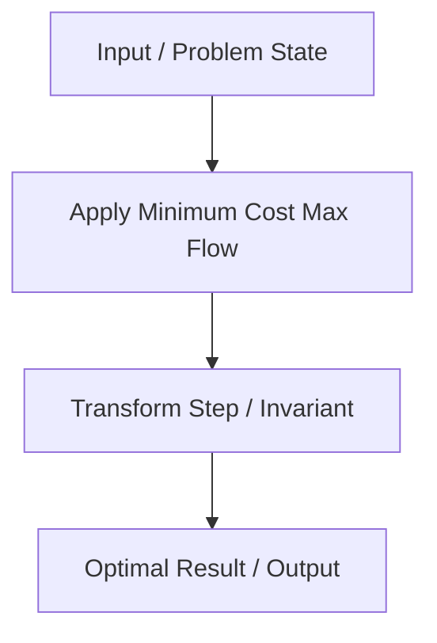

# Minimum Cost Max Flow

> **Category:** AdvancedAndRare · **Tier:** Competitive Programming (Advanced)

---

## 🔗 Resources & Visualizers
- **YouTube:** [Watch Minimum Cost Max Flow Visual Guide](https://www.youtube.com/results?search_query=Minimum%20Cost%20Max%20Flow%20algorithm%20visual%20explanation)
- **Blog / Editorial:** [CP-Algorithms / GeeksforGeeks Guide](https://www.google.com/search?q=Minimum%20Cost%20Max%20Flow%20algorithm%20tutorial%20CP%20algorithms)
- **Interactive Visualizer:** [VisuAlgo Interactive Simulation](https://visualgo.net/en)

---

## 🧠 Intuition & Mental Model
> [!TIP]
> **Core Concept:** Min Cost Max Flow (MCMF) is a network flow algorithm that

Min Cost Max Flow (MCMF) is a network flow algorithm that
sends the maximum possible flow from source to sink while
minimizing total cost of transporting that flow.
Each edge has capacity and cost per unit flow.
Algorithm Explanation
We repeat:
Use Shortest Path (Bellman-Ford/SPFA) on residual graph to
find the minimum cost path from source to sink.
Send the maximum possible flow through that path.
Update residual capacities.
Repeat until no path exists.
Greedy on shortest cost path + residual capacity maintenance.

---

## 🎯 When to Use & Problem Triggers
- **Trigger 1:** When the brute-force enumeration takes quadratic time or higher and a linear/logarithmic invariant exists.
- **Trigger 2:** Common patterns involving **AdvancedAndRare**, subsegments, query sequences, or optimal substructures.
- **Trigger 3:** Constraints where $N \ge 10^5$ require $O(N)$ or $O(N \log N)$ performance.

---

## 📊 Visual Explanation & Dry Run



<details>
<summary>🔍 <strong>Step-by-Step Algorithm Walkthrough</strong> (Click to expand)</summary>

1. **Initialization:** Set up boundary pointers, state variables, or base auxiliary arrays.
2. **Iteration / Traversal:** Advance through the input elements while maintaining the algorithmic invariant.
3. **State Transition:** Update the current state, dynamic array, or accumulator in $O(1)$ or $O(\log N)$.
4. **Final Result:** Extract the optimal answer from the computed state or reconstructed solution.

</details>

---

## 💻 Algorithm Code (Java)

```java
import java.io.*;
import java.util.*;

class MinCostMaxFlow {

    static class Edge {
        int to;
        int rev;
        int capacity;
        int cost;

        Edge(int to, int rev, int capacity, int cost) {
            this.to = to;
            this.rev = rev;
            this.capacity = capacity;
            this.cost = cost;
        }
    }

    static class MCMF {
        int n;
        List<Edge>[] graph;

        MCMF(int n) {
            this.n = n;
            graph = new ArrayList[n];
            for (int i = 0; i < n; i++)
                graph[i] = new ArrayList<>();
        }

        void addEdge(int u, int v, int capacity, int cost) {
            graph[u].add(new Edge(v, graph[v].size(), capacity, cost));
            graph[v].add(new Edge(u, graph[u].size() - 1, 0, -cost));
        }

        int[] minCostMaxFlow(int source, int sink) {
            int flow = 0;
            int cost = 0;

            int[] dist = new int[n];
            int[] parentNode = new int[n];
            int[] parentEdge = new int[n];

            while (true) {
                Arrays.fill(dist, Integer.MAX_VALUE);
                dist[source] = 0;

                boolean[] inQueue = new boolean[n];
                Queue<Integer> queue = new LinkedList<>();
                queue.add(source);
                inQueue[source] = true;

                while (!queue.isEmpty()) {
                    int u = queue.poll();
                    inQueue[u] = false;

                    for (int i = 0; i < graph[u].size(); i++) {
                        Edge e = graph[u].get(i);

                        if (e.capacity > 0 && dist[u] + e.cost < dist[e.to]) {
                            dist[e.to] = dist[u] + e.cost;
                            parentNode[e.to] = u;
                            parentEdge[e.to] = i;

                            if (!inQueue[e.to]) {
                                queue.add(e.to);
                                inQueue[e.to] = true;
                            }
                        }
                    }
                }

                if (dist[sink] == Integer.MAX_VALUE)
                    break;

                int pathflow = Integer.MAX_VALUE;

                for (int v = sink; v != source; v = parentNode[v]) {
                    Edge e = graph[parentNode[v]].get(parentEdge[v]);
                    pathflow = Math.min(pathflow, e.capacity);
                }

                for (int v = sink; v != source; v = parentNode[v]) {
                    Edge e = graph[parentNode[v]].get(parentEdge[v]);

                    e.capacity -= pathflow;
                    graph[v].get(e.rev).capacity += pathflow;
                }

                flow += pathflow;
                cost += pathflow * dist[sink];
            }

            return new int[]{
                    flow, cost
            };
        }
    }

    public static void main(String[] args) {
        int nodes = 4;
        MCMF mcmf = new MCMF(nodes);

        mcmf.addEdge(0, 1, 2, 1);
        mcmf.addEdge(0, 2, 1, 2);
        mcmf.addEdge(1, 2, 1, 1);
        mcmf.addEdge(1, 3, 1, 3);
        mcmf.addEdge(2, 3, 2, 1);

        int[] result = mcmf.minCostMaxFlow(0, 3);

        System.out.println("Max Flow = " + result[0]);
        System.out.println("Min Cost = " + result[1]);
    }
}
```

---

## ⏱️ Complexity Analysis
- **Time Complexity (TC):** Typically `O(N)` or `O(N log N)` depending on auxiliary sorting or tree operations.
- **Space Complexity (SC):** Typically `O(1)` auxiliary space or `O(N)` for auxiliary arrays/tables.

---

## 🔄 Similar & Connected Algorithms
- **Related Category:** Explore other fundamental algorithms in [AdvancedAndRare](../).
- **Composite Patterns:** Often combined with Prefix Sums, Binary Search on Answer, or Dynamic Programming memoization.

---

## ⚔️ Practice Questions

### 🟡 LeetCode
- [ ] [Explore Minimum Cost Max Flow Problems on LeetCode](https://leetcode.com/problemset/?search=Minimum%20Cost%20Max%20Flow%20LeetCode) — `Practice`

### 🔵 CodeChef & Codeforces
- [ ] [Practice on Codeforces Problemset](https://codeforces.com/problemset) — `Catalog`
- [ ] [Practice on CodeChef Practice Portal](https://www.codechef.com/practice) — `Catalog`
