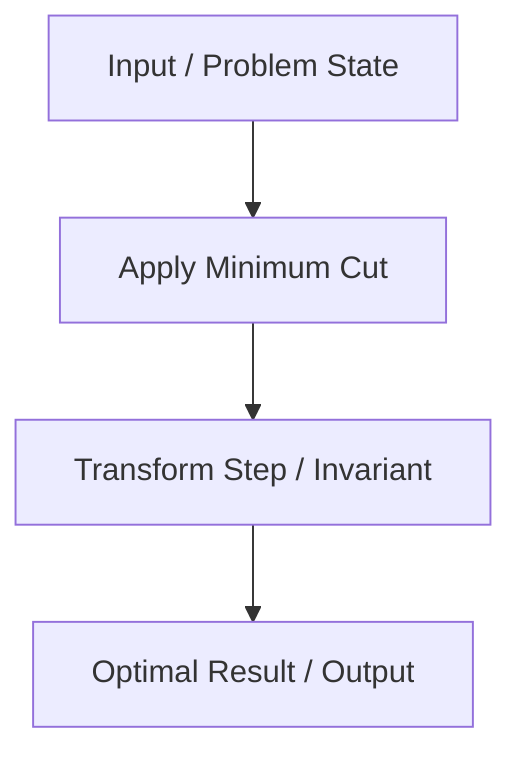

# Minimum Cut

> **Category:** AdvancedAndRare · **Tier:** Competitive Programming (Advanced)

---

## 🔗 Resources & Visualizers
- **YouTube:** [Watch Minimum Cut Visual Guide](https://www.youtube.com/results?search_query=Minimum%20Cut%20algorithm%20visual%20explanation)
- **Blog / Editorial:** [CP-Algorithms / GeeksforGeeks Guide](https://www.google.com/search?q=Minimum%20Cut%20algorithm%20tutorial%20CP%20algorithms)
- **Interactive Visualizer:** [VisuAlgo Interactive Simulation](https://visualgo.net/en)

---

## 🧠 Intuition & Mental Model
> [!TIP]
> **Core Concept:** The Minimum Cut Algorithm finds the minimum number

The Minimum Cut Algorithm finds the minimum number
of edges that, if removed, disconnect a graph into two components.
David Karger proposed a randomized contraction-based
approach to solve this problem efficiently with high probability.
Algorithm Explanation
Core Idea → Random Contraction
While more than 2 vertices remain:
Pick a random edge.
Merge (contract) the two vertices of that edge.
Remove self-loops.
When only 2 vertices remain:
The remaining edges between them = Minimum Cut.
Because it's randomized, we repeat multiple times to improve accuracy.

---

## 🎯 When to Use & Problem Triggers
- **Trigger 1:** When the brute-force enumeration takes quadratic time or higher and a linear/logarithmic invariant exists.
- **Trigger 2:** Common patterns involving **AdvancedAndRare**, subsegments, query sequences, or optimal substructures.
- **Trigger 3:** Constraints where $N \ge 10^5$ require $O(N)$ or $O(N \log N)$ performance.

---

## 📊 Visual Explanation & Dry Run



<details>
<summary>🔍 <strong>Step-by-Step Algorithm Walkthrough</strong> (Click to expand)</summary>

1. **Initialization:** Set up boundary pointers, state variables, or base auxiliary arrays.
2. **Iteration / Traversal:** Advance through the input elements while maintaining the algorithmic invariant.
3. **State Transition:** Update the current state, dynamic array, or accumulator in $O(1)$ or $O(\log N)$.
4. **Final Result:** Extract the optimal answer from the computed state or reconstructed solution.

</details>

---

## 💻 Algorithm Code (Java)

```java
import java.util.*;
import java.io.*;

class MinimumCut {

    static class Edge {
        int src, dest;

        Edge(int s, int d) {
            this.src = s;
            this.dest = d;
        }
    }

    static class Graph {
        int V, E;
        Edge[] edges;

        Graph(int v, int e) {
            V = v;
            E = e;
            edges = new Edge[E];
        }
    }

    static int find(int parent[], int i) {
        if (parent[i] == i)
            return i;
        return find(parent, parent[i]);
    }

    static void union(int parent[], int x, int y) {
        int xset = find(parent, x);
        int yset = find(parent, y);
        parent[xset] = yset;
    }

    static int KergerMinCut(Graph graph) {
        int V = graph.V;
        int E = graph.E;
        Edge[] edges = graph.edges;

        int parent[] = new int[V];

        for (int i = 0; i < V; i++)
            parent[i] = i;

        int vertices = V;

        Random rand = new Random();

        while (vertices > 2) {
            int i = rand.nextInt(E);

            int subset1 = find(parent, edges[i].src);
            int subset2 = find(parent, edges[i].dest);

            if (subset1 == subset2)
                continue;

            else {
                union(parent, subset1, subset2);
                vertices--;
            }
        }

        int cutEdges = 0;

        for (int i = 0; i < E; i++) {
            int subset1 = find(parent, edges[i].src);
            int subset2 = find(parent, edges[i].dest);

            if (subset1 != subset2)
                cutEdges++;
        }

        return cutEdges;

    }


    public static void main(String[] args) {
        int V = 4;
        int E = 5;

        Graph graph = new Graph(V, E);

        graph.edges[0] = new Edge(0, 1);
        graph.edges[1] = new Edge(0, 2);
        graph.edges[2] = new Edge(1, 2);
        graph.edges[3] = new Edge(1, 3);
        graph.edges[4] = new Edge(2, 3);

        System.out.println("Minimum Cut = " + KergerMinCut(graph));
    }
}
```

---

## ⏱️ Complexity Analysis
- **Time Complexity (TC):** Typically `O(N)` or `O(N log N)` depending on auxiliary sorting or tree operations.
- **Space Complexity (SC):** Typically `O(1)` auxiliary space or `O(N)` for auxiliary arrays/tables.

---

## 🔄 Similar & Connected Algorithms
- **Related Category:** Explore other fundamental algorithms in [AdvancedAndRare](../).
- **Composite Patterns:** Often combined with Prefix Sums, Binary Search on Answer, or Dynamic Programming memoization.

---

## ⚔️ Practice Questions

### 🟡 LeetCode
- [ ] [Explore Minimum Cut Problems on LeetCode](https://leetcode.com/problemset/?search=Minimum%20Cut%20LeetCode) — `Practice`

### 🔵 CodeChef & Codeforces
- [ ] [Practice on Codeforces Problemset](https://codeforces.com/problemset) — `Catalog`
- [ ] [Practice on CodeChef Practice Portal](https://www.codechef.com/practice) — `Catalog`
