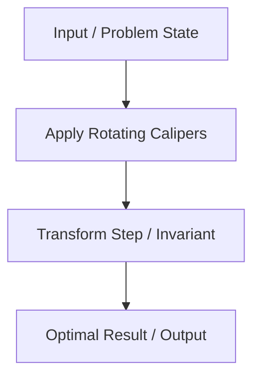

# Rotating Calipers

> **Category:** AdvancedAndRare · **Tier:** Competitive Programming (Advanced)

---

## 🔗 Resources & Visualizers
- **YouTube:** [Watch Rotating Calipers Visual Guide](https://www.youtube.com/results?search_query=Rotating%20Calipers%20algorithm%20visual%20explanation)
- **Blog / Editorial:** [CP-Algorithms / GeeksforGeeks Guide](https://www.google.com/search?q=Rotating%20Calipers%20algorithm%20tutorial%20CP%20algorithms)
- **Interactive Visualizer:** [VisuAlgo Interactive Simulation](https://visualgo.net/en)

---

## 🧠 Intuition & Mental Model
> [!TIP]
> **Core Concept:** Rotating Calipers is a geometric technique used on a convex polygon

Rotating Calipers is a geometric technique used on a convex polygon
to compute properties like diameter (farthest pair of points),
width, or minimum bounding rectangle.
It works by placing two parallel “calipers” on the
polygon and rotating them around the hull in linear time.
Algorithm Explanation
For finding diameter of convex hull:
Start with two points: one at the leftmost point and one at the
farthest opposite point.
Move the second pointer while the area formed increases.
At every step, compute distance between current pair.
Rotate pointers around hull once → total O(n).
Core Idea:
Each pointer moves at most one full cycle → linear processing.

---

## 🎯 When to Use & Problem Triggers
- **Trigger 1:** When the brute-force enumeration takes quadratic time or higher and a linear/logarithmic invariant exists.
- **Trigger 2:** Common patterns involving **AdvancedAndRare**, subsegments, query sequences, or optimal substructures.
- **Trigger 3:** Constraints where $N \ge 10^5$ require $O(N)$ or $O(N \log N)$ performance.

---

## 📊 Visual Explanation & Dry Run



<details>
<summary>🔍 <strong>Step-by-Step Algorithm Walkthrough</strong> (Click to expand)</summary>

1. **Initialization:** Set up boundary pointers, state variables, or base auxiliary arrays.
2. **Iteration / Traversal:** Advance through the input elements while maintaining the algorithmic invariant.
3. **State Transition:** Update the current state, dynamic array, or accumulator in $O(1)$ or $O(\log N)$.
4. **Final Result:** Extract the optimal answer from the computed state or reconstructed solution.

</details>

---

## 💻 Algorithm Code (Java)

```java
import java.io.*;
import java.util.*;

class Main {

    static class P {
        long x, y;

        P(long x, long y) {
            this.x = x;
            this.y = y;
        }
    }

    static long dist2(P a, P b) {
        long dx = a.x - b.x;
        long dy = a.y - b.y;

        return dx * dx + dy * dy;
    }

    static long cross(P a, P b, P c) {
        return (b.x - a.x) * (c.y - a.y)
                - (b.y - a.y) * (c.x - a.x);
    }

    public static void main(String[] args) throws Exception {
        PrintWriter out = new PrintWriter(System.out);

        P[] p = new P[4];
        p[0] = new P(0, 0);
        p[1] = new P(2, 0);
        p[2] = new P(2, 2);
        p[3] = new P(0, 2);

        int n = p.length;
        int j = 1;
        long max = 0;

        for (int i = 0; i < n; i++) {
            int ni = (i + 1) % n;

            while (Math.abs(cross(p[i], p[ni], p[(j + 1) % n])) >
                    Math.abs(cross(p[i], p[ni], p[j]))) {
                j = (j + 1) % n;
            }

            long d = dist2(p[i], p[j]);
            if (d > max) max = d;
        }

        out.println(max);
        out.flush();
    }
}
```

---

## ⏱️ Complexity Analysis
- **Time Complexity (TC):** Typically `O(N)` or `O(N log N)` depending on auxiliary sorting or tree operations.
- **Space Complexity (SC):** Typically `O(1)` auxiliary space or `O(N)` for auxiliary arrays/tables.

---

## 🔄 Similar & Connected Algorithms
- **Related Category:** Explore other fundamental algorithms in [AdvancedAndRare](../).
- **Composite Patterns:** Often combined with Prefix Sums, Binary Search on Answer, or Dynamic Programming memoization.

---

## ⚔️ Practice Questions

### 🟡 LeetCode
- [ ] [Explore Rotating Calipers Problems on LeetCode](https://leetcode.com/problemset/?search=Rotating%20Calipers%20LeetCode) — `Practice`

### 🔵 CodeChef & Codeforces
- [ ] [Practice on Codeforces Problemset](https://codeforces.com/problemset) — `Catalog`
- [ ] [Practice on CodeChef Practice Portal](https://www.codechef.com/practice) — `Catalog`
