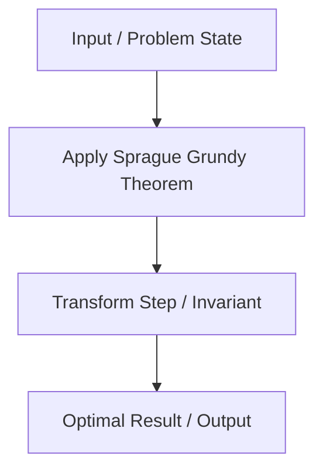

# Sprague Grundy Theorem

> **Category:** AdvancedAndRare · **Tier:** Competitive Programming (Advanced)

---

## 🔗 Resources & Visualizers
- **YouTube:** [Watch Sprague Grundy Theorem Visual Guide](https://www.youtube.com/results?search_query=Sprague%20Grundy%20Theorem%20algorithm%20visual%20explanation)
- **Blog / Editorial:** [CP-Algorithms / GeeksforGeeks Guide](https://www.google.com/search?q=Sprague%20Grundy%20Theorem%20algorithm%20tutorial%20CP%20algorithms)
- **Interactive Visualizer:** [VisuAlgo Interactive Simulation](https://visualgo.net/en)

---

## 🧠 Intuition & Mental Model
> [!TIP]
> **Core Concept:** The Sprague–Grundy Theorem states that every impartial game under

The Sprague–Grundy Theorem states that every impartial game under
normal play is equivalent to a Nim heap.
Each position is assigned a Grundy number (mex of reachable states).
If XOR of all Grundy numbers ≠ 0 → First player wins, else loses.
Algorithm Explanation
For every state x, compute Grundy number:
G(x) = mex({G(next_states)})
Base case: Terminal state → Grundy = 0
For multiple piles → XOR all Grundy numbers
If XOR ≠ 0 → Winning position

---

## 🎯 When to Use & Problem Triggers
- **Trigger 1:** When the brute-force enumeration takes quadratic time or higher and a linear/logarithmic invariant exists.
- **Trigger 2:** Common patterns involving **AdvancedAndRare**, subsegments, query sequences, or optimal substructures.
- **Trigger 3:** Constraints where $N \ge 10^5$ require $O(N)$ or $O(N \log N)$ performance.

---

## 📊 Visual Explanation & Dry Run



<details>
<summary>🔍 <strong>Step-by-Step Algorithm Walkthrough</strong> (Click to expand)</summary>

1. **Initialization:** Set up boundary pointers, state variables, or base auxiliary arrays.
2. **Iteration / Traversal:** Advance through the input elements while maintaining the algorithmic invariant.
3. **State Transition:** Update the current state, dynamic array, or accumulator in $O(1)$ or $O(\log N)$.
4. **Final Result:** Extract the optimal answer from the computed state or reconstructed solution.

</details>

---

## 💻 Algorithm Code (Java)

```java
import java.util.*;

class Main {

    static int[] dp;

    static int grundy(int n) {
        if (n == 0) return 0;

        if (dp[n] != -1)
            return dp[n];

        HashSet<Integer> set = new HashSet<>();

        if (n >= 1)
            set.add(grundy(n - 1));

        if (n >= 2)
            set.add(grundy(n - 2));

        if (n >= 3)
            set.add(grundy(n - 3));

        int mex = 0;

        while (set.contains(mex))
            mex++;

        return dp[n] = mex;
    }

    public static void main(String[] args) {
        int n = 4;

        dp = new int[n + 1];

        Arrays.fill(dp, -1);

        int g = grundy(n);

        System.out.println("grundy Value: " + g);

        if (g != 0)
            System.out.println("First player Wins!");
        else
            System.out.println("Second Player Wins!");
    }
}
```

---

## ⏱️ Complexity Analysis
- **Time Complexity (TC):** Typically `O(N)` or `O(N log N)` depending on auxiliary sorting or tree operations.
- **Space Complexity (SC):** Typically `O(1)` auxiliary space or `O(N)` for auxiliary arrays/tables.

---

## 🔄 Similar & Connected Algorithms
- **Related Category:** Explore other fundamental algorithms in [AdvancedAndRare](../).
- **Composite Patterns:** Often combined with Prefix Sums, Binary Search on Answer, or Dynamic Programming memoization.

---

## ⚔️ Practice Questions

### 🟡 LeetCode
- [ ] [Explore Sprague Grundy Theorem Problems on LeetCode](https://leetcode.com/problemset/?search=Sprague%20Grundy%20Theorem%20LeetCode) — `Practice`

### 🔵 CodeChef & Codeforces
- [ ] [Practice on Codeforces Problemset](https://codeforces.com/problemset) — `Catalog`
- [ ] [Practice on CodeChef Practice Portal](https://www.codechef.com/practice) — `Catalog`
