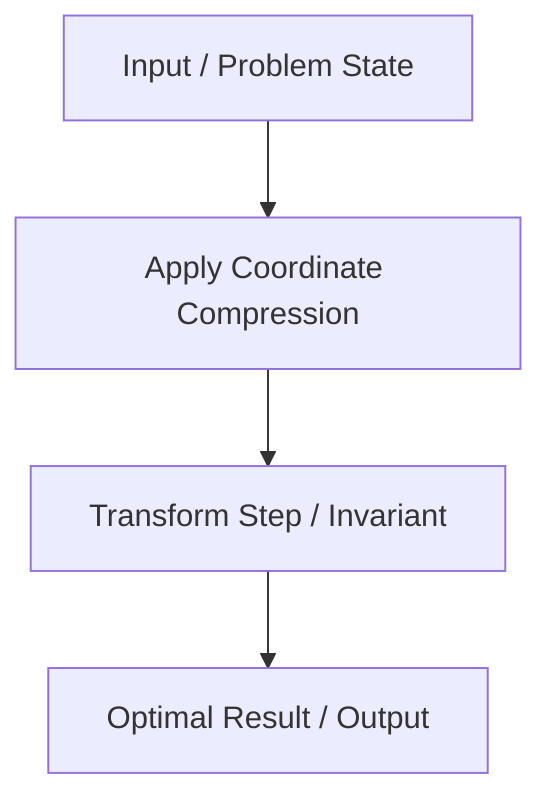

# Coordinate Compression

> **Category:** Arrays · **Tier:** Core Interview (Intermediate)

---

## 🔗 Resources & Visualizers
- **YouTube:** [Watch Coordinate Compression Visual Guide](https://www.youtube.com/results?search_query=Coordinate%20Compression%20algorithm%20visual%20explanation)
- **Blog / Editorial:** [CP-Algorithms / GeeksforGeeks Guide](https://www.google.com/search?q=Coordinate%20Compression%20algorithm%20tutorial%20CP%20algorithms)
- **Interactive Visualizer:** [VisuAlgo Interactive Simulation](https://visualgo.net/en)

---

## 🧠 Intuition & Mental Model
> [!TIP]
> **Core Concept:** Coordinate Compression replaces large or arbitrary

Coordinate Compression replaces large or arbitrary
values in an array with their rank positions after sorting unique values,
while preserving order relationships.
Algorithm Explanation
Copy the original array into a temporary array
Sort the temporary array
Remove duplicates from the sorted array
For each original element, find its index in the unique sorted array
That index is the compressed coordinate

---

## 🎯 When to Use & Problem Triggers
- **Trigger 1:** When the brute-force enumeration takes quadratic time or higher and a linear/logarithmic invariant exists.
- **Trigger 2:** Common patterns involving **Arrays**, subsegments, query sequences, or optimal substructures.
- **Trigger 3:** Constraints where $N \ge 10^5$ require $O(N)$ or $O(N \log N)$ performance.

---

## 📊 Visual Explanation & Dry Run



<details>
<summary>🔍 <strong>Step-by-Step Algorithm Walkthrough</strong> (Click to expand)</summary>

1. **Initialization:** Set up boundary pointers, state variables, or base auxiliary arrays.
2. **Iteration / Traversal:** Advance through the input elements while maintaining the algorithmic invariant.
3. **State Transition:** Update the current state, dynamic array, or accumulator in $O(1)$ or $O(\log N)$.
4. **Final Result:** Extract the optimal answer from the computed state or reconstructed solution.

</details>

---

## 💻 Algorithm Code (Java)

```java
import java.io.*;
import java.util.*;

class Main {
    public static void main(String[] args) throws Exception {

        BufferedReader br = new BufferedReader(new InputStreamReader(System.in));
        PrintWriter out = new PrintWriter(System.out);

        int[] arr = {100, 500, 100, 200};
        int n = arr.length;

        int[] temp = arr.clone();
        Arrays.sort(temp);

        int[] uniq = new int[n];
        int m = 0;

        for (int i = 0; i < n; i++) {
            if (i == 0 || temp[i] != temp[i - 1]) {
                uniq[m++] = temp[i];
            }
        }

        int[] comp = new int[n];

        for (int i = 0; i < n; i++) {
            int idx = Arrays.binarySearch(uniq, 0, m, arr[i]);
            comp[i] = idx;
        }

        for (int x : comp) out.print(x + " ");
        out.println();

        out.flush();
    }
}
```

---

## ⏱️ Complexity Analysis
- **Time Complexity (TC):** Typically `O(N)` or `O(N log N)` depending on auxiliary sorting or tree operations.
- **Space Complexity (SC):** Typically `O(1)` auxiliary space or `O(N)` for auxiliary arrays/tables.

---

## 🔄 Similar & Connected Algorithms
- **Related Category:** Explore other fundamental algorithms in [Arrays](../).
- **Composite Patterns:** Often combined with Prefix Sums, Binary Search on Answer, or Dynamic Programming memoization.

---

## ⚔️ Practice Questions

### 🟡 LeetCode
- [ ] [Explore Coordinate Compression Problems on LeetCode](https://leetcode.com/problemset/?search=Coordinate%20Compression%20LeetCode) — `Practice`

### 🔵 CodeChef & Codeforces
- [ ] [Practice on Codeforces Problemset](https://codeforces.com/problemset) — `Catalog`
- [ ] [Practice on CodeChef Practice Portal](https://www.codechef.com/practice) — `Catalog`
