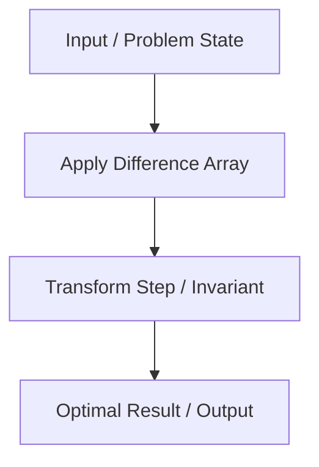

# Difference Array

> **Category:** Arrays · **Tier:** Core Interview (High-Yield)

---

## 🔗 Resources & Visualizers
- **YouTube:** [Watch Difference Array Visual Guide](https://www.youtube.com/playlist?list=PLpIkg8OmuX-Kqkb8DqDe_4-Tiav6ilS_L)
- **Blog / Editorial:** [CP-Algorithms / GeeksforGeeks Guide](https://www.google.com/search?q=Difference%20Array%20algorithm%20tutorial%20CP%20algorithms)
- **Interactive Visualizer:** [VisuAlgo Interactive Simulation](https://visualgo.net/en)

---

## 🧠 Intuition & Mental Model
> [!TIP]
> **Core Concept:** A Difference Array stores changes between consecutive elements instead of actual values.

A Difference Array stores changes between consecutive elements instead of actual values.
It allows fast range updates by updating only two positions.
Algorithm Explanation
Start with an array arr of size n
Build a difference array diff where
diff[i] = arr[i] - arr[i-1]
To add val to range [l, r]
Do diff[l] += val
Do diff[r + 1] -= val (if inside bounds)
After all updates, prefix sum of diff gives final array

---

## 🎯 When to Use & Problem Triggers
- **Trigger 1:** When the brute-force enumeration takes quadratic time or higher and a linear/logarithmic invariant exists.
- **Trigger 2:** Common patterns involving **Arrays**, subsegments, query sequences, or optimal substructures.
- **Trigger 3:** Constraints where $N \ge 10^5$ require $O(N)$ or $O(N \log N)$ performance.

---

## 📊 Visual Explanation & Dry Run



<details>
<summary>🔍 <strong>Step-by-Step Algorithm Walkthrough</strong> (Click to expand)</summary>

1. **Initialization:** Set up boundary pointers, state variables, or base auxiliary arrays.
2. **Iteration / Traversal:** Advance through the input elements while maintaining the algorithmic invariant.
3. **State Transition:** Update the current state, dynamic array, or accumulator in $O(1)$ or $O(\log N)$.
4. **Final Result:** Extract the optimal answer from the computed state or reconstructed solution.

</details>

---

## 💻 Algorithm Code (Java)

```java
import java.io.*;

class Main {

    public static void main(String[] args) throws Exception {
        PrintWriter out = new PrintWriter(System.out);

        int n = 5;
        int[] arr = {10, 10, 10, 10, 10};

        int[] diff = new int[n + 1];

        diff[0] = arr[0];

        for (int i = 1; i < n; i++) {
            diff[i] = arr[i] - arr[i - 1];
        }

        int l = 1, r = 3, val = 5;

        diff[l] += val;
        diff[r + 1] -= val;

        int[] res = new int[n];

        res[0] = diff[0];

        for (int i = 1; i < n; i++) {
            res[i] = res[i - 1] + diff[i];
        }

        for (int x : res) out.print(x + " ");

        out.flush();
    }
}
```

---

## ⏱️ Complexity Analysis
- **Time Complexity (TC):** Typically `O(N)` or `O(N log N)` depending on auxiliary sorting or tree operations.
- **Space Complexity (SC):** Typically `O(1)` auxiliary space or `O(N)` for auxiliary arrays/tables.

---

## 🔄 Similar & Connected Algorithms
- **Related Category:** Explore other fundamental algorithms in [Arrays](../).
- **Composite Patterns:** Often combined with Prefix Sums, Binary Search on Answer, or Dynamic Programming memoization.

---

## ⚔️ Practice Questions

### 🟡 LeetCode
- [ ] [1109. Corporate Flight Bookings](https://leetcode.com/problems/corporate-flight-bookings/) — `Medium`
- [ ] [1094. Car Pooling](https://leetcode.com/problems/car-pooling/) — `Medium`
- [ ] [253. Meeting Rooms II](https://leetcode.com/problems/meeting-rooms-ii/) — `Medium`

### 🔵 CodeChef & Codeforces
- [ ] [295A - Greg and Array](https://codeforces.com/problemset/problem/295/A) — `1400`
- [ ] [FENCE - Multiple Gift Delivery](https://www.codechef.com/) — `Medium`
