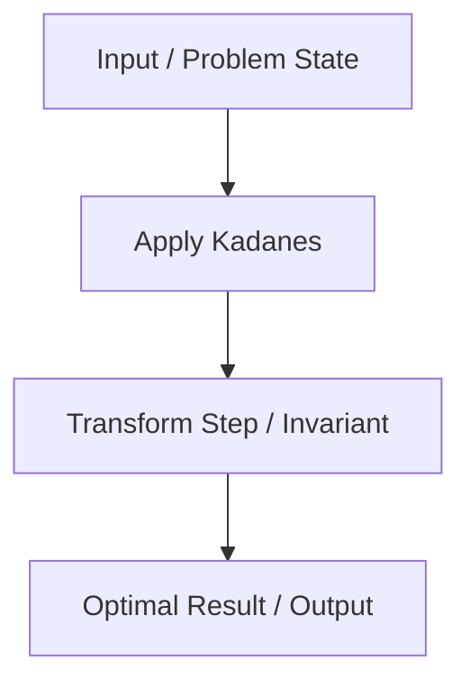

# Kadanes

> **Category:** Arrays · **Tier:** Core Interview (Essential)

---

## 🔗 Resources & Visualizers
- **YouTube:** [Watch Kadanes Visual Guide](https://www.youtube.com/results?search_query=Kadanes%20algorithm%20visual%20explanation)
- **Blog / Editorial:** [CP-Algorithms / GeeksforGeeks Guide](https://www.google.com/search?q=Kadanes%20algorithm%20tutorial%20CP%20algorithms)
- **Interactive Visualizer:** [VisuAlgo Interactive Simulation](https://visualgo.net/en)

---

## 🧠 Intuition & Mental Model
> [!TIP]
> **Core Concept:** Kadane’s Algorithm finds the maximum sum of a contiguous subarray in a given integer array.

Kadane’s Algorithm finds the maximum sum of a contiguous subarray in a given integer array.
It works in linear time by deciding at each index whether
to extend the current subarray or start fresh.
How the Algorithm Works :
Maintain two variables:
currSum → maximum subarray sum ending at current index
maxSum → maximum subarray sum found so far
For each element:
Either extend the previous subarray (currSum + a[i])
Or start new subarray from current element (a[i])
Update maxSum whenever currSum becomes larger
Final maxSum is the answer

---

## 🎯 When to Use & Problem Triggers
- **Trigger 1:** When the brute-force enumeration takes quadratic time or higher and a linear/logarithmic invariant exists.
- **Trigger 2:** Common patterns involving **Arrays**, subsegments, query sequences, or optimal substructures.
- **Trigger 3:** Constraints where $N \ge 10^5$ require $O(N)$ or $O(N \log N)$ performance.

---

## 📊 Visual Explanation & Dry Run



<details>
<summary>🔍 <strong>Step-by-Step Algorithm Walkthrough</strong> (Click to expand)</summary>

1. **Initialization:** Set up boundary pointers, state variables, or base auxiliary arrays.
2. **Iteration / Traversal:** Advance through the input elements while maintaining the algorithmic invariant.
3. **State Transition:** Update the current state, dynamic array, or accumulator in $O(1)$ or $O(\log N)$.
4. **Final Result:** Extract the optimal answer from the computed state or reconstructed solution.

</details>

---

## 💻 Algorithm Code (Java)

```java
import java.io.*;

class Main {
    public static void main(String[] args) throws Exception {
        int[] a = {-2, 1, -3, 4, -1, 2, 1};

        int currSum = a[0];
        int maxSum = a[0];

        for (int i = 1; i < a.length; i++) {
            currSum = Math.max(a[i], currSum + a[i]);
            maxSum = Math.max(maxSum, currSum);
        }

        System.out.println(maxSum);
    }
}
```

---

## ⏱️ Complexity Analysis
- **Time Complexity (TC):** Typically `O(N)` or `O(N log N)` depending on auxiliary sorting or tree operations.
- **Space Complexity (SC):** Typically `O(1)` auxiliary space or `O(N)` for auxiliary arrays/tables.

---

## 🔄 Similar & Connected Algorithms
- **Related Category:** Explore other fundamental algorithms in [Arrays](../).
- **Composite Patterns:** Often combined with Prefix Sums, Binary Search on Answer, or Dynamic Programming memoization.

---

## ⚔️ Practice Questions

### 🟡 LeetCode
- [ ] [53. Maximum Subarray](https://leetcode.com/problems/maximum-subarray/) — `Medium`
- [ ] [918. Maximum Sum Circular Subarray](https://leetcode.com/problems/maximum-sum-circular-subarray/) — `Medium`
- [ ] [152. Maximum Product Subarray](https://leetcode.com/problems/maximum-product-subarray/) — `Medium`

### 🔵 CodeChef & Codeforces
- [ ] [1155C - Alarm Clocks Everywhere](https://codeforces.com/problemset/problem/1155/C) — `1100`
