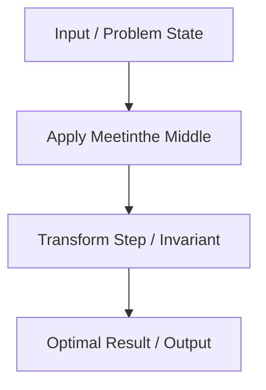

# Meetinthe Middle

> **Category:** Arrays · **Tier:** Advanced Interview (Optimization)

---

## 🔗 Resources & Visualizers
- **YouTube:** [Watch Meetinthe Middle Visual Guide](https://www.youtube.com/results?search_query=Meetinthe%20Middle%20algorithm%20visual%20explanation)
- **Blog / Editorial:** [CP-Algorithms / GeeksforGeeks Guide](https://www.google.com/search?q=Meetinthe%20Middle%20algorithm%20tutorial%20CP%20algorithms)
- **Interactive Visualizer:** [VisuAlgo Interactive Simulation](https://visualgo.net/en)

---

## 🧠 Intuition & Mental Model
> [!TIP]
> **Core Concept:** Meet in the Middle splits a problem into two halves,

Meet in the Middle splits a problem into two halves,
solves each half independently, and then combines the results efficiently.
It is mainly used when brute force is too slow but DP is not feasible.
How the Algorithm Works :
Split the input into two halves
Generate all possible results for each half
Store results of one half
For each result in the other half, search/match required value
Combine both halves to get the final answer
Java Code
Example Used
Problem:
Given array {1, 2, 3, 4} → Check if any subset has sum = 5

---

## 🎯 When to Use & Problem Triggers
- **Trigger 1:** When the brute-force enumeration takes quadratic time or higher and a linear/logarithmic invariant exists.
- **Trigger 2:** Common patterns involving **Arrays**, subsegments, query sequences, or optimal substructures.
- **Trigger 3:** Constraints where $N \ge 10^5$ require $O(N)$ or $O(N \log N)$ performance.

---

## 📊 Visual Explanation & Dry Run



<details>
<summary>🔍 <strong>Step-by-Step Algorithm Walkthrough</strong> (Click to expand)</summary>

1. **Initialization:** Set up boundary pointers, state variables, or base auxiliary arrays.
2. **Iteration / Traversal:** Advance through the input elements while maintaining the algorithmic invariant.
3. **State Transition:** Update the current state, dynamic array, or accumulator in $O(1)$ or $O(\log N)$.
4. **Final Result:** Extract the optimal answer from the computed state or reconstructed solution.

</details>

---

## 💻 Algorithm Code (Java)

```java
import java.io.*;
import java.util.*;

class Main {
    public static void main(String[] args) throws Exception {
        int[] a = {1, 2, 3, 4};
        int target = 5;

        int n = a.length;

        int mid = n / 2;

        int[] left = Arrays.copyOfRange(a, 0, mid);
        int[] right = Arrays.copyOfRange(a, mid, n);

        ArrayList<Integer> L = new ArrayList<>();
        ArrayList<Integer> R = new ArrayList<>();

        generate(left, 0, 0, L);
        generate(right, 0, 0, R);

        Collections.sort(R);

        boolean ok = false;

        for (int x : L) {
            int need = target - x;

            if (Collections.binarySearch(R, need) >= 0) {
                ok = true;
                break;
            }
        }

        System.out.println(ok ? "YES" : "NO");
    }

    static void generate(int[] a, int i, int sum, ArrayList<Integer> res) {
        if (i == a.length) {
            res.add(sum);
            return;
        }

        generate(a, i + 1, sum, res);
        generate(a, i + 1, sum + a[i], res);
    }
}
```

---

## ⏱️ Complexity Analysis
- **Time Complexity (TC):** Typically `O(N)` or `O(N log N)` depending on auxiliary sorting or tree operations.
- **Space Complexity (SC):** Typically `O(1)` auxiliary space or `O(N)` for auxiliary arrays/tables.

---

## 🔄 Similar & Connected Algorithms
- **Related Category:** Explore other fundamental algorithms in [Arrays](../).
- **Composite Patterns:** Often combined with Prefix Sums, Binary Search on Answer, or Dynamic Programming memoization.

---

## ⚔️ Practice Questions

### 🟡 LeetCode
- [ ] [Explore Meetinthe Middle Problems on LeetCode](https://leetcode.com/problemset/?search=Meetinthe%20Middle%20LeetCode) — `Practice`

### 🔵 CodeChef & Codeforces
- [ ] [Practice on Codeforces Problemset](https://codeforces.com/problemset) — `Catalog`
- [ ] [Practice on CodeChef Practice Portal](https://www.codechef.com/practice) — `Catalog`
