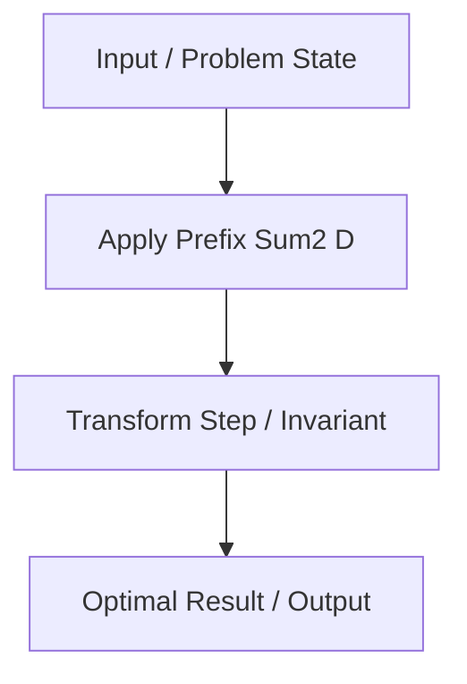

# Prefix Sum2 D

> **Category:** Arrays · **Tier:** Core Interview (High-Yield)

---

## 🔗 Resources & Visualizers
- **YouTube:** [Watch Prefix Sum2 D Visual Guide](https://www.youtube.com/results?search_query=Prefix%20Sum2%20D%20algorithm%20visual%20explanation)
- **Blog / Editorial:** [CP-Algorithms / GeeksforGeeks Guide](https://www.google.com/search?q=Prefix%20Sum2%20D%20algorithm%20tutorial%20CP%20algorithms)
- **Interactive Visualizer:** [VisuAlgo Interactive Simulation](https://visualgo.net/en)

---

## 🧠 Intuition & Mental Model
> [!TIP]
> **Core Concept:** 2D Prefix Sum is a preprocessing technique where each cell

2D Prefix Sum is a preprocessing technique where each cell
stores the sum of all elements from (0,0) to (i,j).
It allows answering submatrix sum queries in O(1) time after preprocessing.
Algorithm Explanation
Start with a 2D matrix a of size n x m.
Create another matrix ps of the same size.
Each ps[i][j] stores the sum of all elements in the rectangle from top-left (0,0) to (i,j).
To compute ps[i][j]:
Take sum from top → ps[i-1][j]
Take sum from left → ps[i][j-1]
Subtract overlap → ps[i-1][j-1]
Add current cell → a[i][j]
Once built, any submatrix sum can be computed using 4 prefix values.

---

## 🎯 When to Use & Problem Triggers
- **Trigger 1:** When the brute-force enumeration takes quadratic time or higher and a linear/logarithmic invariant exists.
- **Trigger 2:** Common patterns involving **Arrays**, subsegments, query sequences, or optimal substructures.
- **Trigger 3:** Constraints where $N \ge 10^5$ require $O(N)$ or $O(N \log N)$ performance.

---

## 📊 Visual Explanation & Dry Run



<details>
<summary>🔍 <strong>Step-by-Step Algorithm Walkthrough</strong> (Click to expand)</summary>

1. **Initialization:** Set up boundary pointers, state variables, or base auxiliary arrays.
2. **Iteration / Traversal:** Advance through the input elements while maintaining the algorithmic invariant.
3. **State Transition:** Update the current state, dynamic array, or accumulator in $O(1)$ or $O(\log N)$.
4. **Final Result:** Extract the optimal answer from the computed state or reconstructed solution.

</details>

---

## 💻 Algorithm Code (Java)

```java
import java.io.*;
import java.util.*;

class Main {

    public static void main(String[] args) {
        int[][] a = {
                {1, 2},
                {3, 4}
        };

        int n = a.length;
        int m = a[0].length;

        int[][] ps = new int[n][m];

        for (int i = 0; i < n; i++) {
            for (int j = 0; j < m; j++) {
                int up = (i > 0) ? ps[i - 1][j] : 0;
                int left = (j > 0) ? ps[i][j - 1] : 0;
                int diag = (i > 0 && j > 0) ? ps[i - 1][j - 1] : 0;

                ps[i][j] = up + left - diag + a[i][j];
            }
        }

        int r1 = 0, c1 = 0, r2 = 1, c2 = 1;

        int total = ps[r2][c2];
        int subUp = (r1 > 0) ? ps[r1 - 1][c2] : 0;
        int subLeft = (c1 > 0) ? ps[r2][c1 - 1] : 0;
        int addBack = (r1 > 0 && c1 > 0) ? ps[r1 - 1][c1 - 1] : 0;

        int ans = total - subUp - subLeft + addBack;

        System.out.println(ans);
    }
}
```

---

## ⏱️ Complexity Analysis
- **Time Complexity (TC):** Typically `O(N)` or `O(N log N)` depending on auxiliary sorting or tree operations.
- **Space Complexity (SC):** Typically `O(1)` auxiliary space or `O(N)` for auxiliary arrays/tables.

---

## 🔄 Similar & Connected Algorithms
- **Related Category:** Explore other fundamental algorithms in [Arrays](../).
- **Composite Patterns:** Often combined with Prefix Sums, Binary Search on Answer, or Dynamic Programming memoization.

---

## ⚔️ Practice Questions

### 🟡 LeetCode
- [ ] [Explore Prefix Sum2 D Problems on LeetCode](https://leetcode.com/problemset/?search=Prefix%20Sum2%20D%20LeetCode) — `Practice`

### 🔵 CodeChef & Codeforces
- [ ] [Practice on Codeforces Problemset](https://codeforces.com/problemset) — `Catalog`
- [ ] [Practice on CodeChef Practice Portal](https://www.codechef.com/practice) — `Catalog`
