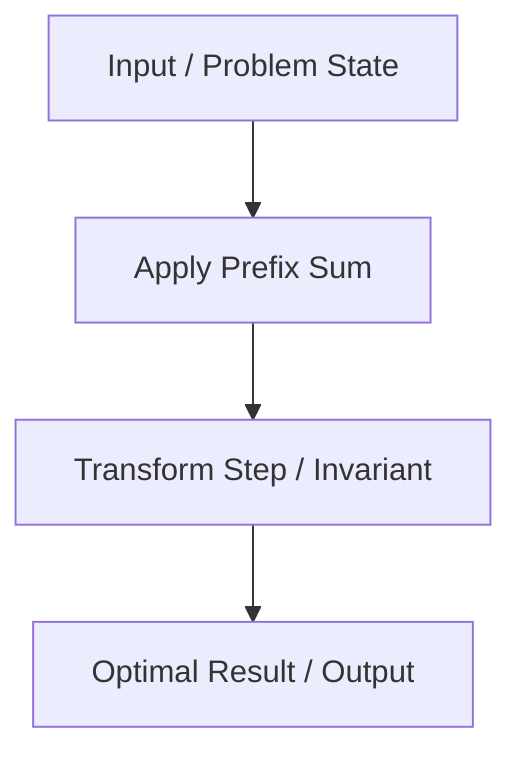

# Prefix Sum

> **Category:** Arrays · **Tier:** Core Interview (Essential)

---

## 🔗 Resources & Visualizers
- **YouTube:** [Watch Prefix Sum Visual Guide](https://www.youtube.com/results?search_query=Prefix%20Sum%20algorithm%20visual%20explanation)
- **Blog / Editorial:** [CP-Algorithms / GeeksforGeeks Guide](https://www.google.com/search?q=Prefix%20Sum%20algorithm%20tutorial%20CP%20algorithms)
- **Interactive Visualizer:** [VisuAlgo Interactive Simulation](https://visualgo.net/en)

---

## 🧠 Intuition & Mental Model
> [!TIP]
> **Core Concept:** Prefix Sum is an array where each index stores the sum of

Prefix Sum is an array where each index stores the sum of
all elements from index 0 to that index.
It allows fast range sum queries after linear preprocessing.
Algorithm Explanation
Start with an input array a
Create a prefix array p of same size
p[0] = a[0]
For every index i > 0
→ p[i] = p[i-1] + a[i]
Now:
Sum of range [0 … r] = p[r]
Sum of range [l … r] = p[r] - p[l-1]

---

## 🎯 When to Use & Problem Triggers
- **Trigger 1:** When the brute-force enumeration takes quadratic time or higher and a linear/logarithmic invariant exists.
- **Trigger 2:** Common patterns involving **Arrays**, subsegments, query sequences, or optimal substructures.
- **Trigger 3:** Constraints where $N \ge 10^5$ require $O(N)$ or $O(N \log N)$ performance.

---

## 📊 Visual Explanation & Dry Run



<details>
<summary>🔍 <strong>Step-by-Step Algorithm Walkthrough</strong> (Click to expand)</summary>

1. **Initialization:** Set up boundary pointers, state variables, or base auxiliary arrays.
2. **Iteration / Traversal:** Advance through the input elements while maintaining the algorithmic invariant.
3. **State Transition:** Update the current state, dynamic array, or accumulator in $O(1)$ or $O(\log N)$.
4. **Final Result:** Extract the optimal answer from the computed state or reconstructed solution.

</details>

---

## 💻 Algorithm Code (Java)

```java
import java.io.*;
import java.util.*;

class Main {

    public static void main(String[] args) throws Exception {
        int[] a = {2, 4, 6, 8};

        int n = a.length;

        int[] p = new int[n];

        p[0] = a[0];

        for (int i = 1; i < n; i++) {
            p[i] = p[i - 1] + a[i];
        }

        int l = 1;
        int r = 3;

        int rangeSum = p[r] - p[l - 1];

        System.out.println(rangeSum);
    }
}
```

---

## ⏱️ Complexity Analysis
- **Time Complexity (TC):** Typically `O(N)` or `O(N log N)` depending on auxiliary sorting or tree operations.
- **Space Complexity (SC):** Typically `O(1)` auxiliary space or `O(N)` for auxiliary arrays/tables.

---

## 🔄 Similar & Connected Algorithms
- **Related Category:** Explore other fundamental algorithms in [Arrays](../).
- **Composite Patterns:** Often combined with Prefix Sums, Binary Search on Answer, or Dynamic Programming memoization.

---

## ⚔️ Practice Questions

### 🟡 LeetCode
- [ ] [Explore Prefix Sum Problems on LeetCode](https://leetcode.com/problemset/?search=Prefix%20Sum%20LeetCode) — `Practice`

### 🔵 CodeChef & Codeforces
- [ ] [Practice on Codeforces Problemset](https://codeforces.com/problemset) — `Catalog`
- [ ] [Practice on CodeChef Practice Portal](https://www.codechef.com/practice) — `Catalog`
