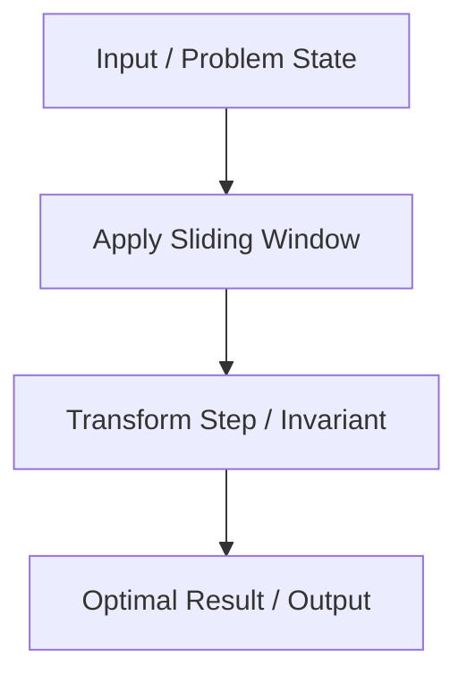

# Sliding Window

> **Category:** Arrays · **Tier:** Core Interview (Essential)

---

## 🔗 Resources & Visualizers
- **YouTube:** [Watch Sliding Window Visual Guide](https://www.youtube.com/results?search_query=Sliding%20Window%20algorithm%20visual%20explanation)
- **Blog / Editorial:** [CP-Algorithms / GeeksforGeeks Guide](https://www.google.com/search?q=Sliding%20Window%20algorithm%20tutorial%20CP%20algorithms)
- **Interactive Visualizer:** [VisuAlgo Interactive Simulation](https://visualgo.net/en)

---

## 🧠 Intuition & Mental Model
> [!TIP]
> **Core Concept:** Sliding Window is an optimization technique to process a contiguous

Sliding Window is an optimization technique to process a contiguous
subarray/substring by maintaining a moving window.
It avoids recomputation by adding the next element and removing the previous one.
Generic Explanation
Choose a window size (fixed or dynamic).
Place the window at the start of the array.
Compute the result for the first window.
Slide the window one step to the right:
Add the new incoming element.
Remove the outgoing element.
Update the answer at each step.
Continue until the window reaches the end.

---

## 🎯 When to Use & Problem Triggers
- **Trigger 1:** When the brute-force enumeration takes quadratic time or higher and a linear/logarithmic invariant exists.
- **Trigger 2:** Common patterns involving **Arrays**, subsegments, query sequences, or optimal substructures.
- **Trigger 3:** Constraints where $N \ge 10^5$ require $O(N)$ or $O(N \log N)$ performance.

---

## 📊 Visual Explanation & Dry Run



<details>
<summary>🔍 <strong>Step-by-Step Algorithm Walkthrough</strong> (Click to expand)</summary>

1. **Initialization:** Set up boundary pointers, state variables, or base auxiliary arrays.
2. **Iteration / Traversal:** Advance through the input elements while maintaining the algorithmic invariant.
3. **State Transition:** Update the current state, dynamic array, or accumulator in $O(1)$ or $O(\log N)$.
4. **Final Result:** Extract the optimal answer from the computed state or reconstructed solution.

</details>

---

## 💻 Algorithm Code (Java)

```java
import java.io.*;
import java.util.*;

class Main {
    public static void main(String[] args) throws Exception {

        BufferedReader br = new BufferedReader(new InputStreamReader(System.in));
        PrintWriter out = new PrintWriter(System.out);

        int[] a = {2, 1, 5, 1, 3, 2};

        int k = 3;

        int w = 0;

        for (int i = 0; i < k; i++) {
            w += a[i];
        }

        int ans = w;

        for (int i = k; i < a.length; i++) {
            w += a[i];
            w -= a[i - k];

            if (w > ans) ans = w;
        }

        out.println(ans);
        out.flush();
    }
}
```

---

## ⏱️ Complexity Analysis
- **Time Complexity (TC):** Typically `O(N)` or `O(N log N)` depending on auxiliary sorting or tree operations.
- **Space Complexity (SC):** Typically `O(1)` auxiliary space or `O(N)` for auxiliary arrays/tables.

---

## 🔄 Similar & Connected Algorithms
- **Related Category:** Explore other fundamental algorithms in [Arrays](../).
- **Composite Patterns:** Often combined with Prefix Sums, Binary Search on Answer, or Dynamic Programming memoization.

---

## ⚔️ Practice Questions

### 🟡 LeetCode
- [ ] [3. Longest Substring Without Repeating Characters](https://leetcode.com/problems/longest-substring-without-repeating-characters/) — `Medium`
- [ ] [76. Minimum Window Substring](https://leetcode.com/problems/minimum-window-substring/) — `Hard`
- [ ] [424. Longest Repeating Character Replacement](https://leetcode.com/problems/longest-repeating-character-replacement/) — `Medium`

### 🔵 CodeChef & Codeforces
- [ ] [SUBINC - Distinct Subarrays](https://www.codechef.com/) — `Easy`
