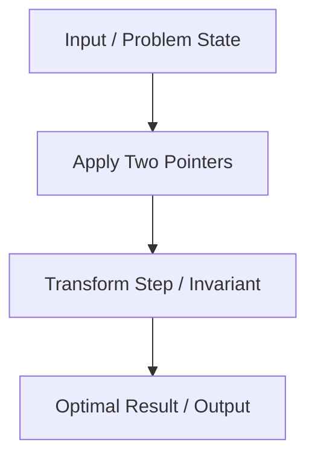

# Two Pointers

> **Category:** Arrays · **Tier:** Core Interview (Essential)

---

## 🔗 Resources & Visualizers
- **YouTube:** [Watch Two Pointers Visual Guide](https://www.youtube.com/results?search_query=Two%20Pointers%20algorithm%20visual%20explanation)
- **Blog / Editorial:** [CP-Algorithms / GeeksforGeeks Guide](https://www.google.com/search?q=Two%20Pointers%20algorithm%20tutorial%20CP%20algorithms)
- **Interactive Visualizer:** [VisuAlgo Interactive Simulation](https://visualgo.net/en)

---

## 🧠 Intuition & Mental Model
> [!TIP]
> **Core Concept:** Two Pointers Algorithm uses two indices that move through a data structure (usually an array)

Two Pointers Algorithm uses two indices that move through a data structure (usually an array)
to efficiently solve problems by reducing unnecessary iterations.
Generic Explanation
Initialize two pointers (usually left and right)
Pointers start at different positions (start–end or both at start)
Evaluate a condition using elements at pointers
Based on the condition:
Move left forward or
Move right backward
Continue until pointers meet or cross
Eliminates nested loops → improves performance

---

## 🎯 When to Use & Problem Triggers
- **Trigger 1:** When the brute-force enumeration takes quadratic time or higher and a linear/logarithmic invariant exists.
- **Trigger 2:** Common patterns involving **Arrays**, subsegments, query sequences, or optimal substructures.
- **Trigger 3:** Constraints where $N \ge 10^5$ require $O(N)$ or $O(N \log N)$ performance.

---

## 📊 Visual Explanation & Dry Run



<details>
<summary>🔍 <strong>Step-by-Step Algorithm Walkthrough</strong> (Click to expand)</summary>

1. **Initialization:** Set up boundary pointers, state variables, or base auxiliary arrays.
2. **Iteration / Traversal:** Advance through the input elements while maintaining the algorithmic invariant.
3. **State Transition:** Update the current state, dynamic array, or accumulator in $O(1)$ or $O(\log N)$.
4. **Final Result:** Extract the optimal answer from the computed state or reconstructed solution.

</details>

---

## 💻 Algorithm Code (Java)

```java
import java.io.*;
import java.util.*;

class Main {
    public static void main(String[] args) throws Exception {
        int[] a = {1, 2, 3, 4, 6};
        int x = 6;

        int l = 0;
        int r = a.length - 1;

        boolean f = false;

        while (l < r) {
            int s = a[l] + a[r];

            if (s == x) {
                f = true;
                break;
            }

            if (s < x) {
                l++;
            } else {
                r--;
            }
        }

        if (f) {
            System.out.println("Yes");
        } else {
            System.out.println("No");
        }
    }
}
```

---

## ⏱️ Complexity Analysis
- **Time Complexity (TC):** Typically `O(N)` or `O(N log N)` depending on auxiliary sorting or tree operations.
- **Space Complexity (SC):** Typically `O(1)` auxiliary space or `O(N)` for auxiliary arrays/tables.

---

## 🔄 Similar & Connected Algorithms
- **Related Category:** Explore other fundamental algorithms in [Arrays](../).
- **Composite Patterns:** Often combined with Prefix Sums, Binary Search on Answer, or Dynamic Programming memoization.

---

## ⚔️ Practice Questions

### 🟡 LeetCode
- [ ] [167. Two Sum II - Input Array Is Sorted](https://leetcode.com/problems/two-sum-ii-input-array-is-sorted/) — `Medium`
- [ ] [15. 3Sum](https://leetcode.com/problems/3sum/) — `Medium`
- [ ] [11. Container With Most Water](https://leetcode.com/problems/container-with-most-water/) — `Medium`

### 🔵 CodeChef & Codeforces
- [ ] [676C - Vasya and String](https://codeforces.com/problemset/problem/676/C) — `1500`
