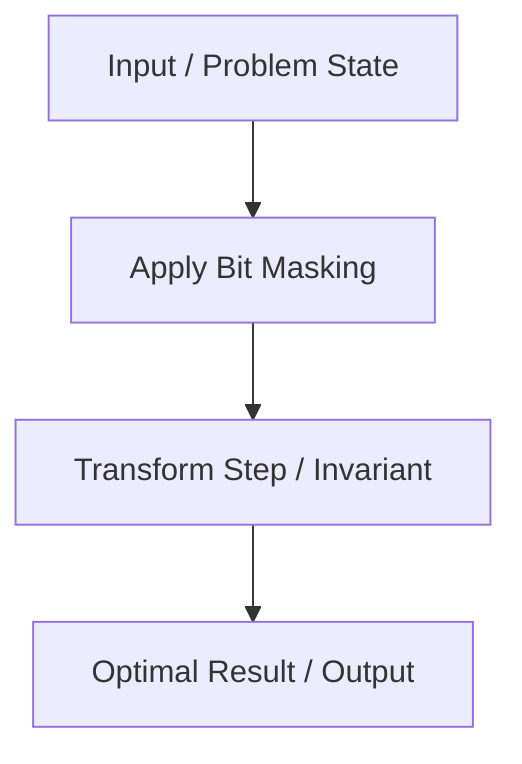

# Bit Masking

> **Category:** BitManipulation · **Tier:** Core Interview (High-Yield)

---

## 🔗 Resources & Visualizers
- **YouTube:** [Watch Bit Masking Visual Guide](https://www.youtube.com/results?search_query=Bit%20Masking%20algorithm%20visual%20explanation)
- **Blog / Editorial:** [CP-Algorithms / GeeksforGeeks Guide](https://www.google.com/search?q=Bit%20Masking%20algorithm%20tutorial%20CP%20algorithms)
- **Interactive Visualizer:** [VisuAlgo Interactive Simulation](https://visualgo.net/en)

---

## 🧠 Intuition & Mental Model
> [!TIP]
> **Core Concept:** Bit Masking is a technique where integers are used as binary representations

Bit Masking is a technique where integers are used as binary representations
to efficiently
represent, check, or manipulate multiple boolean states using bitwise operators.
Generic Explanation
Each bit in an integer represents a state (0 or 1)
Bit position i corresponds to element/index i
1 << i sets the i-th bit
(mask & (1 << i)) != 0 checks whether the i-th bit is ON
Looping masks from 0 to (1<<n)-1 covers all combinations

---

## 🎯 When to Use & Problem Triggers
- **Trigger 1:** When the brute-force enumeration takes quadratic time or higher and a linear/logarithmic invariant exists.
- **Trigger 2:** Common patterns involving **BitManipulation**, subsegments, query sequences, or optimal substructures.
- **Trigger 3:** Constraints where $N \ge 10^5$ require $O(N)$ or $O(N \log N)$ performance.

---

## 📊 Visual Explanation & Dry Run



<details>
<summary>🔍 <strong>Step-by-Step Algorithm Walkthrough</strong> (Click to expand)</summary>

1. **Initialization:** Set up boundary pointers, state variables, or base auxiliary arrays.
2. **Iteration / Traversal:** Advance through the input elements while maintaining the algorithmic invariant.
3. **State Transition:** Update the current state, dynamic array, or accumulator in $O(1)$ or $O(\log N)$.
4. **Final Result:** Extract the optimal answer from the computed state or reconstructed solution.

</details>

---

## 💻 Algorithm Code (Java)

```java
import java.io.*;
import java.util.*;

class Main {
    public static void main(String[] args) throws Exception {
        int[] arr = {1, 2, 3};
        int n = arr.length;

        int totalMasks = 1 << n;

        for (int mask = 0; mask < totalMasks; mask++) {
            System.out.print("{");

            for (int i = 0; i < n; i++) {
                if ((mask & (1 << i)) != 0) {
                    System.out.print(arr[i] + " ");
                }
            }

            System.out.println("}");
        }
    }
}
```

---

## ⏱️ Complexity Analysis
- **Time Complexity (TC):** Typically `O(N)` or `O(N log N)` depending on auxiliary sorting or tree operations.
- **Space Complexity (SC):** Typically `O(1)` auxiliary space or `O(N)` for auxiliary arrays/tables.

---

## 🔄 Similar & Connected Algorithms
- **Related Category:** Explore other fundamental algorithms in [BitManipulation](../).
- **Composite Patterns:** Often combined with Prefix Sums, Binary Search on Answer, or Dynamic Programming memoization.

---

## ⚔️ Practice Questions

### 🟡 LeetCode
- [ ] [Explore Bit Masking Problems on LeetCode](https://leetcode.com/problemset/?search=Bit%20Masking%20LeetCode) — `Practice`

### 🔵 CodeChef & Codeforces
- [ ] [Practice on Codeforces Problemset](https://codeforces.com/problemset) — `Catalog`
- [ ] [Practice on CodeChef Practice Portal](https://www.codechef.com/practice) — `Catalog`
