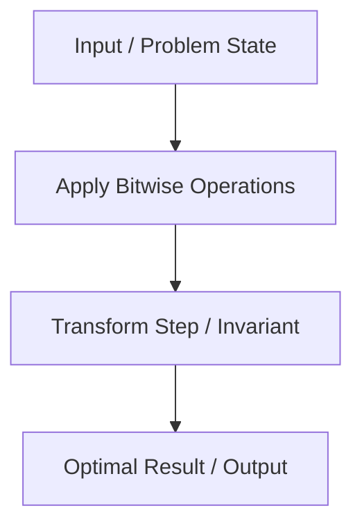

# Bitwise Operations

> **Category:** BitManipulation · **Tier:** Core Interview (Essential)

---

## 🔗 Resources & Visualizers
- **YouTube:** [Watch Bitwise Operations Visual Guide](https://www.youtube.com/results?search_query=Bitwise%20Operations%20algorithm%20visual%20explanation)
- **Blog / Editorial:** [CP-Algorithms / GeeksforGeeks Guide](https://www.google.com/search?q=Bitwise%20Operations%20algorithm%20tutorial%20CP%20algorithms)
- **Interactive Visualizer:** [VisuAlgo Interactive Simulation](https://visualgo.net/en)

---

## 🧠 Intuition & Mental Model
> [!TIP]
> **Core Concept:** Bitwise Operators Algorithm uses binary-level operations

Bitwise Operators Algorithm uses binary-level operations
(AND, OR, XOR, SHIFT) to solve number problems efficiently
by directly manipulating bits.
It avoids arithmetic overhead and works in O(1) or O(log N) time.
Generic Explanation
Every number is stored in binary (0s and 1s)
Bitwise operators act bit by bit
& checks common set bits
| sets bits if any side has 1
^ toggles bits (1 if different)
<< and >> shift bits to multiply/divide by powers of 2
These operations are faster than arithmetic
Example: Check if a Number is Even or Odd using Bitwise AND
Logic:
Last bit of even number = 0
Last bit of odd number = 1
n & 1 checks last bit

---

## 🎯 When to Use & Problem Triggers
- **Trigger 1:** When the brute-force enumeration takes quadratic time or higher and a linear/logarithmic invariant exists.
- **Trigger 2:** Common patterns involving **BitManipulation**, subsegments, query sequences, or optimal substructures.
- **Trigger 3:** Constraints where $N \ge 10^5$ require $O(N)$ or $O(N \log N)$ performance.

---

## 📊 Visual Explanation & Dry Run



<details>
<summary>🔍 <strong>Step-by-Step Algorithm Walkthrough</strong> (Click to expand)</summary>

1. **Initialization:** Set up boundary pointers, state variables, or base auxiliary arrays.
2. **Iteration / Traversal:** Advance through the input elements while maintaining the algorithmic invariant.
3. **State Transition:** Update the current state, dynamic array, or accumulator in $O(1)$ or $O(\log N)$.
4. **Final Result:** Extract the optimal answer from the computed state or reconstructed solution.

</details>

---

## 💻 Algorithm Code (Java)

```java
import java.io.*;

class Main {
    public static void main(String[] args) throws Exception {
        BufferedReader br = new BufferedReader(new InputStreamReader(System.in));

        int n = 5;

        if ((n & 1) == 0) {
            System.out.println("Even");
        } else {
            System.out.println("Odd");
        }
    }
}
```

---

## ⏱️ Complexity Analysis
- **Time Complexity (TC):** Typically `O(N)` or `O(N log N)` depending on auxiliary sorting or tree operations.
- **Space Complexity (SC):** Typically `O(1)` auxiliary space or `O(N)` for auxiliary arrays/tables.

---

## 🔄 Similar & Connected Algorithms
- **Related Category:** Explore other fundamental algorithms in [BitManipulation](../).
- **Composite Patterns:** Often combined with Prefix Sums, Binary Search on Answer, or Dynamic Programming memoization.

---

## ⚔️ Practice Questions

### 🟡 LeetCode
- [ ] [Explore Bitwise Operations Problems on LeetCode](https://leetcode.com/problemset/?search=Bitwise%20Operations%20LeetCode) — `Practice`

### 🔵 CodeChef & Codeforces
- [ ] [Practice on Codeforces Problemset](https://codeforces.com/problemset) — `Catalog`
- [ ] [Practice on CodeChef Practice Portal](https://www.codechef.com/practice) — `Catalog`
