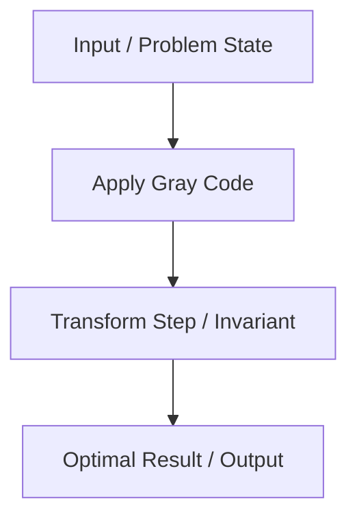

# Gray Code

> **Category:** BitManipulation · **Tier:** Advanced Interview (Pattern)

---

## 🔗 Resources & Visualizers
- **YouTube:** [Watch Gray Code Visual Guide](https://www.youtube.com/results?search_query=Gray%20Code%20algorithm%20visual%20explanation)
- **Blog / Editorial:** [CP-Algorithms / GeeksforGeeks Guide](https://www.google.com/search?q=Gray%20Code%20algorithm%20tutorial%20CP%20algorithms)
- **Interactive Visualizer:** [VisuAlgo Interactive Simulation](https://visualgo.net/en)

---

## 🧠 Intuition & Mental Model
> [!TIP]
> **Core Concept:** Gray Code is a binary number sequence where two

Gray Code is a binary number sequence where two
consecutive numbers differ by exactly one bit.
It is generated using the formula: Gray = n ^ (n >> 1).
Algorithm Explanation :
Start with normal numbers from 0 to (2ⁿ − 1)
For every number i:
Right shift i by 1 bit → (i >> 1)
XOR it with original i
XOR ensures only one bit changes between consecutive values
This guarantees valid Gray Code sequence

---

## 🎯 When to Use & Problem Triggers
- **Trigger 1:** When the brute-force enumeration takes quadratic time or higher and a linear/logarithmic invariant exists.
- **Trigger 2:** Common patterns involving **BitManipulation**, subsegments, query sequences, or optimal substructures.
- **Trigger 3:** Constraints where $N \ge 10^5$ require $O(N)$ or $O(N \log N)$ performance.

---

## 📊 Visual Explanation & Dry Run



<details>
<summary>🔍 <strong>Step-by-Step Algorithm Walkthrough</strong> (Click to expand)</summary>

1. **Initialization:** Set up boundary pointers, state variables, or base auxiliary arrays.
2. **Iteration / Traversal:** Advance through the input elements while maintaining the algorithmic invariant.
3. **State Transition:** Update the current state, dynamic array, or accumulator in $O(1)$ or $O(\log N)$.
4. **Final Result:** Extract the optimal answer from the computed state or reconstructed solution.

</details>

---

## 💻 Algorithm Code (Java)

```java
import java.io.*;

class GrayCode {
    public static void main(String[] args) throws Exception {
        int n = 2;
        int limit = 1 << n;

        for (int i = 0; i < limit; i++) {
            int gray = i ^ (i >> 1);

            System.out.println("Binary: " + toBinary(i, n) + " F=Gray: " + toBinary(gray, n));
        }
    }

    static String toBinary(int x, int bits) {
        String s = Integer.toBinaryString(x);

        while (s.length() < bits)
            s = "0" + s;

        return s;
    }
}
```

---

## ⏱️ Complexity Analysis
- **Time Complexity (TC):** Typically `O(N)` or `O(N log N)` depending on auxiliary sorting or tree operations.
- **Space Complexity (SC):** Typically `O(1)` auxiliary space or `O(N)` for auxiliary arrays/tables.

---

## 🔄 Similar & Connected Algorithms
- **Related Category:** Explore other fundamental algorithms in [BitManipulation](../).
- **Composite Patterns:** Often combined with Prefix Sums, Binary Search on Answer, or Dynamic Programming memoization.

---

## ⚔️ Practice Questions

### 🟡 LeetCode
- [ ] [Explore Gray Code Problems on LeetCode](https://leetcode.com/problemset/?search=Gray%20Code%20LeetCode) — `Practice`

### 🔵 CodeChef & Codeforces
- [ ] [Practice on Codeforces Problemset](https://codeforces.com/problemset) — `Catalog`
- [ ] [Practice on CodeChef Practice Portal](https://www.codechef.com/practice) — `Catalog`
