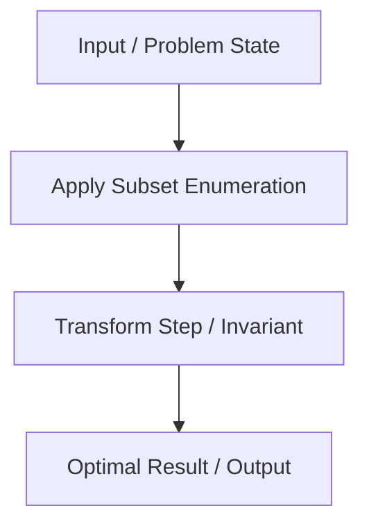

# Subset Enumeration

> **Category:** BitManipulation · **Tier:** Core Interview (High-Yield)

---

## 🔗 Resources & Visualizers
- **YouTube:** [Watch Subset Enumeration Visual Guide](https://www.youtube.com/results?search_query=Subset%20Enumeration%20algorithm%20visual%20explanation)
- **Blog / Editorial:** [CP-Algorithms / GeeksforGeeks Guide](https://www.google.com/search?q=Subset%20Enumeration%20algorithm%20tutorial%20CP%20algorithms)
- **Interactive Visualizer:** [VisuAlgo Interactive Simulation](https://visualgo.net/en)

---

## 🧠 Intuition & Mental Model
> [!TIP]
> **Core Concept:** Subset Enumeration using Bits is a technique

Subset Enumeration using Bits is a technique
where each number from 0 to (2^n − 1) represents one subset.
Each bit decides whether an element is included (1) or excluded (0).
Algorithm Explanation
If an array has n elements, total subsets = 2^n
Numbers from 0 to 2^n - 1 cover all bit combinations
For each number:
Check every bit position
If bit is 1, include that element in subset
Repeat until all numbers are processed

---

## 🎯 When to Use & Problem Triggers
- **Trigger 1:** When the brute-force enumeration takes quadratic time or higher and a linear/logarithmic invariant exists.
- **Trigger 2:** Common patterns involving **BitManipulation**, subsegments, query sequences, or optimal substructures.
- **Trigger 3:** Constraints where $N \ge 10^5$ require $O(N)$ or $O(N \log N)$ performance.

---

## 📊 Visual Explanation & Dry Run



<details>
<summary>🔍 <strong>Step-by-Step Algorithm Walkthrough</strong> (Click to expand)</summary>

1. **Initialization:** Set up boundary pointers, state variables, or base auxiliary arrays.
2. **Iteration / Traversal:** Advance through the input elements while maintaining the algorithmic invariant.
3. **State Transition:** Update the current state, dynamic array, or accumulator in $O(1)$ or $O(\log N)$.
4. **Final Result:** Extract the optimal answer from the computed state or reconstructed solution.

</details>

---

## 💻 Algorithm Code (Java)

```java
import java.io.*;

class Main {
    public static void main(String[] args) throws Exception {
        PrintWriter out = new PrintWriter(System.out);

        int[] a = {1, 2, 3};
        int n = a.length;

        int total = 1 << n;

        for (int mask = 0; mask < total; mask++) {
            out.print("{ ");

            for (int i = 0; i < n; i++) {
                if ((mask & (1 << i)) != 0) {
                    out.print(a[i] + " ");
                }
            }

            out.println("}");
        }

        out.flush();
    }
}
```

---

## ⏱️ Complexity Analysis
- **Time Complexity (TC):** Typically `O(N)` or `O(N log N)` depending on auxiliary sorting or tree operations.
- **Space Complexity (SC):** Typically `O(1)` auxiliary space or `O(N)` for auxiliary arrays/tables.

---

## 🔄 Similar & Connected Algorithms
- **Related Category:** Explore other fundamental algorithms in [BitManipulation](../).
- **Composite Patterns:** Often combined with Prefix Sums, Binary Search on Answer, or Dynamic Programming memoization.

---

## ⚔️ Practice Questions

### 🟡 LeetCode
- [ ] [Explore Subset Enumeration Problems on LeetCode](https://leetcode.com/problemset/?search=Subset%20Enumeration%20LeetCode) — `Practice`

### 🔵 CodeChef & Codeforces
- [ ] [Practice on Codeforces Problemset](https://codeforces.com/problemset) — `Catalog`
- [ ] [Practice on CodeChef Practice Portal](https://www.codechef.com/practice) — `Catalog`
