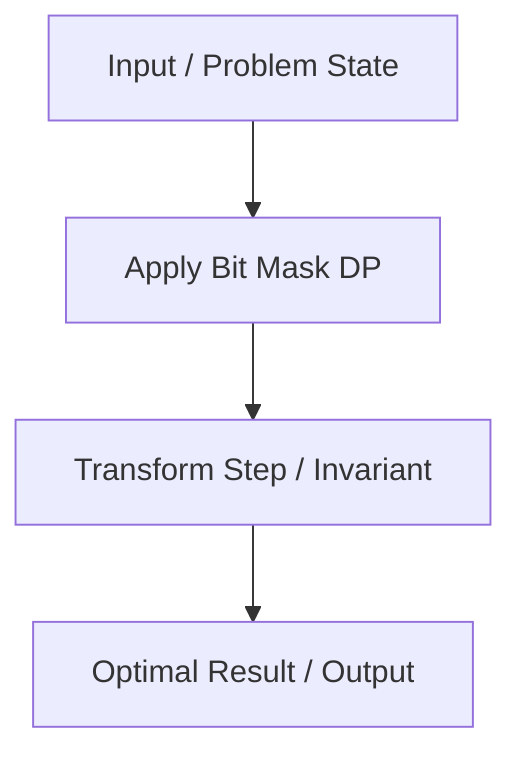

# Bit Mask DP

> **Category:** DynamicProgramming · **Tier:** Advanced Interview (Hard)

---

## 🔗 Resources & Visualizers
- **YouTube:** [Watch Bit Mask DP Visual Guide](https://www.youtube.com/results?search_query=Bit%20Mask%20DP%20algorithm%20visual%20explanation)
- **Blog / Editorial:** [CP-Algorithms / GeeksforGeeks Guide](https://www.google.com/search?q=Bit%20Mask%20DP%20algorithm%20tutorial%20CP%20algorithms)
- **Interactive Visualizer:** [VisuAlgo Interactive Simulation](https://visualgo.net/en)

---

## 🧠 Intuition & Mental Model
> [!TIP]
> **Core Concept:** An optimized algorithmic pattern for DynamicProgramming problems.

The **Bit Mask DP** is a foundational pattern in **DynamicProgramming** designed to solve range, optimization, or search problems efficiently without brute-force enumeration.

---

## 🎯 When to Use & Problem Triggers
- **Trigger 1:** When the brute-force enumeration takes quadratic time or higher and a linear/logarithmic invariant exists.
- **Trigger 2:** Common patterns involving **DynamicProgramming**, subsegments, query sequences, or optimal substructures.
- **Trigger 3:** Constraints where $N \ge 10^5$ require $O(N)$ or $O(N \log N)$ performance.

---

## 📊 Visual Explanation & Dry Run



<details>
<summary>🔍 <strong>Step-by-Step Algorithm Walkthrough</strong> (Click to expand)</summary>

1. **Initialization:** Set up boundary pointers, state variables, or base auxiliary arrays.
2. **Iteration / Traversal:** Advance through the input elements while maintaining the algorithmic invariant.
3. **State Transition:** Update the current state, dynamic array, or accumulator in $O(1)$ or $O(\log N)$.
4. **Final Result:** Extract the optimal answer from the computed state or reconstructed solution.

</details>

---

## 💻 Algorithm Code (Java)

```java
import java.io.*;
import java.util.*;

class Main {

    public static void main(String[] args) throws Exception {

        PrintWriter out = new PrintWriter(System.out);

        int n = 3;

        int[][] cost = {
                {9, 2, 7},
                {6, 4, 3},
                {5, 8, 1}
        };

        int size = 1 << n;

        int[] dp = new int[size];

        Arrays.fill(dp, Integer.MAX_VALUE);

        dp[0] = 0;

        for (int mask = 0; mask < size; mask++) {

            int person = Integer.bitCount(mask);

            for (int job = 0; job < n; job++) {

                if ((mask & (1 << job)) == 0) {

                    int nextMask = mask | (1 << job);

                    dp[nextMask] = Math.min(
                            dp[nextMask],
                            dp[mask] + cost[person][job]
                    );
                }
            }
        }

        out.println(dp[size - 1]);

        out.flush();
    }
}
```

---

## ⏱️ Complexity Analysis
- **Time Complexity (TC):** Typically `O(N)` or `O(N log N)` depending on auxiliary sorting or tree operations.
- **Space Complexity (SC):** Typically `O(1)` auxiliary space or `O(N)` for auxiliary arrays/tables.

---

## 🔄 Similar & Connected Algorithms
- **Related Category:** Explore other fundamental algorithms in [DynamicProgramming](../).
- **Composite Patterns:** Often combined with Prefix Sums, Binary Search on Answer, or Dynamic Programming memoization.

---

## ⚔️ Practice Questions

### 🟡 LeetCode
- [ ] [Explore Bit Mask DP Problems on LeetCode](https://leetcode.com/problemset/?search=Bit%20Mask%20DP%20LeetCode) — `Practice`

### 🔵 CodeChef & Codeforces
- [ ] [Practice on Codeforces Problemset](https://codeforces.com/problemset) — `Catalog`
- [ ] [Practice on CodeChef Practice Portal](https://www.codechef.com/practice) — `Catalog`
