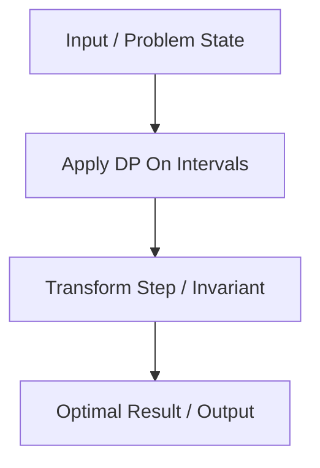

# DP On Intervals

> **Category:** DynamicProgramming · **Tier:** Advanced Interview (Hard)

---

## 🔗 Resources & Visualizers
- **YouTube:** [Watch DP On Intervals Visual Guide](https://www.youtube.com/results?search_query=DP%20On%20Intervals%20algorithm%20visual%20explanation)
- **Blog / Editorial:** [CP-Algorithms / GeeksforGeeks Guide](https://www.google.com/search?q=DP%20On%20Intervals%20algorithm%20tutorial%20CP%20algorithms)
- **Interactive Visualizer:** [VisuAlgo Interactive Simulation](https://visualgo.net/en)

---

## 🧠 Intuition & Mental Model
> [!TIP]
> **Core Concept:** DP on Intervals is a dynamic programming technique where we solve

DP on Intervals is a dynamic programming technique where we solve
problems by computing optimal answers for all subarrays/subintervals and
then combining them to solve larger intervals.
The DP state usually represents the answer for an interval [l, r], and
transitions try all possible partition points inside that interval.
Algorithm Explanation
Define dp[l][r] as the minimum cost to solve the interval from l to r
Length of interval increases from small to large
For every interval [l, r], try splitting at every k where l ≤ k < r
Choose the minimum among all possible splits

---

## 🎯 When to Use & Problem Triggers
- **Trigger 1:** When the brute-force enumeration takes quadratic time or higher and a linear/logarithmic invariant exists.
- **Trigger 2:** Common patterns involving **DynamicProgramming**, subsegments, query sequences, or optimal substructures.
- **Trigger 3:** Constraints where $N \ge 10^5$ require $O(N)$ or $O(N \log N)$ performance.

---

## 📊 Visual Explanation & Dry Run



<details>
<summary>🔍 <strong>Step-by-Step Algorithm Walkthrough</strong> (Click to expand)</summary>

1. **Initialization:** Set up boundary pointers, state variables, or base auxiliary arrays.
2. **Iteration / Traversal:** Advance through the input elements while maintaining the algorithmic invariant.
3. **State Transition:** Update the current state, dynamic array, or accumulator in $O(1)$ or $O(\log N)$.
4. **Final Result:** Extract the optimal answer from the computed state or reconstructed solution.

</details>

---

## 💻 Algorithm Code (Java)

```java
import java.io.*;
import java.util.*;

class Main {
    public static void main(String[] args) throws Exception {

        BufferedReader br = new BufferedReader(new InputStreamReader(System.in));
        PrintWriter out = new PrintWriter(System.out);

        int[] a = {10, 20, 30, 40};
        int n = a.length;

        int[][] dp = new int[n][n];

        for (int len = 2; len < n; len++) {
            for (int l = 1; l + len - 1 < n; l++) {
                int r = l + len - 1;
                dp[l][r] = Integer.MAX_VALUE;
                for (int k = l; k < r; k++) {
                    int cost = dp[l][k] + dp[k + 1][r] + a[l - 1] * a[k] * a[r];
                    dp[l][r] = Math.min(dp[l][r], cost);
                }
            }
        }

        out.println(dp[1][n - 1]);
        out.flush();
    }
}
```

---

## ⏱️ Complexity Analysis
- **Time Complexity (TC):** Typically `O(N)` or `O(N log N)` depending on auxiliary sorting or tree operations.
- **Space Complexity (SC):** Typically `O(1)` auxiliary space or `O(N)` for auxiliary arrays/tables.

---

## 🔄 Similar & Connected Algorithms
- **Related Category:** Explore other fundamental algorithms in [DynamicProgramming](../).
- **Composite Patterns:** Often combined with Prefix Sums, Binary Search on Answer, or Dynamic Programming memoization.

---

## ⚔️ Practice Questions

### 🟡 LeetCode
- [ ] [Explore DP On Intervals Problems on LeetCode](https://leetcode.com/problemset/?search=DP%20On%20Intervals%20LeetCode) — `Practice`

### 🔵 CodeChef & Codeforces
- [ ] [Practice on Codeforces Problemset](https://codeforces.com/problemset) — `Catalog`
- [ ] [Practice on CodeChef Practice Portal](https://www.codechef.com/practice) — `Catalog`
