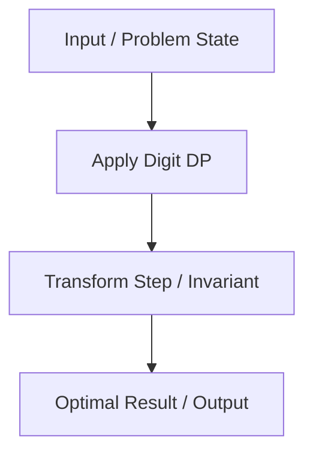

# Digit DP

> **Category:** DynamicProgramming · **Tier:** Advanced Interview (Hard)

---

## 🔗 Resources & Visualizers
- **YouTube:** [Watch Digit DP Visual Guide](https://www.youtube.com/results?search_query=Digit%20DP%20algorithm%20visual%20explanation)
- **Blog / Editorial:** [CP-Algorithms / GeeksforGeeks Guide](https://www.google.com/search?q=Digit%20DP%20algorithm%20tutorial%20CP%20algorithms)
- **Interactive Visualizer:** [VisuAlgo Interactive Simulation](https://visualgo.net/en)

---

## 🧠 Intuition & Mental Model
> [!TIP]
> **Core Concept:** Digit DP is a dynamic programming technique used to solve problems on

Digit DP is a dynamic programming technique used to solve problems on
numbers by processing them digit by digit.
It efficiently counts or optimizes values over a range of numbers
while respecting constraints like digit sum, digit count, or limits.
Algorithm Explanation
Convert the number N into digits.
Build the number left to right using DP.
At each digit:
Track position, tight constraint (≤ N), and required state (like digit sum).
Use memoization to avoid recomputation.
The final DP value gives the answer.

---

## 🎯 When to Use & Problem Triggers
- **Trigger 1:** When the brute-force enumeration takes quadratic time or higher and a linear/logarithmic invariant exists.
- **Trigger 2:** Common patterns involving **DynamicProgramming**, subsegments, query sequences, or optimal substructures.
- **Trigger 3:** Constraints where $N \ge 10^5$ require $O(N)$ or $O(N \log N)$ performance.

---

## 📊 Visual Explanation & Dry Run



<details>
<summary>🔍 <strong>Step-by-Step Algorithm Walkthrough</strong> (Click to expand)</summary>

1. **Initialization:** Set up boundary pointers, state variables, or base auxiliary arrays.
2. **Iteration / Traversal:** Advance through the input elements while maintaining the algorithmic invariant.
3. **State Transition:** Update the current state, dynamic array, or accumulator in $O(1)$ or $O(\log N)$.
4. **Final Result:** Extract the optimal answer from the computed state or reconstructed solution.

</details>

---

## 💻 Algorithm Code (Java)

```java
import java.io.*;
import java.util.*;

class Main {

    static char[] d;
    static int S;
    static int[][][] dp;

    static int f(int i, int sum, int tight) {
        if (sum > S) return 0;

        if (i == d.length)
            return sum == S ? 1 : 0;

        if (dp[i][sum][tight] != -1)
            return dp[i][sum][tight];

        int lim = (tight == 1) ? d[i] - '0' : 9;
        int res = 0;

        for (int dig = 0; dig <= lim; dig++) {
            res += f(
                    i + 1,
                    sum + dig,
                    (tight == 1 && dig == lim) ? 1 : 0
            );
        }

        return dp[i][sum][tight] = res;
    }

    public static void main(String[] args) {
        String N = "25";
        S = 3;

        d = N.toCharArray();
        dp = new int[d.length][S + 1][2];

        for (int[][] x : dp)
            for (int[] y : x)
                Arrays.fill(y, -1);

        int ans = f(0, 0, 1);
        System.out.println(ans);
    }
}
```

---

## ⏱️ Complexity Analysis
- **Time Complexity (TC):** Typically `O(N)` or `O(N log N)` depending on auxiliary sorting or tree operations.
- **Space Complexity (SC):** Typically `O(1)` auxiliary space or `O(N)` for auxiliary arrays/tables.

---

## 🔄 Similar & Connected Algorithms
- **Related Category:** Explore other fundamental algorithms in [DynamicProgramming](../).
- **Composite Patterns:** Often combined with Prefix Sums, Binary Search on Answer, or Dynamic Programming memoization.

---

## ⚔️ Practice Questions

### 🟡 LeetCode
- [ ] [Explore Digit DP Problems on LeetCode](https://leetcode.com/problemset/?search=Digit%20DP%20LeetCode) — `Practice`

### 🔵 CodeChef & Codeforces
- [ ] [Practice on Codeforces Problemset](https://codeforces.com/problemset) — `Catalog`
- [ ] [Practice on CodeChef Practice Portal](https://www.codechef.com/practice) — `Catalog`
