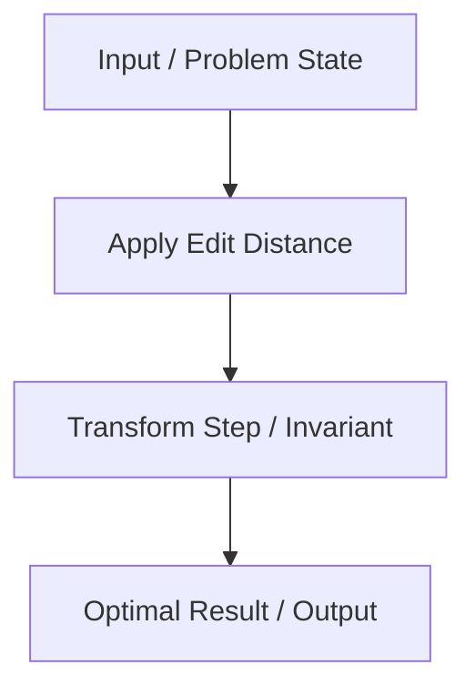

# Edit Distance

> **Category:** DynamicProgramming · **Tier:** Core Interview (Classic)

---

## 🔗 Resources & Visualizers
- **YouTube:** [Watch Edit Distance Visual Guide](https://www.youtube.com/results?search_query=Edit%20Distance%20algorithm%20visual%20explanation)
- **Blog / Editorial:** [CP-Algorithms / GeeksforGeeks Guide](https://www.google.com/search?q=Edit%20Distance%20algorithm%20tutorial%20CP%20algorithms)
- **Interactive Visualizer:** [VisuAlgo Interactive Simulation](https://visualgo.net/en)

---

## 🧠 Intuition & Mental Model
> [!TIP]
> **Core Concept:** Edit Distance is a dynamic programming algorithm that computes the minimum number of

Edit Distance is a dynamic programming algorithm that computes the minimum number of
operations (insert, delete, replace) required to convert one string into another.
Each operation has a cost of 1, and the goal is to minimize total cost.
Algorithm Explanation
Use a DP table dp[i][j] where
dp[i][j] = minimum operations to convert first i characters of s1 into first j characters of s2
If characters match → no operation
If they don’t → choose min(insert, delete, replace) + 1
Final answer is stored at dp[n][m]

---

## 🎯 When to Use & Problem Triggers
- **Trigger 1:** When the brute-force enumeration takes quadratic time or higher and a linear/logarithmic invariant exists.
- **Trigger 2:** Common patterns involving **DynamicProgramming**, subsegments, query sequences, or optimal substructures.
- **Trigger 3:** Constraints where $N \ge 10^5$ require $O(N)$ or $O(N \log N)$ performance.

---

## 📊 Visual Explanation & Dry Run



<details>
<summary>🔍 <strong>Step-by-Step Algorithm Walkthrough</strong> (Click to expand)</summary>

1. **Initialization:** Set up boundary pointers, state variables, or base auxiliary arrays.
2. **Iteration / Traversal:** Advance through the input elements while maintaining the algorithmic invariant.
3. **State Transition:** Update the current state, dynamic array, or accumulator in $O(1)$ or $O(\log N)$.
4. **Final Result:** Extract the optimal answer from the computed state or reconstructed solution.

</details>

---

## 💻 Algorithm Code (Java)

```java
import java.io.*;

class Main {
    public static void main(String[] args) throws Exception {

        BufferedReader br = new BufferedReader(new InputStreamReader(System.in));
        PrintWriter out = new PrintWriter(System.out);

        String s1 = "horse";
        String s2 = "ros";

        int n = s1.length();
        int m = s2.length();

        int[][] dp = new int[n + 1][m + 1];

        for (int i = 0; i <= n; i++) {
            dp[i][0] = i;
        }

        for (int j = 0; j <= m; j++) {
            dp[0][j] = j;
        }

        for (int i = 1; i <= n; i++) {
            for (int j = 1; j <= m; j++) {
                if (s1.charAt(i - 1) == s2.charAt(j - 1)) {
                    dp[i][j] = dp[i - 1][j - 1];
                } else {
                    dp[i][j] = 1 + Math.min(
                            dp[i - 1][j],
                            Math.min(
                                    dp[i][j - 1],
                                    dp[i - 1][j - 1]
                            )
                    );
                }
            }
        }

        out.println(dp[n][m]);
        out.flush();
    }
}
```

---

## ⏱️ Complexity Analysis
- **Time Complexity (TC):** Typically `O(N)` or `O(N log N)` depending on auxiliary sorting or tree operations.
- **Space Complexity (SC):** Typically `O(1)` auxiliary space or `O(N)` for auxiliary arrays/tables.

---

## 🔄 Similar & Connected Algorithms
- **Related Category:** Explore other fundamental algorithms in [DynamicProgramming](../).
- **Composite Patterns:** Often combined with Prefix Sums, Binary Search on Answer, or Dynamic Programming memoization.

---

## ⚔️ Practice Questions

### 🟡 LeetCode
- [ ] [Explore Edit Distance Problems on LeetCode](https://leetcode.com/problemset/?search=Edit%20Distance%20LeetCode) — `Practice`

### 🔵 CodeChef & Codeforces
- [ ] [Practice on Codeforces Problemset](https://codeforces.com/problemset) — `Catalog`
- [ ] [Practice on CodeChef Practice Portal](https://www.codechef.com/practice) — `Catalog`
