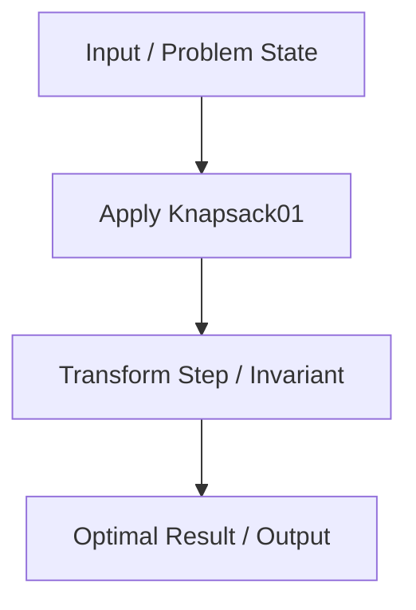

# Knapsack01

> **Category:** DynamicProgramming · **Tier:** Core Interview (Essential)

---

## 🔗 Resources & Visualizers
- **YouTube:** [Watch Knapsack01 Visual Guide](https://www.youtube.com/results?search_query=Knapsack01%20algorithm%20visual%20explanation)
- **Blog / Editorial:** [CP-Algorithms / GeeksforGeeks Guide](https://www.google.com/search?q=Knapsack01%20algorithm%20tutorial%20CP%20algorithms)
- **Interactive Visualizer:** [VisuAlgo Interactive Simulation](https://visualgo.net/en)

---

## 🧠 Intuition & Mental Model
> [!TIP]
> **Core Concept:** 0/1 Knapsack is a dynamic programming algorithm used to maximize

0/1 Knapsack is a dynamic programming algorithm used to maximize
total value in a knapsack of fixed capacity, where each item can be
chosen either once or not at all.
Each item has a weight and a value, and the goal is optimal selection
under capacity constraints.
Algorithm Explanation
Use DP where dp[i][w] = maximum value using first i items with capacity w
For each item:
Either exclude it → value stays same
Or include it (if weight allows) → add its value
Final answer is dp[n][W]

---

## 🎯 When to Use & Problem Triggers
- **Trigger 1:** When the brute-force enumeration takes quadratic time or higher and a linear/logarithmic invariant exists.
- **Trigger 2:** Common patterns involving **DynamicProgramming**, subsegments, query sequences, or optimal substructures.
- **Trigger 3:** Constraints where $N \ge 10^5$ require $O(N)$ or $O(N \log N)$ performance.

---

## 📊 Visual Explanation & Dry Run



<details>
<summary>🔍 <strong>Step-by-Step Algorithm Walkthrough</strong> (Click to expand)</summary>

1. **Initialization:** Set up boundary pointers, state variables, or base auxiliary arrays.
2. **Iteration / Traversal:** Advance through the input elements while maintaining the algorithmic invariant.
3. **State Transition:** Update the current state, dynamic array, or accumulator in $O(1)$ or $O(\log N)$.
4. **Final Result:** Extract the optimal answer from the computed state or reconstructed solution.

</details>

---

## 💻 Algorithm Code (Java)

```java
import java.io.*;

class Main {
    public static void main(String[] args) throws Exception {

        BufferedReader br = new BufferedReader(new InputStreamReader(System.in));

        int n = 3;
        int W = 4;

        int[] wt = {4, 5, 1};
        int[] val = {1, 2, 3};

        int[][] dp = new int[n + 1][W + 1];

        for (int i = 1; i <= n; i++) {
            for (int w = 0; w <= W; w++) {
                dp[i][w] = dp[i - 1][w];
                if (wt[i - 1] <= w) {
                    dp[i][w] = Math.max(dp[i][w], val[i - 1] + dp[i - 1][w - wt[i - 1]]);
                }
            }
        }

        PrintWriter out = new PrintWriter(System.out);
        out.println(dp[n][W]);
        out.flush();

    }
}
```

---

## ⏱️ Complexity Analysis
- **Time Complexity (TC):** Typically `O(N)` or `O(N log N)` depending on auxiliary sorting or tree operations.
- **Space Complexity (SC):** Typically `O(1)` auxiliary space or `O(N)` for auxiliary arrays/tables.

---

## 🔄 Similar & Connected Algorithms
- **Related Category:** Explore other fundamental algorithms in [DynamicProgramming](../).
- **Composite Patterns:** Often combined with Prefix Sums, Binary Search on Answer, or Dynamic Programming memoization.

---

## ⚔️ Practice Questions

### 🟡 LeetCode
- [ ] [416. Partition Equal Subset Sum](https://leetcode.com/problems/partition-equal-subset-sum/) — `Medium`
- [ ] [494. Target Sum](https://leetcode.com/problems/target-sum/) — `Medium`
- [ ] [1049. Last Stone Weight II](https://leetcode.com/problems/last-stone-weight-ii/) — `Medium`

### 🔵 CodeChef & Codeforces
- [ ] [1388C - Uncle Bogdan and Country Happiness](https://codeforces.com/problemset/problem/1388/C) — `1800`
