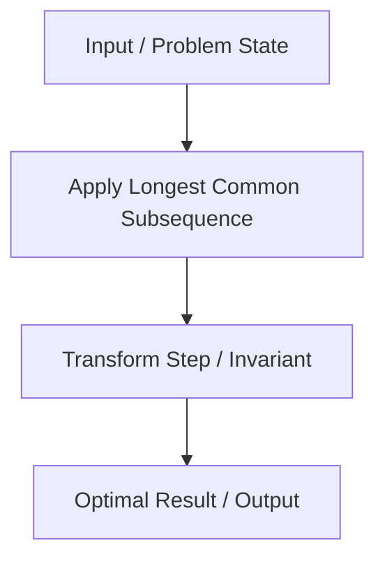

# Longest Common Subsequence

> **Category:** DynamicProgramming · **Tier:** Core Interview (Classic)

---

## 🔗 Resources & Visualizers
- **YouTube:** [Watch Longest Common Subsequence Visual Guide](https://www.youtube.com/results?search_query=Longest%20Common%20Subsequence%20algorithm%20visual%20explanation)
- **Blog / Editorial:** [CP-Algorithms / GeeksforGeeks Guide](https://www.google.com/search?q=Longest%20Common%20Subsequence%20algorithm%20tutorial%20CP%20algorithms)
- **Interactive Visualizer:** [VisuAlgo Interactive Simulation](https://visualgo.net/en)

---

## 🧠 Intuition & Mental Model
> [!TIP]
> **Core Concept:** Longest Common Subsequence (LCS) finds the longest sequence of

Longest Common Subsequence (LCS) finds the longest sequence of
characters that appear in the same order in two strings, but not necessarily contiguously.
It is a classic Dynamic Programming problem because overlapping subproblems repeat.
Algorithm Explanation
Use a 2D DP table where dp[i][j] = LCS length of first i chars of s1 and first j chars of s2
If characters match → take diagonal + 1
Else → take max from top or left
Final answer is at dp[n][m]

---

## 🎯 When to Use & Problem Triggers
- **Trigger 1:** When the brute-force enumeration takes quadratic time or higher and a linear/logarithmic invariant exists.
- **Trigger 2:** Common patterns involving **DynamicProgramming**, subsegments, query sequences, or optimal substructures.
- **Trigger 3:** Constraints where $N \ge 10^5$ require $O(N)$ or $O(N \log N)$ performance.

---

## 📊 Visual Explanation & Dry Run



<details>
<summary>🔍 <strong>Step-by-Step Algorithm Walkthrough</strong> (Click to expand)</summary>

1. **Initialization:** Set up boundary pointers, state variables, or base auxiliary arrays.
2. **Iteration / Traversal:** Advance through the input elements while maintaining the algorithmic invariant.
3. **State Transition:** Update the current state, dynamic array, or accumulator in $O(1)$ or $O(\log N)$.
4. **Final Result:** Extract the optimal answer from the computed state or reconstructed solution.

</details>

---

## 💻 Algorithm Code (Java)

```java
import java.io.BufferedReader;
import java.io.InputStreamReader;
import java.io.PrintWriter;

class Main {
    public static void main(String[] args) throws Exception {

        BufferedReader br = new BufferedReader(new InputStreamReader(System.in));
        PrintWriter out = new PrintWriter(System.out);

        String s1 = "abcde";
        String s2 = "ace";

        int n = s1.length();
        int m = s2.length();

        int[][] dp = new int[n + 1][m + 1];

        for (int i = 1; i <= n; i++) {
            for (int j = 1; j <= m; j++) {
                if (s1.charAt(i - 1) == s2.charAt(j - 1)) {
                    dp[i][j] = dp[i - 1][j - 1] + 1;
                } else {
                    dp[i][j] = Math.max(dp[i - 1][j], dp[i][j - 1]);
                }
            }
        }

        out.println(dp[n][m]);
        out.flush();

    }
}
```

---

## ⏱️ Complexity Analysis
- **Time Complexity (TC):** Typically `O(N)` or `O(N log N)` depending on auxiliary sorting or tree operations.
- **Space Complexity (SC):** Typically `O(1)` auxiliary space or `O(N)` for auxiliary arrays/tables.

---

## 🔄 Similar & Connected Algorithms
- **Related Category:** Explore other fundamental algorithms in [DynamicProgramming](../).
- **Composite Patterns:** Often combined with Prefix Sums, Binary Search on Answer, or Dynamic Programming memoization.

---

## ⚔️ Practice Questions

### 🟡 LeetCode
- [ ] [1143. Longest Common Subsequence](https://leetcode.com/problems/longest-common-subsequence/) — `Medium`
- [ ] [72. Edit Distance](https://leetcode.com/problems/edit-distance/) — `Medium`
- [ ] [1092. Shortest Common Supersequence](https://leetcode.com/problems/shortest-common-supersequence/) — `Hard`

### 🔵 CodeChef & Codeforces

