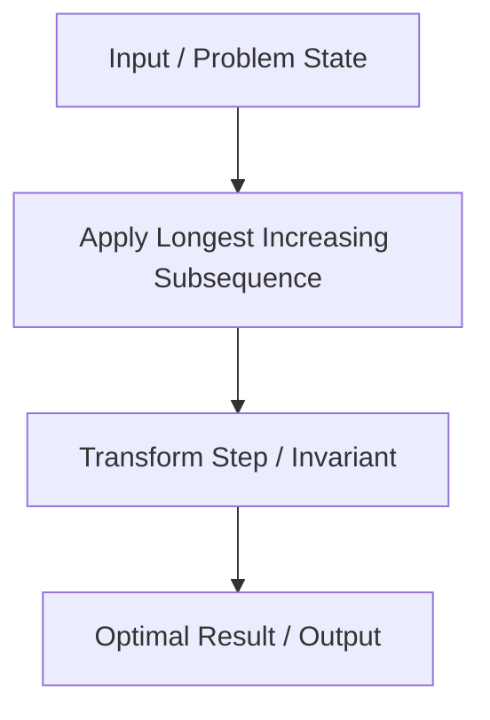

# Longest Increasing Subsequence

> **Category:** DynamicProgramming · **Tier:** Core Interview (Classic)

---

## 🔗 Resources & Visualizers
- **YouTube:** [Watch Longest Increasing Subsequence Visual Guide](https://www.youtube.com/results?search_query=Longest%20Increasing%20Subsequence%20algorithm%20visual%20explanation)
- **Blog / Editorial:** [CP-Algorithms / GeeksforGeeks Guide](https://www.google.com/search?q=Longest%20Increasing%20Subsequence%20algorithm%20tutorial%20CP%20algorithms)
- **Interactive Visualizer:** [VisuAlgo Interactive Simulation](https://visualgo.net/en)

---

## 🧠 Intuition & Mental Model
> [!TIP]
> **Core Concept:** Longest Increasing Subsequence (LIS) is a sequence derived from an array such that:

Longest Increasing Subsequence (LIS) is a sequence derived from an array such that:
The elements are strictly increasing
The sequence maintains original order
The goal is to find the maximum possible length of such a subsequence
Algorithm Explanation
Use Dynamic Programming
Let dp[i] = length of LIS ending at index i
For every element, look back at all previous smaller elements and
update the best possible LIS ending at i
The maximum value in dp[] is the answer

---

## 🎯 When to Use & Problem Triggers
- **Trigger 1:** When the brute-force enumeration takes quadratic time or higher and a linear/logarithmic invariant exists.
- **Trigger 2:** Common patterns involving **DynamicProgramming**, subsegments, query sequences, or optimal substructures.
- **Trigger 3:** Constraints where $N \ge 10^5$ require $O(N)$ or $O(N \log N)$ performance.

---

## 📊 Visual Explanation & Dry Run



<details>
<summary>🔍 <strong>Step-by-Step Algorithm Walkthrough</strong> (Click to expand)</summary>

1. **Initialization:** Set up boundary pointers, state variables, or base auxiliary arrays.
2. **Iteration / Traversal:** Advance through the input elements while maintaining the algorithmic invariant.
3. **State Transition:** Update the current state, dynamic array, or accumulator in $O(1)$ or $O(\log N)$.
4. **Final Result:** Extract the optimal answer from the computed state or reconstructed solution.

</details>

---

## 💻 Algorithm Code (Java)

```java
import java.io.*;

class Main {
    public static void main(String[] args) throws Exception {
        int[] arr = {10, 9, 2, 5, 3, 7, 101, 18};
        int n = arr.length;

        int[] dp = new int[n];

        for (int i = 0; i < n; i++) {
            dp[i] = 1;
        }

        for (int i = 1; i < n; i++) {
            for (int j = 0; j < i; j++) {
                if (arr[i] > arr[j]) {
                    dp[i] = Math.max(dp[i], dp[j] + 1);
                }
            }
        }

        int ans = 0;
        for (int i = 0; i < n; i++) {
            ans = Math.max(ans, dp[i]);
        }

        System.out.println(ans);
    }
}
```

---

## ⏱️ Complexity Analysis
- **Time Complexity (TC):** Typically `O(N)` or `O(N log N)` depending on auxiliary sorting or tree operations.
- **Space Complexity (SC):** Typically `O(1)` auxiliary space or `O(N)` for auxiliary arrays/tables.

---

## 🔄 Similar & Connected Algorithms
- **Related Category:** Explore other fundamental algorithms in [DynamicProgramming](../).
- **Composite Patterns:** Often combined with Prefix Sums, Binary Search on Answer, or Dynamic Programming memoization.

---

## ⚔️ Practice Questions

### 🟡 LeetCode
- [ ] [300. Longest Increasing Subsequence](https://leetcode.com/problems/longest-increasing-subsequence/) — `Medium`
- [ ] [354. Russian Doll Envelopes](https://leetcode.com/problems/russian-doll-envelopes/) — `Hard`
- [ ] [673. Number of Longest Increasing Subsequence](https://leetcode.com/problems/number-of-longest-increasing-subsequence/) — `Medium`

### 🔵 CodeChef & Codeforces

