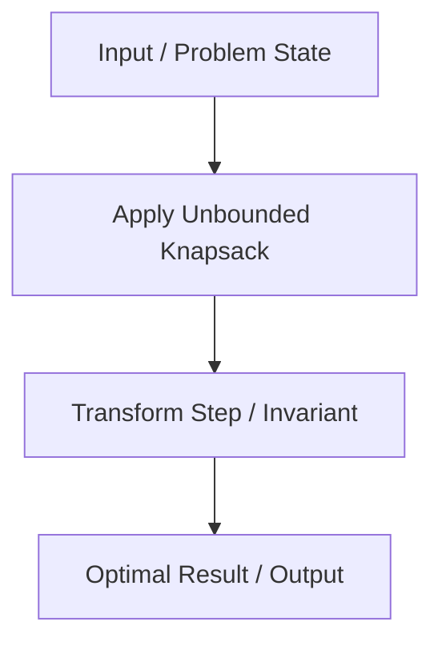

# Unbounded Knapsack

> **Category:** DynamicProgramming · **Tier:** Core Interview (High-Yield)

---

## 🔗 Resources & Visualizers
- **YouTube:** [Watch Unbounded Knapsack Visual Guide](https://www.youtube.com/results?search_query=Unbounded%20Knapsack%20algorithm%20visual%20explanation)
- **Blog / Editorial:** [CP-Algorithms / GeeksforGeeks Guide](https://www.google.com/search?q=Unbounded%20Knapsack%20algorithm%20tutorial%20CP%20algorithms)
- **Interactive Visualizer:** [VisuAlgo Interactive Simulation](https://visualgo.net/en)

---

## 🧠 Intuition & Mental Model
> [!TIP]
> **Core Concept:** Unbounded Knapsack is a Dynamic Programming problem where each item can be chosen unlimited times.

Unbounded Knapsack is a Dynamic Programming problem where each item can be chosen unlimited times.
The goal is to maximize total value without exceeding the knapsack’s capacity.
Algorithm Explanation
Use 1D DP where dp[w] = maximum value achievable with capacity w.
For each capacity, try taking every item again (since unbounded).
Transition:
dp[w] = max(dp[w], dp[w - weight[i]] + value[i])

---

## 🎯 When to Use & Problem Triggers
- **Trigger 1:** When the brute-force enumeration takes quadratic time or higher and a linear/logarithmic invariant exists.
- **Trigger 2:** Common patterns involving **DynamicProgramming**, subsegments, query sequences, or optimal substructures.
- **Trigger 3:** Constraints where $N \ge 10^5$ require $O(N)$ or $O(N \log N)$ performance.

---

## 📊 Visual Explanation & Dry Run



<details>
<summary>🔍 <strong>Step-by-Step Algorithm Walkthrough</strong> (Click to expand)</summary>

1. **Initialization:** Set up boundary pointers, state variables, or base auxiliary arrays.
2. **Iteration / Traversal:** Advance through the input elements while maintaining the algorithmic invariant.
3. **State Transition:** Update the current state, dynamic array, or accumulator in $O(1)$ or $O(\log N)$.
4. **Final Result:** Extract the optimal answer from the computed state or reconstructed solution.

</details>

---

## 💻 Algorithm Code (Java)

```java
class Main {
    public static void main(String[] args) {
        int n = 2;
        int W = 7;

        int[] wt = {2, 3};
        int[] val = {10, 15};

        int[] dp = new int[W + 1];

        for (int w = 0; w <= W; w++) {
            for (int i = 0; i < n; i++) {
                if (w >= wt[i]) {
                    dp[w] = Math.max(dp[w], dp[w - wt[i]] + val[i]);
                }
            }
        }

        System.out.println(dp[W]);
    }
}
```

---

## ⏱️ Complexity Analysis
- **Time Complexity (TC):** Typically `O(N)` or `O(N log N)` depending on auxiliary sorting or tree operations.
- **Space Complexity (SC):** Typically `O(1)` auxiliary space or `O(N)` for auxiliary arrays/tables.

---

## 🔄 Similar & Connected Algorithms
- **Related Category:** Explore other fundamental algorithms in [DynamicProgramming](../).
- **Composite Patterns:** Often combined with Prefix Sums, Binary Search on Answer, or Dynamic Programming memoization.

---

## ⚔️ Practice Questions

### 🟡 LeetCode
- [ ] [Explore Unbounded Knapsack Problems on LeetCode](https://leetcode.com/problemset/?search=Unbounded%20Knapsack%20LeetCode) — `Practice`

### 🔵 CodeChef & Codeforces
- [ ] [Practice on Codeforces Problemset](https://codeforces.com/problemset) — `Catalog`
- [ ] [Practice on CodeChef Practice Portal](https://www.codechef.com/practice) — `Catalog`
