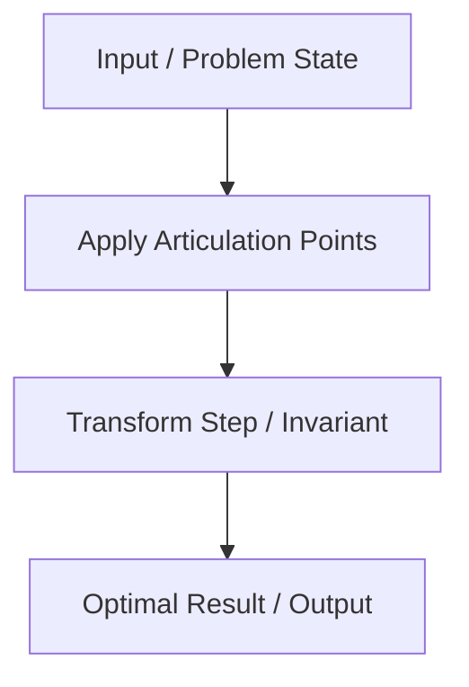

# Articulation Points

> **Category:** Graphs · **Tier:** Advanced Interview (Tarjan)

---

## 🔗 Resources & Visualizers
- **YouTube:** [Watch Articulation Points Visual Guide](https://www.youtube.com/results?search_query=Articulation%20Points%20algorithm%20visual%20explanation)
- **Blog / Editorial:** [CP-Algorithms / GeeksforGeeks Guide](https://www.google.com/search?q=Articulation%20Points%20algorithm%20tutorial%20CP%20algorithms)
- **Interactive Visualizer:** [VisuAlgo Interactive Simulation](https://visualgo.net/en)

---

## 🧠 Intuition & Mental Model
> [!TIP]
> **Core Concept:** An Articulation Point is a vertex whose removal increases

An Articulation Point is a vertex whose removal increases
the number of connected components in a graph.
Removing it breaks connectivity of the graph.
Algorithm Explanation :
Idea (DFS + Time Tracking):
Run DFS and assign each node a discovery time (tin)
Maintain lowest reachable time (low) from subtree
A node is an articulation point if:
Root node has 2 or more DFS children
Non-root node has a child such that
low[child] >= tin[current]
Why this works:
low[child] tells whether the child subtree can reach an ancestor
If it cannot, removing current node disconnects that subtree

---

## 🎯 When to Use & Problem Triggers
- **Trigger 1:** When the brute-force enumeration takes quadratic time or higher and a linear/logarithmic invariant exists.
- **Trigger 2:** Common patterns involving **Graphs**, subsegments, query sequences, or optimal substructures.
- **Trigger 3:** Constraints where $N \ge 10^5$ require $O(N)$ or $O(N \log N)$ performance.

---

## 📊 Visual Explanation & Dry Run



<details>
<summary>🔍 <strong>Step-by-Step Algorithm Walkthrough</strong> (Click to expand)</summary>

1. **Initialization:** Set up boundary pointers, state variables, or base auxiliary arrays.
2. **Iteration / Traversal:** Advance through the input elements while maintaining the algorithmic invariant.
3. **State Transition:** Update the current state, dynamic array, or accumulator in $O(1)$ or $O(\log N)$.
4. **Final Result:** Extract the optimal answer from the computed state or reconstructed solution.

</details>

---

## 💻 Algorithm Code (Java)

```java
import java.util.*;

class ArticulationPoint {

    static int n;
    static List<Integer>[] g;
    static int[] tin, low;
    static boolean[] vis, ap;
    static int timer = 0;

    static void dfs(int u, int p) {
        vis[u] = true;
        tin[u] = low[u] = ++timer;
        int child = 0;

        for (int v : g[u]) {
            if (v == p) continue;

            if (!vis[v]) {
                dfs(v, u);
                low[u] = Math.min(low[u], low[v]);

                if (p != -1 && low[v] >= tin[u])
                    ap[u] = true;

                child++;
            } else {
                low[u] = Math.min(low[u], tin[v]);
            }
        }

        if (p == -1 && child > 1)
            ap[u] = true;
    }

    public static void main(String[] args) {
        n = 5;
        g = new ArrayList[n];

        for (int i = 0; i < n; i++)
            g[i] = new ArrayList<>();

        addEdge(0, 1);
        addEdge(1, 2);
        addEdge(1, 3);
        addEdge(3, 4);

        tin = new int[n];
        low = new int[n];
        vis = new boolean[n];
        ap = new boolean[n];

        dfs(0, -1);

        System.out.println("Articulation Points:");
        for (int i = 0; i < n; i++) {
            if (ap[i]) System.out.println(i);
        }
    }

    static void addEdge(int u, int v) {
        g[u].add(v);
        g[v].add(u);
    }
}
```

---

## ⏱️ Complexity Analysis
- **Time Complexity (TC):** Typically `O(N)` or `O(N log N)` depending on auxiliary sorting or tree operations.
- **Space Complexity (SC):** Typically `O(1)` auxiliary space or `O(N)` for auxiliary arrays/tables.

---

## 🔄 Similar & Connected Algorithms
- **Related Category:** Explore other fundamental algorithms in [Graphs](../).
- **Composite Patterns:** Often combined with Prefix Sums, Binary Search on Answer, or Dynamic Programming memoization.

---

## ⚔️ Practice Questions

### 🟡 LeetCode
- [ ] [Explore Articulation Points Problems on LeetCode](https://leetcode.com/problemset/?search=Articulation%20Points%20LeetCode) — `Practice`

### 🔵 CodeChef & Codeforces
- [ ] [Practice on Codeforces Problemset](https://codeforces.com/problemset) — `Catalog`
- [ ] [Practice on CodeChef Practice Portal](https://www.codechef.com/practice) — `Catalog`
