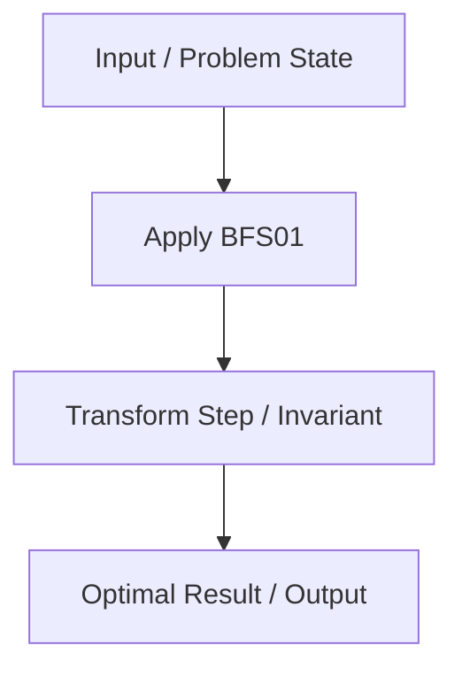

# BFS01

> **Category:** Graphs · **Tier:** Advanced Interview (Shortest Path)

---

## 🔗 Resources & Visualizers
- **YouTube:** [Watch BFS01 Visual Guide](https://www.youtube.com/results?search_query=BFS01%20algorithm%20visual%20explanation)
- **Blog / Editorial:** [CP-Algorithms / GeeksforGeeks Guide](https://www.google.com/search?q=BFS01%20algorithm%20tutorial%20CP%20algorithms)
- **Interactive Visualizer:** [VisuAlgo Interactive Simulation](https://visualgo.net/en)

---

## 🧠 Intuition & Mental Model
> [!TIP]
> **Core Concept:** 0–1 BFS is a shortest path algorithm for graphs where every edge weight is either 0 or 1.

0–1 BFS is a shortest path algorithm for graphs where every edge weight is either 0 or 1.
It uses a Deque instead of a priority queue to achieve linear time complexity.
How the Algorithm Works
Works on graphs with edge weights only 0 or 1
Uses a Deque (Double Ended Queue)
Start from source, distance[source] = 0
When relaxing an edge:
If weight = 0 → push node to front of deque
If weight = 1 → push node to back of deque
Always process the front of deque
Ensures shortest distance without Dijkstra’s overhead

---

## 🎯 When to Use & Problem Triggers
- **Trigger 1:** When the brute-force enumeration takes quadratic time or higher and a linear/logarithmic invariant exists.
- **Trigger 2:** Common patterns involving **Graphs**, subsegments, query sequences, or optimal substructures.
- **Trigger 3:** Constraints where $N \ge 10^5$ require $O(N)$ or $O(N \log N)$ performance.

---

## 📊 Visual Explanation & Dry Run



<details>
<summary>🔍 <strong>Step-by-Step Algorithm Walkthrough</strong> (Click to expand)</summary>

1. **Initialization:** Set up boundary pointers, state variables, or base auxiliary arrays.
2. **Iteration / Traversal:** Advance through the input elements while maintaining the algorithmic invariant.
3. **State Transition:** Update the current state, dynamic array, or accumulator in $O(1)$ or $O(\log N)$.
4. **Final Result:** Extract the optimal answer from the computed state or reconstructed solution.

</details>

---

## 💻 Algorithm Code (Java)

```java
import java.io.*;
import java.util.*;

class Main {

    static class Edge {
        int to;
        int wt;

        Edge(int t, int w) {
            to = t;
            wt = w;
        }
    }

    public static void main(String[] args) throws Exception {
        int n = 4;

        List<Edge>[] g = new ArrayList[n];

        for (int i = 0; i < n; i++)
            g[i] = new ArrayList<>();

        g[0].add(new Edge(1, 0));
        g[0].add(new Edge(2, 1));
        g[1].add(new Edge(2, 1));
        g[1].add(new Edge(3, 0));
        g[2].add(new Edge(3, 0));

        int[] dist = new int[n];

        Arrays.fill(dist, Integer.MAX_VALUE);

        Deque<Integer> dq = new ArrayDeque<>();

        int src = 0;
        dist[src] = 0;
        dq.addFirst(src);

        while (!dq.isEmpty()) {
            int u = dq.pollFirst();

            for (Edge e : g[u]) {
                int v = e.to;
                int w = e.wt;

                if (dist[u] + w < dist[v]) {
                    dist[v] = dist[u] + w;

                    if (w == 0)
                        dq.addFirst(v);
                    else
                        dq.addLast(v);
                }
            }
        }

        PrintWriter out = new PrintWriter(System.out);
        for (int i = 0; i < n; i++)
            out.println("Distance from 0 to " + i + " = " + dist[i]);
        out.flush();
    }
}
```

---

## ⏱️ Complexity Analysis
- **Time Complexity (TC):** Typically `O(N)` or `O(N log N)` depending on auxiliary sorting or tree operations.
- **Space Complexity (SC):** Typically `O(1)` auxiliary space or `O(N)` for auxiliary arrays/tables.

---

## 🔄 Similar & Connected Algorithms
- **Related Category:** Explore other fundamental algorithms in [Graphs](../).
- **Composite Patterns:** Often combined with Prefix Sums, Binary Search on Answer, or Dynamic Programming memoization.

---

## ⚔️ Practice Questions

### 🟡 LeetCode
- [ ] [Explore BFS01 Problems on LeetCode](https://leetcode.com/problemset/?search=BFS01%20LeetCode) — `Practice`

### 🔵 CodeChef & Codeforces
- [ ] [Practice on Codeforces Problemset](https://codeforces.com/problemset) — `Catalog`
- [ ] [Practice on CodeChef Practice Portal](https://www.codechef.com/practice) — `Catalog`
