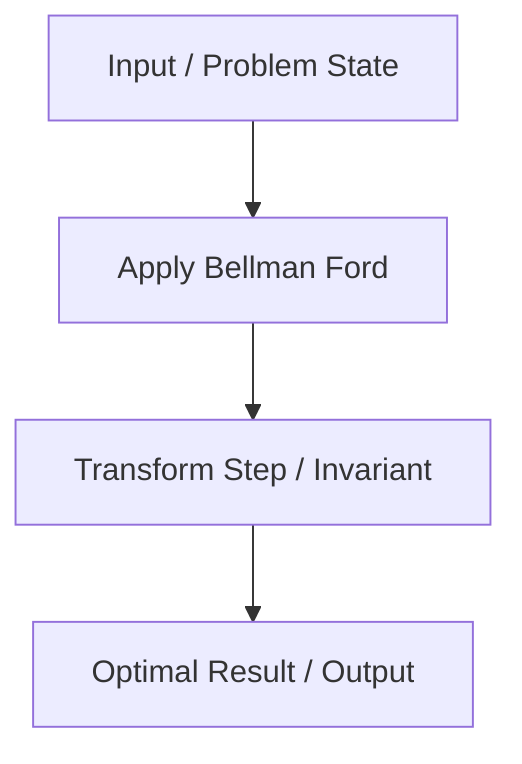

# Bellman Ford

> **Category:** Graphs · **Tier:** Core Interview (Classic)

---

## 🔗 Resources & Visualizers
- **YouTube:** [Watch Bellman Ford Visual Guide](https://www.youtube.com/results?search_query=Bellman%20Ford%20algorithm%20visual%20explanation)
- **Blog / Editorial:** [CP-Algorithms / GeeksforGeeks Guide](https://www.google.com/search?q=Bellman%20Ford%20algorithm%20tutorial%20CP%20algorithms)
- **Interactive Visualizer:** [VisuAlgo Interactive Simulation](https://visualgo.net/en)

---

## 🧠 Intuition & Mental Model
> [!TIP]
> **Core Concept:** Bellman–Ford is a single-source shortest path algorithm that works on weighted graphs.

Bellman–Ford is a single-source shortest path algorithm that works on weighted graphs.
It can handle negative edge weights and can detect negative weight cycles.
How the Algorithm Works
Initialize distance of source as 0, all other vertices as ∞
Repeat V − 1 times:
For every edge (u → v, wt)
If dist[u] + wt < dist[v], update dist[v]
Do one extra iteration:
If any distance still reduces → negative cycle exists
Reason for V − 1:
Maximum edges in shortest path without cycle = V − 1

---

## 🎯 When to Use & Problem Triggers
- **Trigger 1:** When the brute-force enumeration takes quadratic time or higher and a linear/logarithmic invariant exists.
- **Trigger 2:** Common patterns involving **Graphs**, subsegments, query sequences, or optimal substructures.
- **Trigger 3:** Constraints where $N \ge 10^5$ require $O(N)$ or $O(N \log N)$ performance.

---

## 📊 Visual Explanation & Dry Run



<details>
<summary>🔍 <strong>Step-by-Step Algorithm Walkthrough</strong> (Click to expand)</summary>

1. **Initialization:** Set up boundary pointers, state variables, or base auxiliary arrays.
2. **Iteration / Traversal:** Advance through the input elements while maintaining the algorithmic invariant.
3. **State Transition:** Update the current state, dynamic array, or accumulator in $O(1)$ or $O(\log N)$.
4. **Final Result:** Extract the optimal answer from the computed state or reconstructed solution.

</details>

---

## 💻 Algorithm Code (Java)

```java
import java.io.*;
import java.util.*;

class BellmanFord {

    static class Edge {
        int u;
        int v;
        int w;

        Edge(int u, int v, int w) {
            this.u = u;
            this.v = v;
            this.w = w;
        }
    }

    public static void main(String[] args) throws Exception {

        int V = 3;

        Edge[] edges = new Edge[3];
        edges[0] = new Edge(0, 1, 4);
        edges[1] = new Edge(0, 2, 5);
        edges[2] = new Edge(1, 2, -3);

        int src = 0;

        int[] dist = new int[V];

        Arrays.fill(dist, Integer.MAX_VALUE);

        dist[src] = 0;

        for (int i = 1; i <= V - 1; i++) {
            for (Edge e : edges) {
                if (dist[e.u] != Integer.MAX_VALUE &&
                        dist[e.u] + e.w < dist[e.v]) {
                    dist[e.v] = dist[e.u] + e.w;
                }
            }
        }

        boolean negCycle = false;

        for (Edge e : edges) {
            if (dist[e.u] != Integer.MAX_VALUE &&
                    dist[e.u] + e.w < dist[e.v]) {
                negCycle = true;
                break;
            }
        }

        if (negCycle) {
            System.out.println("Negative Weight Cycle Detected!");
        } else {
            for (int i = 0; i < V; i++) {
                System.out.println("Distance from " + src + " to " + i + " = " + dist[i]);
            }
        }
    }
}
```

---

## ⏱️ Complexity Analysis
- **Time Complexity (TC):** Typically `O(N)` or `O(N log N)` depending on auxiliary sorting or tree operations.
- **Space Complexity (SC):** Typically `O(1)` auxiliary space or `O(N)` for auxiliary arrays/tables.

---

## 🔄 Similar & Connected Algorithms
- **Related Category:** Explore other fundamental algorithms in [Graphs](../).
- **Composite Patterns:** Often combined with Prefix Sums, Binary Search on Answer, or Dynamic Programming memoization.

---

## ⚔️ Practice Questions

### 🟡 LeetCode
- [ ] [Explore Bellman Ford Problems on LeetCode](https://leetcode.com/problemset/?search=Bellman%20Ford%20LeetCode) — `Practice`

### 🔵 CodeChef & Codeforces
- [ ] [Practice on Codeforces Problemset](https://codeforces.com/problemset) — `Catalog`
- [ ] [Practice on CodeChef Practice Portal](https://www.codechef.com/practice) — `Catalog`
