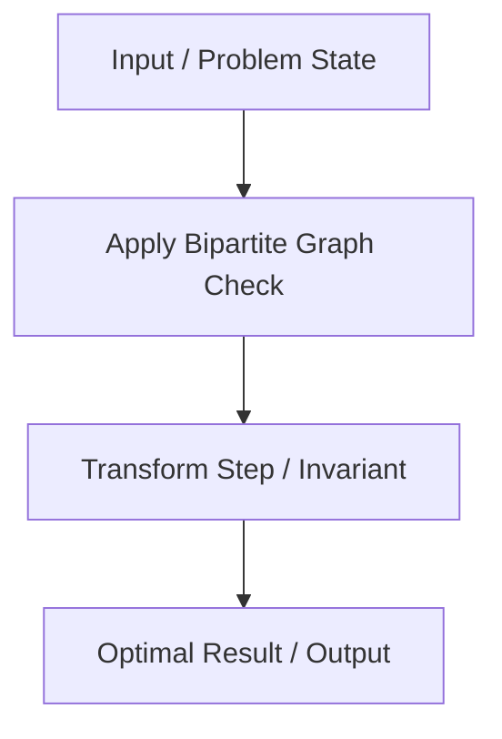

# Bipartite Graph Check

> **Category:** Graphs · **Tier:** Core Interview (High-Yield)

---

## 🔗 Resources & Visualizers
- **YouTube:** [Watch Bipartite Graph Check Visual Guide](https://www.youtube.com/results?search_query=Bipartite%20Graph%20Check%20algorithm%20visual%20explanation)
- **Blog / Editorial:** [CP-Algorithms / GeeksforGeeks Guide](https://www.google.com/search?q=Bipartite%20Graph%20Check%20algorithm%20tutorial%20CP%20algorithms)
- **Interactive Visualizer:** [VisuAlgo Interactive Simulation](https://visualgo.net/en)

---

## 🧠 Intuition & Mental Model
> [!TIP]
> **Core Concept:** A Bipartite Graph is a graph whose vertices can be divided into two disjoint sets such that no two

A Bipartite Graph is a graph whose vertices can be divided into two disjoint sets such that no two
adjacent vertices belong to the same set.
The Bipartite Graph Check algorithm verifies this by coloring the graph
using two colors and ensuring no adjacent nodes share the same color.
Algorithm Explanation
Assign a color to a starting node.
Traverse the graph using BFS.
Assign opposite colors to adjacent nodes.
If any adjacent nodes have the same color, the graph is not bipartite.

---

## 🎯 When to Use & Problem Triggers
- **Trigger 1:** When the brute-force enumeration takes quadratic time or higher and a linear/logarithmic invariant exists.
- **Trigger 2:** Common patterns involving **Graphs**, subsegments, query sequences, or optimal substructures.
- **Trigger 3:** Constraints where $N \ge 10^5$ require $O(N)$ or $O(N \log N)$ performance.

---

## 📊 Visual Explanation & Dry Run



<details>
<summary>🔍 <strong>Step-by-Step Algorithm Walkthrough</strong> (Click to expand)</summary>

1. **Initialization:** Set up boundary pointers, state variables, or base auxiliary arrays.
2. **Iteration / Traversal:** Advance through the input elements while maintaining the algorithmic invariant.
3. **State Transition:** Update the current state, dynamic array, or accumulator in $O(1)$ or $O(\log N)$.
4. **Final Result:** Extract the optimal answer from the computed state or reconstructed solution.

</details>

---

## 💻 Algorithm Code (Java)

```java
import java.io.*;
import java.util.*;

class Main {

    static boolean isBipartite(int n, List<Integer>[] g) {
        int[] col = new int[n];
        Arrays.fill(col, 0);

        for (int i = 0; i < n; i++) {
            if (col[i] != 0) continue;

            Queue<Integer> q = new ArrayDeque<>();
            q.add(i);
            col[i] = 1;

            while (!q.isEmpty()) {
                int u = q.poll();

                for (int v : g[u]) {
                    if (col[v] == 0) {
                        col[v] = -col[u];
                        q.add(v);
                    } else if (col[v] == col[u]) {
                        return false;
                    }
                }
            }
        }

        return true;
    }

    public static void main(String[] args) throws Exception {
        BufferedReader br = new BufferedReader(new InputStreamReader(System.in));
        PrintWriter out = new PrintWriter(System.out);

        int n = 4;
        List<Integer>[] g = new ArrayList[n];

        for (int i = 0; i < n; i++) g[i] = new ArrayList<>();

        g[0].add(1);
        g[1].add(0);
        g[1].add(2);
        g[2].add(1);
        g[2].add(3);
        g[3].add(2);
        g[3].add(0);
        g[0].add(3);

        out.println(isBipartite(n, g));
        out.flush();
    }
}
```

---

## ⏱️ Complexity Analysis
- **Time Complexity (TC):** Typically `O(N)` or `O(N log N)` depending on auxiliary sorting or tree operations.
- **Space Complexity (SC):** Typically `O(1)` auxiliary space or `O(N)` for auxiliary arrays/tables.

---

## 🔄 Similar & Connected Algorithms
- **Related Category:** Explore other fundamental algorithms in [Graphs](../).
- **Composite Patterns:** Often combined with Prefix Sums, Binary Search on Answer, or Dynamic Programming memoization.

---

## ⚔️ Practice Questions

### 🟡 LeetCode
- [ ] [Explore Bipartite Graph Check Problems on LeetCode](https://leetcode.com/problemset/?search=Bipartite%20Graph%20Check%20LeetCode) — `Practice`

### 🔵 CodeChef & Codeforces
- [ ] [Practice on Codeforces Problemset](https://codeforces.com/problemset) — `Catalog`
- [ ] [Practice on CodeChef Practice Portal](https://www.codechef.com/practice) — `Catalog`
