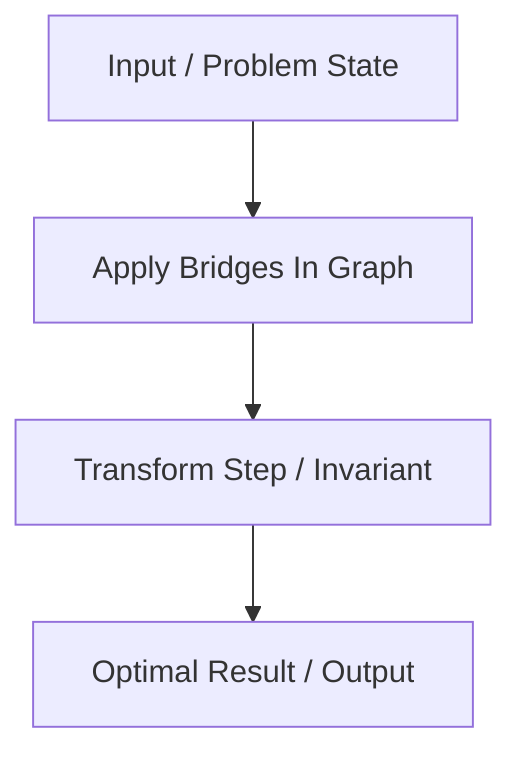

# Bridges In Graph

> **Category:** Graphs · **Tier:** Advanced Interview (Tarjan)

---

## 🔗 Resources & Visualizers
- **YouTube:** [Watch Bridges In Graph Visual Guide](https://www.youtube.com/results?search_query=Bridges%20In%20Graph%20algorithm%20visual%20explanation)
- **Blog / Editorial:** [CP-Algorithms / GeeksforGeeks Guide](https://www.google.com/search?q=Bridges%20In%20Graph%20algorithm%20tutorial%20CP%20algorithms)
- **Interactive Visualizer:** [VisuAlgo Interactive Simulation](https://visualgo.net/en)

---

## 🧠 Intuition & Mental Model
> [!TIP]
> **Core Concept:** A bridge is an edge whose removal increases the number of connected components in a graph.

A bridge is an edge whose removal increases the number of connected components in a graph.
Removing a bridge disconnects part of the graph.
Algorithm Explanation
Use DFS and track discovery time of each node.
Maintain two arrays:
tin[u] → time when node u is first visited
low[u] → earliest visited node reachable from u
For every edge u → v:
If v is not visited → DFS on v
Update low[u] = min(low[u], low[v])
If low[v] > tin[u] → edge (u, v) is a bridge
Ignore the edge going back to the parent.

---

## 🎯 When to Use & Problem Triggers
- **Trigger 1:** When the brute-force enumeration takes quadratic time or higher and a linear/logarithmic invariant exists.
- **Trigger 2:** Common patterns involving **Graphs**, subsegments, query sequences, or optimal substructures.
- **Trigger 3:** Constraints where $N \ge 10^5$ require $O(N)$ or $O(N \log N)$ performance.

---

## 📊 Visual Explanation & Dry Run



<details>
<summary>🔍 <strong>Step-by-Step Algorithm Walkthrough</strong> (Click to expand)</summary>

1. **Initialization:** Set up boundary pointers, state variables, or base auxiliary arrays.
2. **Iteration / Traversal:** Advance through the input elements while maintaining the algorithmic invariant.
3. **State Transition:** Update the current state, dynamic array, or accumulator in $O(1)$ or $O(\log N)$.
4. **Final Result:** Extract the optimal answer from the computed state or reconstructed solution.

</details>

---

## 💻 Algorithm Code (Java)

```java
import java.util.*;

class Main {

    static int n = 5;
    static ArrayList<Integer>[] g;
    static int[] tin, low;
    static boolean[] vis;
    static int timer = 0;

    static void dfs(int u, int p) {
        vis[u] = true;
        tin[u] = low[u] = timer++;

        for (int v : g[u]) {
            if (v == p) continue;

            if (!vis[v]) {
                dfs(v, u);
                low[u] = Math.min(low[u], low[v]);

                if (low[v] > tin[u])
                    System.out.println(u + " - " + v + " is a bridge");
            } else {
                low[u] = Math.min(low[u], tin[v]);
            }
        }
    }

    public static void main(String[] args) throws Exception {
        g = new ArrayList[n];
        for (int i = 0; i < n; i++) g[i] = new ArrayList<>();

        g[0].add(1);
        g[1].add(0);
        g[1].add(2);
        g[2].add(1);
        g[1].add(3);
        g[3].add(1);
        g[3].add(4);
        g[4].add(3);

        tin = new int[n];
        low = new int[n];
        vis = new boolean[n];

        dfs(0, -1);
    }
}
```

---

## ⏱️ Complexity Analysis
- **Time Complexity (TC):** Typically `O(N)` or `O(N log N)` depending on auxiliary sorting or tree operations.
- **Space Complexity (SC):** Typically `O(1)` auxiliary space or `O(N)` for auxiliary arrays/tables.

---

## 🔄 Similar & Connected Algorithms
- **Related Category:** Explore other fundamental algorithms in [Graphs](../).
- **Composite Patterns:** Often combined with Prefix Sums, Binary Search on Answer, or Dynamic Programming memoization.

---

## ⚔️ Practice Questions

### 🟡 LeetCode
- [ ] [Explore Bridges In Graph Problems on LeetCode](https://leetcode.com/problemset/?search=Bridges%20In%20Graph%20LeetCode) — `Practice`

### 🔵 CodeChef & Codeforces
- [ ] [Practice on Codeforces Problemset](https://codeforces.com/problemset) — `Catalog`
- [ ] [Practice on CodeChef Practice Portal](https://www.codechef.com/practice) — `Catalog`
