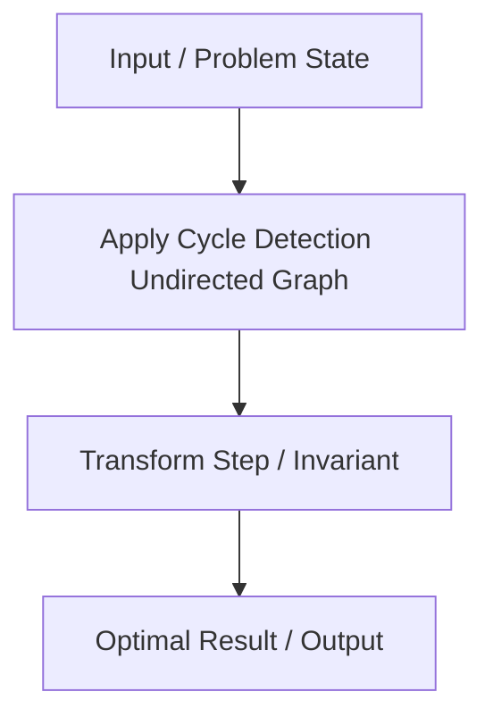

# Cycle Detection Undirected Graph

> **Category:** Graphs · **Tier:** Core Interview (High-Yield)

---

## 🔗 Resources & Visualizers
- **YouTube:** [Watch Cycle Detection Undirected Graph Visual Guide](https://www.youtube.com/results?search_query=Cycle%20Detection%20Undirected%20Graph%20algorithm%20visual%20explanation)
- **Blog / Editorial:** [CP-Algorithms / GeeksforGeeks Guide](https://www.google.com/search?q=Cycle%20Detection%20Undirected%20Graph%20algorithm%20tutorial%20CP%20algorithms)
- **Interactive Visualizer:** [VisuAlgo Interactive Simulation](https://visualgo.net/en)

---

## 🧠 Intuition & Mental Model
> [!TIP]
> **Core Concept:** Cycle detection in an undirected graph checks whether

Cycle detection in an undirected graph checks whether
there exists a path that starts and ends at the same node without reusing an edge.
It is commonly solved using DFS with parent tracking.
Algorithm Explanation
Traverse the graph using DFS.
Maintain a visited[] array to track visited nodes.
For every node, pass its parent in DFS.
If an adjacent node is:
Not visited → DFS recursively.
Visited and not parent → Cycle detected.
If DFS finishes without such a case → No cycle.

---

## 🎯 When to Use & Problem Triggers
- **Trigger 1:** When the brute-force enumeration takes quadratic time or higher and a linear/logarithmic invariant exists.
- **Trigger 2:** Common patterns involving **Graphs**, subsegments, query sequences, or optimal substructures.
- **Trigger 3:** Constraints where $N \ge 10^5$ require $O(N)$ or $O(N \log N)$ performance.

---

## 📊 Visual Explanation & Dry Run



<details>
<summary>🔍 <strong>Step-by-Step Algorithm Walkthrough</strong> (Click to expand)</summary>

1. **Initialization:** Set up boundary pointers, state variables, or base auxiliary arrays.
2. **Iteration / Traversal:** Advance through the input elements while maintaining the algorithmic invariant.
3. **State Transition:** Update the current state, dynamic array, or accumulator in $O(1)$ or $O(\log N)$.
4. **Final Result:** Extract the optimal answer from the computed state or reconstructed solution.

</details>

---

## 💻 Algorithm Code (Java)

```java
import java.io.*;
import java.util.*;

class CycleDetectionUndirected {

    static boolean[] visited;
    static int[][] g;

    static boolean dfs(int u, int parent) {
        visited[u] = true;
        for (int v : g[u]) {
            if (!visited[v]) {
                if (dfs(v, u)) return true;
            } else if (v != parent) {
                return true;
            }
        }

        return false;
    }

    public static void main(String[] args) throws Exception {

        g = new int[][]{
                {1, 3},
                {0, 2},
                {1, 3},
                {0, 2}
        };

        visited = new boolean[4];

        boolean cycle = false;

        for (int i = 0; i < 4; i++) {
            if (!visited[i]) {
                if (dfs(i, -1)) {
                    cycle = true;
                    break;
                }
            }
        }

        System.out.println(cycle ? "Cycle Detected" : "No Cycle");
    }
}
```

---

## ⏱️ Complexity Analysis
- **Time Complexity (TC):** Typically `O(N)` or `O(N log N)` depending on auxiliary sorting or tree operations.
- **Space Complexity (SC):** Typically `O(1)` auxiliary space or `O(N)` for auxiliary arrays/tables.

---

## 🔄 Similar & Connected Algorithms
- **Related Category:** Explore other fundamental algorithms in [Graphs](../).
- **Composite Patterns:** Often combined with Prefix Sums, Binary Search on Answer, or Dynamic Programming memoization.

---

## ⚔️ Practice Questions

### 🟡 LeetCode
- [ ] [Explore Cycle Detection Undirected Graph Problems on LeetCode](https://leetcode.com/problemset/?search=Cycle%20Detection%20Undirected%20Graph%20LeetCode) — `Practice`

### 🔵 CodeChef & Codeforces
- [ ] [Practice on Codeforces Problemset](https://codeforces.com/problemset) — `Catalog`
- [ ] [Practice on CodeChef Practice Portal](https://www.codechef.com/practice) — `Catalog`
