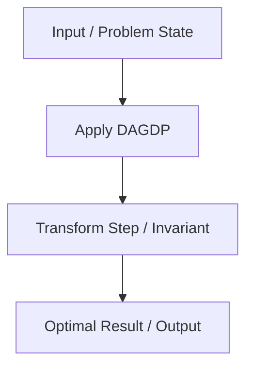

# DAGDP

> **Category:** Graphs · **Tier:** Advanced Interview (Optimization)

---

## 🔗 Resources & Visualizers
- **YouTube:** [Watch DAGDP Visual Guide](https://www.youtube.com/results?search_query=DAGDP%20algorithm%20visual%20explanation)
- **Blog / Editorial:** [CP-Algorithms / GeeksforGeeks Guide](https://www.google.com/search?q=DAGDP%20algorithm%20tutorial%20CP%20algorithms)
- **Interactive Visualizer:** [VisuAlgo Interactive Simulation](https://visualgo.net/en)

---

## 🧠 Intuition & Mental Model
> [!TIP]
> **Core Concept:** DAG DP is a dynamic programming technique applied on a Directed Acyclic Graph,

DAG DP is a dynamic programming technique applied on a Directed Acyclic Graph,
where each node’s value depends on its predecessors.
Since there are no cycles, nodes can be processed in topological order,
ensuring subproblems are solved before being used.
Algorithm Explanation
Perform Topological Sort of the DAG
Initialize DP array for each node
Traverse nodes in topological order
Relax edges and update DP values using transitions

---

## 🎯 When to Use & Problem Triggers
- **Trigger 1:** When the brute-force enumeration takes quadratic time or higher and a linear/logarithmic invariant exists.
- **Trigger 2:** Common patterns involving **Graphs**, subsegments, query sequences, or optimal substructures.
- **Trigger 3:** Constraints where $N \ge 10^5$ require $O(N)$ or $O(N \log N)$ performance.

---

## 📊 Visual Explanation & Dry Run



<details>
<summary>🔍 <strong>Step-by-Step Algorithm Walkthrough</strong> (Click to expand)</summary>

1. **Initialization:** Set up boundary pointers, state variables, or base auxiliary arrays.
2. **Iteration / Traversal:** Advance through the input elements while maintaining the algorithmic invariant.
3. **State Transition:** Update the current state, dynamic array, or accumulator in $O(1)$ or $O(\log N)$.
4. **Final Result:** Extract the optimal answer from the computed state or reconstructed solution.

</details>

---

## 💻 Algorithm Code (Java)

```java
import java.io.*;
import java.util.*;

class Main {

    static class Edge {
        int v, w;

        Edge(int v, int w) {
            this.v = v;
            this.w = w;
        }
    }

    static void dfs(int u, boolean[] vis, Stack<Integer> st, List<Edge>[] g) {
        vis[u] = true;
        for (Edge e : g[u]) {
            if (!vis[e.v])
                dfs(e.v, vis, st, g);

        }

        st.push(u);
    }

    public static void main(String[] args) throws Exception {
        BufferedReader br = new BufferedReader(new InputStreamReader(System.in));
        PrintWriter out = new PrintWriter(System.out);

        int n = 6;
        int m = 7;

        List<Edge>[] g = new ArrayList[n];
        for (int i = 0; i < n; i++)
            g[i] = new ArrayList<>();

        g[0].add(new Edge(1, 5));
        g[0].add(new Edge(2, 3));
        g[1].add(new Edge(3, 6));
        g[1].add(new Edge(2, 2));
        g[2].add(new Edge(4, 4));
        g[2].add(new Edge(5, 2));
        g[2].add(new Edge(3, 7));

        boolean[] vis = new boolean[n];
        Stack<Integer> st = new Stack<>();

        for (int i = 0; i < n; i++)
            if (!vis[i])
                dfs(i, vis, st, g);

        int[] dp = new int[n];
        Arrays.fill(dp, Integer.MIN_VALUE);
        dp[0] = 0;

        while (!st.isEmpty()) {
            int u = st.pop();
            if (dp[u] != Integer.MIN_VALUE) {
                for (Edge e : g[u]) {
                    dp[e.v] = Math.max(dp[e.v], dp[u] + e.w);
                }
            }
        }

        for (int i = 0; i < n; i++)
            out.println("Longest path to node " + i + " = " + dp[i]);

        out.flush();
    }
}
```

---

## ⏱️ Complexity Analysis
- **Time Complexity (TC):** Typically `O(N)` or `O(N log N)` depending on auxiliary sorting or tree operations.
- **Space Complexity (SC):** Typically `O(1)` auxiliary space or `O(N)` for auxiliary arrays/tables.

---

## 🔄 Similar & Connected Algorithms
- **Related Category:** Explore other fundamental algorithms in [Graphs](../).
- **Composite Patterns:** Often combined with Prefix Sums, Binary Search on Answer, or Dynamic Programming memoization.

---

## ⚔️ Practice Questions

### 🟡 LeetCode
- [ ] [Explore DAGDP Problems on LeetCode](https://leetcode.com/problemset/?search=DAGDP%20LeetCode) — `Practice`

### 🔵 CodeChef & Codeforces
- [ ] [Practice on Codeforces Problemset](https://codeforces.com/problemset) — `Catalog`
- [ ] [Practice on CodeChef Practice Portal](https://www.codechef.com/practice) — `Catalog`
