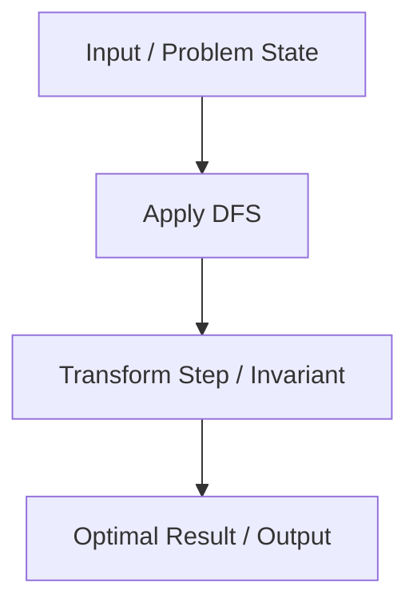

# DFS

> **Category:** Graphs · **Tier:** Core Interview (Essential)

---

## 🔗 Resources & Visualizers
- **YouTube:** [Watch DFS Visual Guide](https://www.youtube.com/results?search_query=DFS%20algorithm%20visual%20explanation)
- **Blog / Editorial:** [CP-Algorithms / GeeksforGeeks Guide](https://www.google.com/search?q=DFS%20algorithm%20tutorial%20CP%20algorithms)
- **Interactive Visualizer:** [VisuAlgo Interactive Simulation](https://visualgo.net/en)

---

## 🧠 Intuition & Mental Model
> [!TIP]
> **Core Concept:** Depth First Search (DFS) is a graph traversal algorithm

Depth First Search (DFS) is a graph traversal algorithm
that explores as far as possible along one path before backtracking.
It uses recursion or an explicit stack to visit nodes deeply.
DFS Algorithm
Start from a source node
Mark the current node as visited
Process the current node
Recursively visit all unvisited neighbors one by one
Backtrack when no unvisited neighbor is left

---

## 🎯 When to Use & Problem Triggers
- **Trigger 1:** When the brute-force enumeration takes quadratic time or higher and a linear/logarithmic invariant exists.
- **Trigger 2:** Common patterns involving **Graphs**, subsegments, query sequences, or optimal substructures.
- **Trigger 3:** Constraints where $N \ge 10^5$ require $O(N)$ or $O(N \log N)$ performance.

---

## 📊 Visual Explanation & Dry Run



<details>
<summary>🔍 <strong>Step-by-Step Algorithm Walkthrough</strong> (Click to expand)</summary>

1. **Initialization:** Set up boundary pointers, state variables, or base auxiliary arrays.
2. **Iteration / Traversal:** Advance through the input elements while maintaining the algorithmic invariant.
3. **State Transition:** Update the current state, dynamic array, or accumulator in $O(1)$ or $O(\log N)$.
4. **Final Result:** Extract the optimal answer from the computed state or reconstructed solution.

</details>

---

## 💻 Algorithm Code (Java)

```java
import java.io.*;
import java.util.*;

class Main {

    static ArrayList<Integer>[] g;
    static boolean[] vis;

    static void dfs(int u) {
        vis[u] = true;
        System.out.print(u + " ");

        for (int v : g[u]) {
            if (!vis[v]) {
                dfs(v);
            }
        }
    }

    public static void main(String[] args) throws Exception {
        int n = 4;

        g = new ArrayList[n];
        for (int i = 0; i < n; i++)
            g[i] = new ArrayList<>();

            g[0].add(1);
            g[0].add(2);
            g[1].add(3);

            vis = new boolean[n];

            dfs(0);
        }
    }
```

---

## ⏱️ Complexity Analysis
- **Time Complexity (TC):** Typically `O(N)` or `O(N log N)` depending on auxiliary sorting or tree operations.
- **Space Complexity (SC):** Typically `O(1)` auxiliary space or `O(N)` for auxiliary arrays/tables.

---

## 🔄 Similar & Connected Algorithms
- **Related Category:** Explore other fundamental algorithms in [Graphs](../).
- **Composite Patterns:** Often combined with Prefix Sums, Binary Search on Answer, or Dynamic Programming memoization.

---

## ⚔️ Practice Questions

### 🟡 LeetCode
- [ ] [Explore DFS Problems on LeetCode](https://leetcode.com/problemset/?search=DFS%20LeetCode) — `Practice`

### 🔵 CodeChef & Codeforces
- [ ] [Practice on Codeforces Problemset](https://codeforces.com/problemset) — `Catalog`
- [ ] [Practice on CodeChef Practice Portal](https://www.codechef.com/practice) — `Catalog`
