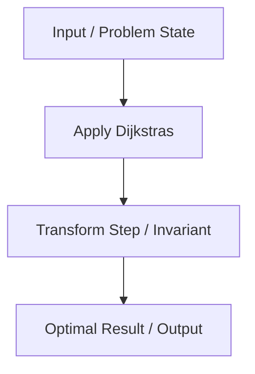

# Dijkstras

> **Category:** Graphs · **Tier:** Core Interview (Essential)

---

## 🔗 Resources & Visualizers
- **YouTube:** [Watch Dijkstras Visual Guide](https://www.youtube.com/results?search_query=Dijkstras%20algorithm%20visual%20explanation)
- **Blog / Editorial:** [CP-Algorithms / GeeksforGeeks Guide](https://www.google.com/search?q=Dijkstras%20algorithm%20tutorial%20CP%20algorithms)
- **Interactive Visualizer:** [VisuAlgo Interactive Simulation](https://visualgo.net/en)

---

## 🧠 Intuition & Mental Model
> [!TIP]
> **Core Concept:** Dijkstra’s Algorithm finds the shortest path from a

Dijkstra’s Algorithm finds the shortest path from a
single source to all other nodes in a graph with non-negative edge weights.
It greedily expands the nearest unvisited node.
Algorithm
Initialize all distances as infinity
Set source distance = 0
Use PriorityQueue to always pick node with minimum distance
Relax all adjacent edges
Update distance if a shorter path is found
Repeat until all nodes are processed

---

## 🎯 When to Use & Problem Triggers
- **Trigger 1:** When the brute-force enumeration takes quadratic time or higher and a linear/logarithmic invariant exists.
- **Trigger 2:** Common patterns involving **Graphs**, subsegments, query sequences, or optimal substructures.
- **Trigger 3:** Constraints where $N \ge 10^5$ require $O(N)$ or $O(N \log N)$ performance.

---

## 📊 Visual Explanation & Dry Run



<details>
<summary>🔍 <strong>Step-by-Step Algorithm Walkthrough</strong> (Click to expand)</summary>

1. **Initialization:** Set up boundary pointers, state variables, or base auxiliary arrays.
2. **Iteration / Traversal:** Advance through the input elements while maintaining the algorithmic invariant.
3. **State Transition:** Update the current state, dynamic array, or accumulator in $O(1)$ or $O(\log N)$.
4. **Final Result:** Extract the optimal answer from the computed state or reconstructed solution.

</details>

---

## 💻 Algorithm Code (Java)

```java
import java.io.*;
import java.util.*;

class Main {

    static class Edge {
        int v, w;

        Edge(int v, int w) {
            this.v = v;
            this.w = w;
        }
    }

    public static void main(String[] args) throws Exception {
        int n = 5;

        List<Edge>[] g = new ArrayList[n];
        for (int i = 0; i < n; i++) g[i] = new ArrayList<>();

        g[0].add(new Edge(1, 2)); // edge 0 -> 1 with weight 2
        g[0].add(new Edge(2, 4)); // edge 0 -> 2 with weight 4
        g[1].add(new Edge(2, 1)); // edge 1 -> 2 with weight 1
        g[1].add(new Edge(3, 7)); // edge 1 -> 3 with weight 7
        g[2].add(new Edge(4, 3)); // edge 2 -> 4 with weight 3
        g[3].add(new Edge(4, 1)); // edge 3 -> 4 with weight 1

        int[] dist = new int[n];
        Arrays.fill(dist, Integer.MAX_VALUE);

        PriorityQueue<int[]> pq = new PriorityQueue<>(
                (a, b) -> a[1] - b[1]
        );

        dist[0] = 0;
        pq.add(new int[]{
                0, 0
        });

        while (!pq.isEmpty()) {
            int[] curr = pq.poll();
            int u = curr[0];
            int d = curr[1];

            if (d > dist[u]) continue;

            for (Edge e : g[u]) {
                int v = e.v;
                int w = e.w;

                if (dist[u] + w < dist[v]) {
                    dist[v] = dist[u] + w;
                    pq.add(new int[]{
                            v, dist[v]
                    });
                }
            }
        }

        for (int i = 0; i < n; i++) {
            System.out.println("0 -> " + i + " = " + dist[i]);
        }
    }
}
```

---

## ⏱️ Complexity Analysis
- **Time Complexity (TC):** Typically `O(N)` or `O(N log N)` depending on auxiliary sorting or tree operations.
- **Space Complexity (SC):** Typically `O(1)` auxiliary space or `O(N)` for auxiliary arrays/tables.

---

## 🔄 Similar & Connected Algorithms
- **Related Category:** Explore other fundamental algorithms in [Graphs](../).
- **Composite Patterns:** Often combined with Prefix Sums, Binary Search on Answer, or Dynamic Programming memoization.

---

## ⚔️ Practice Questions

### 🟡 LeetCode
- [ ] [743. Network Delay Time](https://leetcode.com/problems/network-delay-time/) — `Medium`
- [ ] [1514. Path with Maximum Probability](https://leetcode.com/problems/path-with-maximum-probability/) — `Medium`
- [ ] [787. Cheapest Flights Within K Stops](https://leetcode.com/problems/cheapest-flights-within-k-stops/) — `Medium`

### 🔵 CodeChef & Codeforces
- [ ] [20C - Dijkstra?](https://codeforces.com/problemset/problem/20/C) — `1900`
