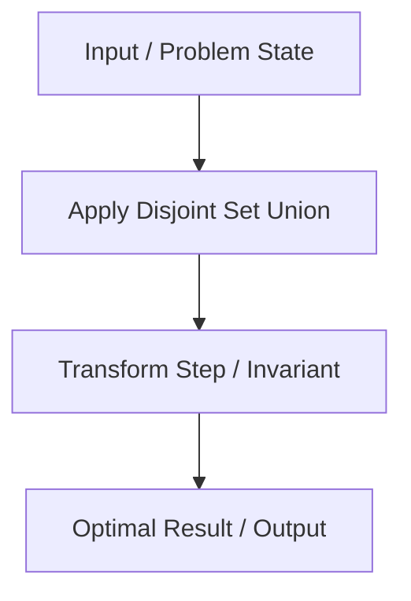

# Disjoint Set Union

> **Category:** Graphs · **Tier:** Core Interview (Essential)

---

## 🔗 Resources & Visualizers
- **YouTube:** [Watch Disjoint Set Union Visual Guide](https://www.youtube.com/results?search_query=Disjoint%20Set%20Union%20algorithm%20visual%20explanation)
- **Blog / Editorial:** [CP-Algorithms / GeeksforGeeks Guide](https://www.google.com/search?q=Disjoint%20Set%20Union%20algorithm%20tutorial%20CP%20algorithms)
- **Interactive Visualizer:** [VisuAlgo Interactive Simulation](https://visualgo.net/en)

---

## 🧠 Intuition & Mental Model
> [!TIP]
> **Core Concept:** Union Find (Disjoint Set Union – DSU) is a data structure used to

Union Find (Disjoint Set Union – DSU) is a data structure used to
track connected components in a graph.
It supports fast union (merge sets) and find
(check parent / connectivity) operations.
How the Algorithm Works
Each node initially belongs to its own set
Every set has a representative (parent/root)
Find(x)
Follows parent pointers to reach the root
Uses path compression to flatten the structure
Union(a, b)
Finds roots of a and b
Attaches smaller tree under larger tree (union by rank)
Used heavily in cycle detection, connected components, Kruskal’s MST

---

## 🎯 When to Use & Problem Triggers
- **Trigger 1:** When the brute-force enumeration takes quadratic time or higher and a linear/logarithmic invariant exists.
- **Trigger 2:** Common patterns involving **Graphs**, subsegments, query sequences, or optimal substructures.
- **Trigger 3:** Constraints where $N \ge 10^5$ require $O(N)$ or $O(N \log N)$ performance.

---

## 📊 Visual Explanation & Dry Run



<details>
<summary>🔍 <strong>Step-by-Step Algorithm Walkthrough</strong> (Click to expand)</summary>

1. **Initialization:** Set up boundary pointers, state variables, or base auxiliary arrays.
2. **Iteration / Traversal:** Advance through the input elements while maintaining the algorithmic invariant.
3. **State Transition:** Update the current state, dynamic array, or accumulator in $O(1)$ or $O(\log N)$.
4. **Final Result:** Extract the optimal answer from the computed state or reconstructed solution.

</details>

---

## 💻 Algorithm Code (Java)

```java
import java.io.*;
import java.util.*;

class Main {

    static int[] parent;
    static int[] rank;

    static int find(int x) {
        if (parent[x] != x) {
            parent[x] = find(parent[x]);
        }

        return parent[x];
    }

    static void union(int a, int b) {
        int rootA = find(a);
        int rootB = find(b);

        if (rootA == rootB) return;

        if (rank[rootA] < rank[rootB]) {
            parent[rootA] = rootB;
        } else if (rank[rootA] > rank[rootB]) {
            parent[rootB] = rootA;
        } else {
            parent[rootB] = rootA;
            rank[rootA]++;
        }
    }

    public static void main(String[] args) throws Exception {

        int n = 5;

        parent = new int[n];
        rank = new int[n];

        for (int i = 0; i < n; i++) {
            parent[i] = i;
            rank[i] = 0;
        }

        union(0, 1);
        union(1, 2);
        union(3, 4);

        System.out.println(find(0) == find(2));
        System.out.println(find(0) == find(4));
    }
}
```

---

## ⏱️ Complexity Analysis
- **Time Complexity (TC):** Typically `O(N)` or `O(N log N)` depending on auxiliary sorting or tree operations.
- **Space Complexity (SC):** Typically `O(1)` auxiliary space or `O(N)` for auxiliary arrays/tables.

---

## 🔄 Similar & Connected Algorithms
- **Related Category:** Explore other fundamental algorithms in [Graphs](../).
- **Composite Patterns:** Often combined with Prefix Sums, Binary Search on Answer, or Dynamic Programming memoization.

---

## ⚔️ Practice Questions

### 🟡 LeetCode
- [ ] [684. Redundant Connection](https://leetcode.com/problems/redundant-connection/) — `Medium`
- [ ] [200. Number of Islands](https://leetcode.com/problems/number-of-islands/) — `Medium`
- [ ] [128. Longest Consecutive Sequence](https://leetcode.com/problems/longest-consecutive-sequence/) — `Medium`

### 🔵 CodeChef & Codeforces
- [ ] [25D - Roads not only in Berland](https://codeforces.com/problemset/problem/25/D) — `1900`
