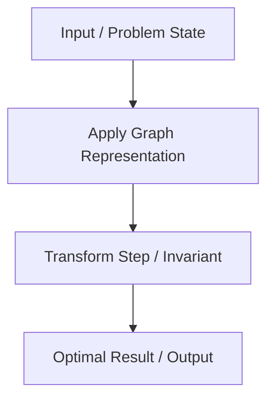

# Graph Representation

> **Category:** Graphs · **Tier:** Core Interview (Essential)

---

## 🔗 Resources & Visualizers
- **YouTube:** [Watch Graph Representation Visual Guide](https://www.youtube.com/results?search_query=Graph%20Representation%20algorithm%20visual%20explanation)
- **Blog / Editorial:** [CP-Algorithms / GeeksforGeeks Guide](https://www.google.com/search?q=Graph%20Representation%20algorithm%20tutorial%20CP%20algorithms)
- **Interactive Visualizer:** [VisuAlgo Interactive Simulation](https://visualgo.net/en)

---

## 🧠 Intuition & Mental Model
> [!TIP]
> **Core Concept:** Graph representation is the way we store vertices and

Graph representation is the way we store vertices and
edges in memory so that graph algorithms can efficiently
traverse and process connections.
The two most common forms are Adjacency List and Adjacency Matrix.
How the Algorithm (Adjacency List) Works
Each node (vertex) is given an index (0 to V-1)
For every node, we maintain a list of its directly connected neighbors
When an edge u → v exists:
Add v to u’s list
If graph is undirected, also add u to v’s list
This structure allows:
Fast traversal of neighbors
Memory efficiency for sparse graphs
Example Graph
Vertices = 3 → {0, 1, 2}
Edges = (0-1), (0-2)

---

## 🎯 When to Use & Problem Triggers
- **Trigger 1:** When the brute-force enumeration takes quadratic time or higher and a linear/logarithmic invariant exists.
- **Trigger 2:** Common patterns involving **Graphs**, subsegments, query sequences, or optimal substructures.
- **Trigger 3:** Constraints where $N \ge 10^5$ require $O(N)$ or $O(N \log N)$ performance.

---

## 📊 Visual Explanation & Dry Run



<details>
<summary>🔍 <strong>Step-by-Step Algorithm Walkthrough</strong> (Click to expand)</summary>

1. **Initialization:** Set up boundary pointers, state variables, or base auxiliary arrays.
2. **Iteration / Traversal:** Advance through the input elements while maintaining the algorithmic invariant.
3. **State Transition:** Update the current state, dynamic array, or accumulator in $O(1)$ or $O(\log N)$.
4. **Final Result:** Extract the optimal answer from the computed state or reconstructed solution.

</details>

---

## 💻 Algorithm Code (Java)

```java
import java.io.*;
import java.util.*;

class Main {
    public static void main(String[] args) throws Exception {
        int V = 3;
        List<Integer>[] g = new ArrayList[V];

        for (int i = 0; i < V; i++) {
            g[i] = new ArrayList<>();
        }

        g[0].add(1);
        g[1].add(0);
        g[0].add(2);
        g[2].add(0);

        PrintWriter out = new PrintWriter(System.out);

        for (int i = 0; i < V; i++) {
            out.print(i + " -> ");
            for (int x : g[i]) {
                out.print(x + " ");
            }

            out.println();
        }

        out.flush();
    }
}
```

---

## ⏱️ Complexity Analysis
- **Time Complexity (TC):** Typically `O(N)` or `O(N log N)` depending on auxiliary sorting or tree operations.
- **Space Complexity (SC):** Typically `O(1)` auxiliary space or `O(N)` for auxiliary arrays/tables.

---

## 🔄 Similar & Connected Algorithms
- **Related Category:** Explore other fundamental algorithms in [Graphs](../).
- **Composite Patterns:** Often combined with Prefix Sums, Binary Search on Answer, or Dynamic Programming memoization.

---

## ⚔️ Practice Questions

### 🟡 LeetCode
- [ ] [Explore Graph Representation Problems on LeetCode](https://leetcode.com/problemset/?search=Graph%20Representation%20LeetCode) — `Practice`

### 🔵 CodeChef & Codeforces
- [ ] [Practice on Codeforces Problemset](https://codeforces.com/problemset) — `Catalog`
- [ ] [Practice on CodeChef Practice Portal](https://www.codechef.com/practice) — `Catalog`
