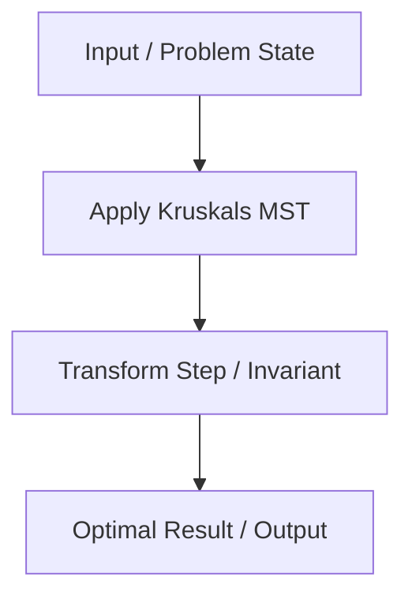

# Kruskals MST

> **Category:** Graphs · **Tier:** Core Interview (High-Yield)

---

## 🔗 Resources & Visualizers
- **YouTube:** [Watch Kruskals MST Visual Guide](https://www.youtube.com/results?search_query=Kruskals%20MST%20algorithm%20visual%20explanation)
- **Blog / Editorial:** [CP-Algorithms / GeeksforGeeks Guide](https://www.google.com/search?q=Kruskals%20MST%20algorithm%20tutorial%20CP%20algorithms)
- **Interactive Visualizer:** [VisuAlgo Interactive Simulation](https://visualgo.net/en)

---

## 🧠 Intuition & Mental Model
> [!TIP]
> **Core Concept:** Kruskal’s Algorithm is a greedy algorithm used to find the Minimum

Kruskal’s Algorithm is a greedy algorithm used to find the Minimum
Spanning Tree (MST) of a weighted, undirected graph.
It selects edges in increasing weight order, avoiding cycles
using Disjoint Set Union (DSU).
Algorithm Explanation
Sort all graph edges by ascending weight
Initialize DSU (Union-Find) for cycle detection
Pick the smallest edge
If it connects two different components, include it in MST
Union those components
Repeat until V − 1 edges are selected

---

## 🎯 When to Use & Problem Triggers
- **Trigger 1:** When the brute-force enumeration takes quadratic time or higher and a linear/logarithmic invariant exists.
- **Trigger 2:** Common patterns involving **Graphs**, subsegments, query sequences, or optimal substructures.
- **Trigger 3:** Constraints where $N \ge 10^5$ require $O(N)$ or $O(N \log N)$ performance.

---

## 📊 Visual Explanation & Dry Run



<details>
<summary>🔍 <strong>Step-by-Step Algorithm Walkthrough</strong> (Click to expand)</summary>

1. **Initialization:** Set up boundary pointers, state variables, or base auxiliary arrays.
2. **Iteration / Traversal:** Advance through the input elements while maintaining the algorithmic invariant.
3. **State Transition:** Update the current state, dynamic array, or accumulator in $O(1)$ or $O(\log N)$.
4. **Final Result:** Extract the optimal answer from the computed state or reconstructed solution.

</details>

---

## 💻 Algorithm Code (Java)

```java
import java.util.*;

class KruskalMST {

    static class Edge implements Comparable<Edge> {
        int u, v, w;

        Edge(int u, int v, int w) {
            this.u = u;
            this.v = v;
            this.w = w;
        }

        public int compareTo(Edge e) {
            return this.w - e.w;
        }
    }

    static int[] parent;

    static int find(int x) {
        if (parent[x] == x) return x;
        return parent[x] = find(parent[x]);
    }

    static void union(int a, int b) {
        int pa = find(a);
        int pb = find(b);
        if (pa != pb) parent[pb] = pa;
    }

    public static void main(String[] args) {

        int V = 4;

        Edge[] edges = {
                new Edge(0, 1, 10),
                new Edge(0, 2, 6),
                new Edge(0, 3, 5),
                new Edge(1, 3, 15),
                new Edge(2, 3, 4)
        };

        Arrays.sort(edges);

        parent = new int[V];
        for (int i = 0; i < V; i++) parent[i] = i;

        int mstCost = 0;
        int edgeCount = 0;

        for (Edge e : edges) {
            if (find(e.u) != find(e.v)) {
                mstCost += e.w;
                union(e.u, e.v);
                edgeCount++;
                if (edgeCount == V - 1) break;
            }
        }

        System.out.println("MST Cost = " + mstCost);
    }
}
```

---

## ⏱️ Complexity Analysis
- **Time Complexity (TC):** Typically `O(N)` or `O(N log N)` depending on auxiliary sorting or tree operations.
- **Space Complexity (SC):** Typically `O(1)` auxiliary space or `O(N)` for auxiliary arrays/tables.

---

## 🔄 Similar & Connected Algorithms
- **Related Category:** Explore other fundamental algorithms in [Graphs](../).
- **Composite Patterns:** Often combined with Prefix Sums, Binary Search on Answer, or Dynamic Programming memoization.

---

## ⚔️ Practice Questions

### 🟡 LeetCode
- [ ] [Explore Kruskals MST Problems on LeetCode](https://leetcode.com/problemset/?search=Kruskals%20MST%20LeetCode) — `Practice`

### 🔵 CodeChef & Codeforces
- [ ] [Practice on Codeforces Problemset](https://codeforces.com/problemset) — `Catalog`
- [ ] [Practice on CodeChef Practice Portal](https://www.codechef.com/practice) — `Catalog`
