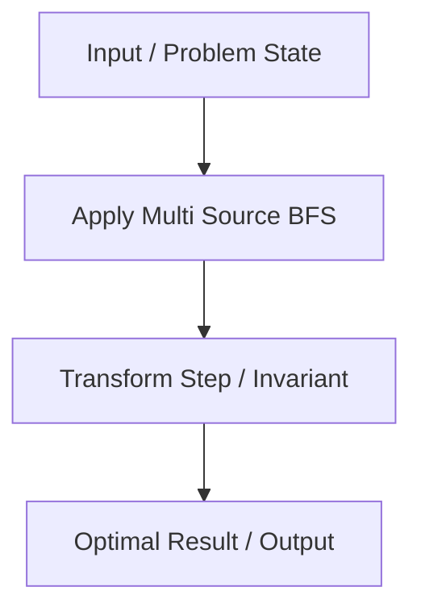

# Multi Source BFS

> **Category:** Graphs · **Tier:** Core Interview (High-Yield)

---

## 🔗 Resources & Visualizers
- **YouTube:** [Watch Multi Source BFS Visual Guide](https://www.youtube.com/results?search_query=Multi%20Source%20BFS%20algorithm%20visual%20explanation)
- **Blog / Editorial:** [CP-Algorithms / GeeksforGeeks Guide](https://www.google.com/search?q=Multi%20Source%20BFS%20algorithm%20tutorial%20CP%20algorithms)
- **Interactive Visualizer:** [VisuAlgo Interactive Simulation](https://visualgo.net/en)

---

## 🧠 Intuition & Mental Model
> [!TIP]
> **Core Concept:** Multi-Source BFS is a BFS where traversal starts simultaneously from multiple source nodes.

Multi-Source BFS is a BFS where traversal starts simultaneously from multiple source nodes.
It computes the minimum distance from the nearest source to
every node in an unweighted graph.
Algorithm Explanation
Put all source nodes into the queue initially
Mark all sources as visited with distance 0
Perform normal BFS
Every node is reached from the closest source first
BFS guarantees minimum distance because graph is unweighted

---

## 🎯 When to Use & Problem Triggers
- **Trigger 1:** When the brute-force enumeration takes quadratic time or higher and a linear/logarithmic invariant exists.
- **Trigger 2:** Common patterns involving **Graphs**, subsegments, query sequences, or optimal substructures.
- **Trigger 3:** Constraints where $N \ge 10^5$ require $O(N)$ or $O(N \log N)$ performance.

---

## 📊 Visual Explanation & Dry Run



<details>
<summary>🔍 <strong>Step-by-Step Algorithm Walkthrough</strong> (Click to expand)</summary>

1. **Initialization:** Set up boundary pointers, state variables, or base auxiliary arrays.
2. **Iteration / Traversal:** Advance through the input elements while maintaining the algorithmic invariant.
3. **State Transition:** Update the current state, dynamic array, or accumulator in $O(1)$ or $O(\log N)$.
4. **Final Result:** Extract the optimal answer from the computed state or reconstructed solution.

</details>

---

## 💻 Algorithm Code (Java)

```java
import java.io.*;
import java.util.*;

class Main {
    public static void main(String[] args) throws Exception {

        int n = 6;

        int[][] g = {
                {1, 2},
                {0, 3},
                {0, 3},
                {1, 2, 4},
                {3, 5},
                {4}
        };

        int[] src = {0, 4};

        int[] d = new int[n];

        Arrays.fill(d, -1);

        ArrayDeque<Integer> q = new ArrayDeque<>();

        for (int s : src) {
            q.add(s);
            d[s] = 0;
        }

        while (!q.isEmpty()) {
            int u = q.poll();

            for (int v : g[u]) {
                if (d[v] == -1) {
                    d[v] = d[u] + 1;
                    q.add(v);
                }
            }
        }

        PrintWriter out = new PrintWriter(System.out);

        for (int i = 0; i < n; i++) {
            out.println("Node " + i + " -> Distance " + d[i]);
        }

        out.flush();
    }
}
```

---

## ⏱️ Complexity Analysis
- **Time Complexity (TC):** Typically `O(N)` or `O(N log N)` depending on auxiliary sorting or tree operations.
- **Space Complexity (SC):** Typically `O(1)` auxiliary space or `O(N)` for auxiliary arrays/tables.

---

## 🔄 Similar & Connected Algorithms
- **Related Category:** Explore other fundamental algorithms in [Graphs](../).
- **Composite Patterns:** Often combined with Prefix Sums, Binary Search on Answer, or Dynamic Programming memoization.

---

## ⚔️ Practice Questions

### 🟡 LeetCode
- [ ] [Explore Multi Source BFS Problems on LeetCode](https://leetcode.com/problemset/?search=Multi%20Source%20BFS%20LeetCode) — `Practice`

### 🔵 CodeChef & Codeforces
- [ ] [Practice on Codeforces Problemset](https://codeforces.com/problemset) — `Catalog`
- [ ] [Practice on CodeChef Practice Portal](https://www.codechef.com/practice) — `Catalog`
