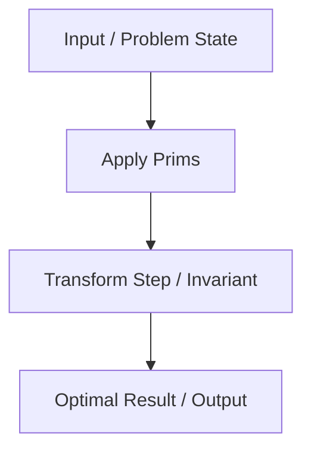

# Prims

> **Category:** Graphs · **Tier:** Core Interview (High-Yield)

---

## 🔗 Resources & Visualizers
- **YouTube:** [Watch Prims Visual Guide](https://www.youtube.com/results?search_query=Prims%20algorithm%20visual%20explanation)
- **Blog / Editorial:** [CP-Algorithms / GeeksforGeeks Guide](https://www.google.com/search?q=Prims%20algorithm%20tutorial%20CP%20algorithms)
- **Interactive Visualizer:** [VisuAlgo Interactive Simulation](https://visualgo.net/en)

---

## 🧠 Intuition & Mental Model
> [!TIP]
> **Core Concept:** Prim’s Algorithm is a greedy graph algorithm used to find the Minimum Spanning Tree

Prim’s Algorithm is a greedy graph algorithm used to find the Minimum Spanning Tree
(MST) of a connected, weighted, undirected graph.
It grows the MST by always picking the minimum weight
edge that connects a visited node to an unvisited node.
How the Algorithm Works
Start from any node and mark it as visited
Consider all edges from visited nodes to unvisited nodes
Pick the edge with minimum weight among them
Add that edge and the new node to the MST
Repeat until all nodes are included

---

## 🎯 When to Use & Problem Triggers
- **Trigger 1:** When the brute-force enumeration takes quadratic time or higher and a linear/logarithmic invariant exists.
- **Trigger 2:** Common patterns involving **Graphs**, subsegments, query sequences, or optimal substructures.
- **Trigger 3:** Constraints where $N \ge 10^5$ require $O(N)$ or $O(N \log N)$ performance.

---

## 📊 Visual Explanation & Dry Run



<details>
<summary>🔍 <strong>Step-by-Step Algorithm Walkthrough</strong> (Click to expand)</summary>

1. **Initialization:** Set up boundary pointers, state variables, or base auxiliary arrays.
2. **Iteration / Traversal:** Advance through the input elements while maintaining the algorithmic invariant.
3. **State Transition:** Update the current state, dynamic array, or accumulator in $O(1)$ or $O(\log N)$.
4. **Final Result:** Extract the optimal answer from the computed state or reconstructed solution.

</details>

---

## 💻 Algorithm Code (Java)

```java
import java.io.*;
import java.util.*;

class Main {
    public static void main(String[] args) {
        int V = 4;

        int[][] g = {
                {0, 1, 4, 0},
                {1, 0, 0, 2},
                {4, 0, 0, 3},
                {0, 2, 3, 0}
        };

        boolean[] visited = new boolean[V];

        int[] key = new int[V];

        int[] parent = new int[V];

        Arrays.fill(key, Integer.MAX_VALUE);

        key[0] = 0;
        parent[0] = -1;

        for (int count = 0; count < V - 1; count++) {
            int u = -1;
            int min = Integer.MAX_VALUE;

            for (int i = 0; i < V; i++) {
                if (!visited[i] && key[i] < min) {
                    min = key[i];
                    u = i;
                }
            }

            visited[u] = true;

            for (int v = 0; v < V; v++) {
                if (g[u][v] != 0 && !visited[v] && g[u][v] < key[v]) {
                    key[v] = g[u][v];
                    parent[v] = u;
                }
            }
        }

        for (int i = 1; i < V; i++) {
            System.out.println(parent[i] + " - " + i + " : " + g[i][parent[i]]);
        }
    }
}
```

---

## ⏱️ Complexity Analysis
- **Time Complexity (TC):** Typically `O(N)` or `O(N log N)` depending on auxiliary sorting or tree operations.
- **Space Complexity (SC):** Typically `O(1)` auxiliary space or `O(N)` for auxiliary arrays/tables.

---

## 🔄 Similar & Connected Algorithms
- **Related Category:** Explore other fundamental algorithms in [Graphs](../).
- **Composite Patterns:** Often combined with Prefix Sums, Binary Search on Answer, or Dynamic Programming memoization.

---

## ⚔️ Practice Questions

### 🟡 LeetCode
- [ ] [Explore Prims Problems on LeetCode](https://leetcode.com/problemset/?search=Prims%20LeetCode) — `Practice`

### 🔵 CodeChef & Codeforces
- [ ] [Practice on Codeforces Problemset](https://codeforces.com/problemset) — `Catalog`
- [ ] [Practice on CodeChef Practice Portal](https://www.codechef.com/practice) — `Catalog`
