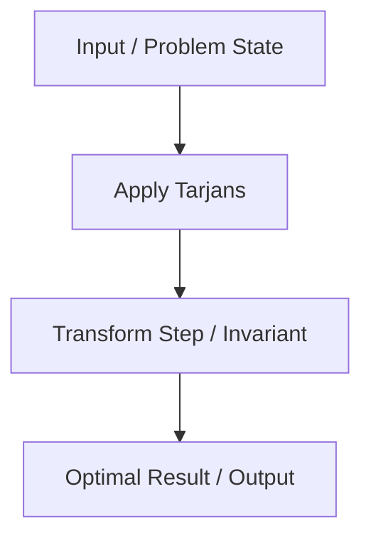

# Tarjans

> **Category:** Graphs · **Tier:** Advanced Interview (Classic)

---

## 🔗 Resources & Visualizers
- **YouTube:** [Watch Tarjans Visual Guide](https://www.youtube.com/results?search_query=Tarjans%20algorithm%20visual%20explanation)
- **Blog / Editorial:** [CP-Algorithms / GeeksforGeeks Guide](https://www.google.com/search?q=Tarjans%20algorithm%20tutorial%20CP%20algorithms)
- **Interactive Visualizer:** [VisuAlgo Interactive Simulation](https://visualgo.net/en)

---

## 🧠 Intuition & Mental Model
> [!TIP]
> **Core Concept:** Tarjan’s SCC Algorithm finds all Strongly Connected Components in a

Tarjan’s SCC Algorithm finds all Strongly Connected Components in a
directed graph using one DFS traversal.
A Strongly Connected Component is a group of nodes where
each node is reachable from every other node.
Algorithm Explanation
Perform DFS on the graph.
Assign each node:
disc[u] → discovery time
low[u] → lowest discovery time reachable
Maintain a stack of active DFS nodes.
While returning from DFS:
Update low[u] using neighbors.
If disc[u] == low[u]:
u is the root of an SCC
Pop nodes from stack until u is removed → one SCC formed.

---

## 🎯 When to Use & Problem Triggers
- **Trigger 1:** When the brute-force enumeration takes quadratic time or higher and a linear/logarithmic invariant exists.
- **Trigger 2:** Common patterns involving **Graphs**, subsegments, query sequences, or optimal substructures.
- **Trigger 3:** Constraints where $N \ge 10^5$ require $O(N)$ or $O(N \log N)$ performance.

---

## 📊 Visual Explanation & Dry Run



<details>
<summary>🔍 <strong>Step-by-Step Algorithm Walkthrough</strong> (Click to expand)</summary>

1. **Initialization:** Set up boundary pointers, state variables, or base auxiliary arrays.
2. **Iteration / Traversal:** Advance through the input elements while maintaining the algorithmic invariant.
3. **State Transition:** Update the current state, dynamic array, or accumulator in $O(1)$ or $O(\log N)$.
4. **Final Result:** Extract the optimal answer from the computed state or reconstructed solution.

</details>

---

## 💻 Algorithm Code (Java)

```java
import java.util.*;

class TarjanSCC {

    static int n = 4;
    static List<Integer>[] g = new ArrayList[n];

    static int time = 0;
    static int[] disc = new int[n];
    static int[] low = new int[n];
    static boolean[] inStack = new boolean[n];

    static Deque<Integer> st = new ArrayDeque<>();

    public static void main(String[] args) {
        for (int i = 0; i < n; i++) g[i] = new ArrayList<>();

        g[0].add(1);
        g[1].add(2);
        g[2].add(0);
        g[2].add(3);

        Arrays.fill(disc, -1);

        for (int i = 0; i < n; i++) {
            if (disc[i] == -1) dfs(i);
        }
    }

    static void dfs(int u) {
        disc[u] = low[u] = time++;
        st.push(u);
        inStack[u] = true;

        for (int v : g[u]) {
            if (disc[v] == -1) {
                dfs(v);
                low[u] = Math.min(low[u], low[v]);
            } else if (inStack[v]) {
                low[u] = Math.min(low[u], disc[v]);
            }
        }

        if (disc[u] == low[u]) {
            System.out.print("SCC: ");
            while (true) {
                int x = st.pop();
                inStack[x] = false;
                System.out.print(x + " ");
                if (x == u) break;
            }

            System.out.println();
        }
    }
}
```

---

## ⏱️ Complexity Analysis
- **Time Complexity (TC):** Typically `O(N)` or `O(N log N)` depending on auxiliary sorting or tree operations.
- **Space Complexity (SC):** Typically `O(1)` auxiliary space or `O(N)` for auxiliary arrays/tables.

---

## 🔄 Similar & Connected Algorithms
- **Related Category:** Explore other fundamental algorithms in [Graphs](../).
- **Composite Patterns:** Often combined with Prefix Sums, Binary Search on Answer, or Dynamic Programming memoization.

---

## ⚔️ Practice Questions

### 🟡 LeetCode
- [ ] [Explore Tarjans Problems on LeetCode](https://leetcode.com/problemset/?search=Tarjans%20LeetCode) — `Practice`

### 🔵 CodeChef & Codeforces
- [ ] [Practice on Codeforces Problemset](https://codeforces.com/problemset) — `Catalog`
- [ ] [Practice on CodeChef Practice Portal](https://www.codechef.com/practice) — `Catalog`
