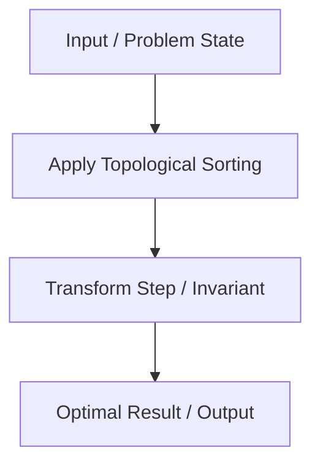

# Topological Sorting

> **Category:** Graphs · **Tier:** Core Interview (Essential)

---

## 🔗 Resources & Visualizers
- **YouTube:** [Watch Topological Sorting Visual Guide](https://www.youtube.com/results?search_query=Topological%20Sorting%20algorithm%20visual%20explanation)
- **Blog / Editorial:** [CP-Algorithms / GeeksforGeeks Guide](https://www.google.com/search?q=Topological%20Sorting%20algorithm%20tutorial%20CP%20algorithms)
- **Interactive Visualizer:** [VisuAlgo Interactive Simulation](https://visualgo.net/en)

---

## 🧠 Intuition & Mental Model
> [!TIP]
> **Core Concept:** Topological Sorting is a linear ordering of vertices in a

Topological Sorting is a linear ordering of vertices in a
Directed Acyclic Graph (DAG) such that for every directed edge u → v,
u appears before v.
Algorithm Explanation ( Kahn’s Algorithm )
Works only for DAG
Compute indegree (incoming edges) for each node
Push all nodes with indegree = 0 into a queue
Repeatedly:
Remove a node from queue
Add it to answer
Reduce indegree of its neighbors
If any neighbor’s indegree becomes 0 → push to queue
If all nodes are processed → valid topological order

---

## 🎯 When to Use & Problem Triggers
- **Trigger 1:** When the brute-force enumeration takes quadratic time or higher and a linear/logarithmic invariant exists.
- **Trigger 2:** Common patterns involving **Graphs**, subsegments, query sequences, or optimal substructures.
- **Trigger 3:** Constraints where $N \ge 10^5$ require $O(N)$ or $O(N \log N)$ performance.

---

## 📊 Visual Explanation & Dry Run



<details>
<summary>🔍 <strong>Step-by-Step Algorithm Walkthrough</strong> (Click to expand)</summary>

1. **Initialization:** Set up boundary pointers, state variables, or base auxiliary arrays.
2. **Iteration / Traversal:** Advance through the input elements while maintaining the algorithmic invariant.
3. **State Transition:** Update the current state, dynamic array, or accumulator in $O(1)$ or $O(\log N)$.
4. **Final Result:** Extract the optimal answer from the computed state or reconstructed solution.

</details>

---

## 💻 Algorithm Code (Java)

```java
import java.io.*;
import java.util.*;

class TopologicalSort {
    public static void main(String[] args) {
        int V = 4;

        int[][] edges = {
                {0, 1},
                {0, 2},
                {1, 3},
                {2, 3}
        };

        List<Integer>[] g = new ArrayList[V];

        for (int i = 0; i < V; i++)
            g[i] = new ArrayList<>();

        for (int[] e : edges)
            g[e[0]].add(e[1]);

        int[] in = new int[V];

        for (int u = 0; u < V; u++)
            for (int v : g[u])
                in[v]++;

        ArrayDeque<Integer> q = new ArrayDeque<>();

        for (int i = 0; i < V; i++)
            if (in[i] == 0)
                q.add(i);

        StringBuilder ans = new StringBuilder();

        while (!q.isEmpty()) {
            int u = q.poll();
            ans.append(u).append(" ");

            for (int v : g[u]) {
                in[v]--;
                if (in[v] == 0)
                    q.add(v);
            }
        }

        System.out.println(ans.toString());
    }
}
```

---

## ⏱️ Complexity Analysis
- **Time Complexity (TC):** Typically `O(N)` or `O(N log N)` depending on auxiliary sorting or tree operations.
- **Space Complexity (SC):** Typically `O(1)` auxiliary space or `O(N)` for auxiliary arrays/tables.

---

## 🔄 Similar & Connected Algorithms
- **Related Category:** Explore other fundamental algorithms in [Graphs](../).
- **Composite Patterns:** Often combined with Prefix Sums, Binary Search on Answer, or Dynamic Programming memoization.

---

## ⚔️ Practice Questions

### 🟡 LeetCode
- [ ] [207. Course Schedule](https://leetcode.com/problems/course-schedule/) — `Medium`
- [ ] [210. Course Schedule II](https://leetcode.com/problems/course-schedule-ii/) — `Medium`
- [ ] [269. Alien Dictionary](https://leetcode.com/problems/alien-dictionary/) — `Hard`

### 🔵 CodeChef & Codeforces
- [ ] [510C - Fox And Names](https://codeforces.com/problemset/problem/510/C) — `1500`
