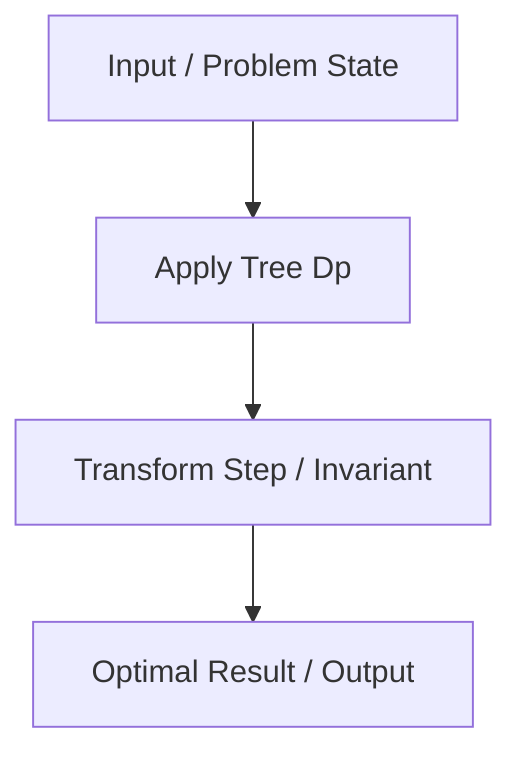

# Tree Dp

> **Category:** Graphs · **Tier:** Advanced Interview (Hard)

---

## 🔗 Resources & Visualizers
- **YouTube:** [Watch Tree Dp Visual Guide](https://www.youtube.com/results?search_query=Tree%20Dp%20algorithm%20visual%20explanation)
- **Blog / Editorial:** [CP-Algorithms / GeeksforGeeks Guide](https://www.google.com/search?q=Tree%20Dp%20algorithm%20tutorial%20CP%20algorithms)
- **Interactive Visualizer:** [VisuAlgo Interactive Simulation](https://visualgo.net/en)

---

## 🧠 Intuition & Mental Model
> [!TIP]
> **Core Concept:** Tree DP is a dynamic programming technique applied on t

Tree DP is a dynamic programming technique applied on t
rees where each node computes answers using results from its children.
It relies on DFS traversal and exploits the no-cycle
property of trees to avoid recomputation.
Algorithm Explanation
Root the tree at any node (usually 0 or 1)
Use DFS to visit children
For each node, compute DP value using children’s DP values
Return DP value to parent
👉 In this example:
dp[node] = value[node] + sum of dp[children]

---

## 🎯 When to Use & Problem Triggers
- **Trigger 1:** When the brute-force enumeration takes quadratic time or higher and a linear/logarithmic invariant exists.
- **Trigger 2:** Common patterns involving **Graphs**, subsegments, query sequences, or optimal substructures.
- **Trigger 3:** Constraints where $N \ge 10^5$ require $O(N)$ or $O(N \log N)$ performance.

---

## 📊 Visual Explanation & Dry Run



<details>
<summary>🔍 <strong>Step-by-Step Algorithm Walkthrough</strong> (Click to expand)</summary>

1. **Initialization:** Set up boundary pointers, state variables, or base auxiliary arrays.
2. **Iteration / Traversal:** Advance through the input elements while maintaining the algorithmic invariant.
3. **State Transition:** Update the current state, dynamic array, or accumulator in $O(1)$ or $O(\log N)$.
4. **Final Result:** Extract the optimal answer from the computed state or reconstructed solution.

</details>

---

## 💻 Algorithm Code (Java)

```java
import java.io.*;
import java.util.*;

class Main {

    static int n;
    static int[] val;
    static int[] dp;
    static int[] head, to, next;
    static int idx = 0;

    static void addEdge(int u, int v) {
        to[idx] = v;
        next[idx] = head[u];
        head[u] = idx;
        idx++;
    }

    static void dfs(int u, int p) {
        dp[u] = val[u];

        for (int i = head[u]; i != -1; i = next[i]) {
            int v = to[i];
            if (v == p) continue;
            dfs(v, u);
            dp[u] += dp[v];
        }
    }

    public static void main(String[] args) throws Exception {
        BufferedReader br = new BufferedReader(new InputStreamReader(System.in));
        PrintWriter out = new PrintWriter(System.out);

        n = 5;

        val = new int[]{1, 2, 3, 4, 5};
        dp = new int[n];
        head = new int[n];
        to = new int[2 * (n - 1)];
        next = new int[2 * (n - 1)];

        Arrays.fill(head, -1);

        addEdge(0, 1);
        addEdge(1, 0);
        addEdge(0, 2);
        addEdge(2, 0);
        addEdge(1, 3);
        addEdge(3, 1);
        addEdge(1, 4);
        addEdge(4, 1);

        dfs(0, -1);

        for (int i = 0; i < n; i++)
            out.print(dp[i] + " ");

        out.flush();
    }
}
```

---

## ⏱️ Complexity Analysis
- **Time Complexity (TC):** Typically `O(N)` or `O(N log N)` depending on auxiliary sorting or tree operations.
- **Space Complexity (SC):** Typically `O(1)` auxiliary space or `O(N)` for auxiliary arrays/tables.

---

## 🔄 Similar & Connected Algorithms
- **Related Category:** Explore other fundamental algorithms in [Graphs](../).
- **Composite Patterns:** Often combined with Prefix Sums, Binary Search on Answer, or Dynamic Programming memoization.

---

## ⚔️ Practice Questions

### 🟡 LeetCode
- [ ] [Explore Tree Dp Problems on LeetCode](https://leetcode.com/problemset/?search=Tree%20Dp%20LeetCode) — `Practice`

### 🔵 CodeChef & Codeforces
- [ ] [Practice on Codeforces Problemset](https://codeforces.com/problemset) — `Catalog`
- [ ] [Practice on CodeChef Practice Portal](https://www.codechef.com/practice) — `Catalog`
