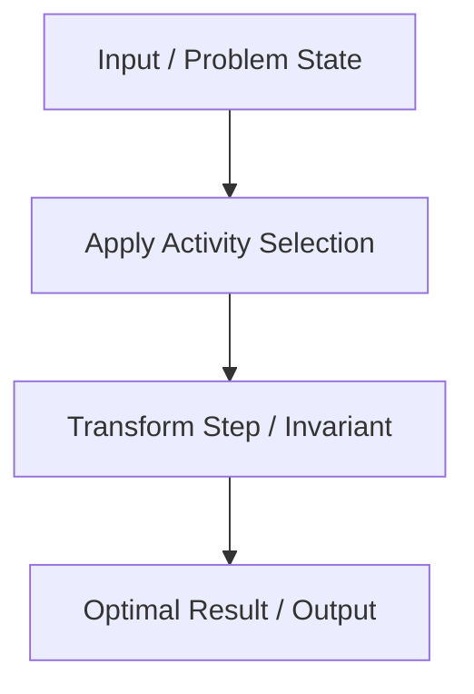

# Activity Selection

> **Category:** Greedy · **Tier:** Core Interview (Classic)

---

## 🔗 Resources & Visualizers
- **YouTube:** [Watch Activity Selection Visual Guide](https://www.youtube.com/results?search_query=Activity%20Selection%20algorithm%20visual%20explanation)
- **Blog / Editorial:** [CP-Algorithms / GeeksforGeeks Guide](https://www.google.com/search?q=Activity%20Selection%20algorithm%20tutorial%20CP%20algorithms)
- **Interactive Visualizer:** [VisuAlgo Interactive Simulation](https://visualgo.net/en)

---

## 🧠 Intuition & Mental Model
> [!TIP]
> **Core Concept:** Activity Selection Algorithm is a greedy algorithm used to select

Activity Selection Algorithm is a greedy algorithm used to select
the maximum number of non-overlapping activities from a given set,
where each activity has a start time and finish time.
The strategy is to always pick the activity that finishes earliest.
Algorithm Explanation
Sort all activities by their finish time
Select the first activity (earliest finish)
For remaining activities, select an activity only if its start time
≥ last selected activity’s finish time
Continue till all activities are checked
Greedy choice works because finishing earlier leaves more room for future activities.

---

## 🎯 When to Use & Problem Triggers
- **Trigger 1:** When the brute-force enumeration takes quadratic time or higher and a linear/logarithmic invariant exists.
- **Trigger 2:** Common patterns involving **Greedy**, subsegments, query sequences, or optimal substructures.
- **Trigger 3:** Constraints where $N \ge 10^5$ require $O(N)$ or $O(N \log N)$ performance.

---

## 📊 Visual Explanation & Dry Run



<details>
<summary>🔍 <strong>Step-by-Step Algorithm Walkthrough</strong> (Click to expand)</summary>

1. **Initialization:** Set up boundary pointers, state variables, or base auxiliary arrays.
2. **Iteration / Traversal:** Advance through the input elements while maintaining the algorithmic invariant.
3. **State Transition:** Update the current state, dynamic array, or accumulator in $O(1)$ or $O(\log N)$.
4. **Final Result:** Extract the optimal answer from the computed state or reconstructed solution.

</details>

---

## 💻 Algorithm Code (Java)

```java
import java.util.Arrays;

class Main {

    static class Activity {
        int start;
        int end;

        Activity(int s, int e) {
            this.start = s;
            this.end = e;
        }
    }

    public static void main(String[] args) throws Exception {
        Activity[] arr = {
                new Activity(1, 3),
                new Activity(2, 4),
                new Activity(3, 5),
                new Activity(0, 6),
                new Activity(5, 7),
                new Activity(8, 9)
        };

        Arrays.sort(arr, (a, b) -> a.end - b.end);

        int count = 1;
        int lastEnd = arr[0].end;

        for (int i = 1; i < arr.length; i++) {
            if (arr[i].start >= lastEnd) {
                count++;
                lastEnd = arr[i].end;
            }
        }

        System.out.println(count);
    }
}
```

---

## ⏱️ Complexity Analysis
- **Time Complexity (TC):** Typically `O(N)` or `O(N log N)` depending on auxiliary sorting or tree operations.
- **Space Complexity (SC):** Typically `O(1)` auxiliary space or `O(N)` for auxiliary arrays/tables.

---

## 🔄 Similar & Connected Algorithms
- **Related Category:** Explore other fundamental algorithms in [Greedy](../).
- **Composite Patterns:** Often combined with Prefix Sums, Binary Search on Answer, or Dynamic Programming memoization.

---

## ⚔️ Practice Questions

### 🟡 LeetCode
- [ ] [Explore Activity Selection Problems on LeetCode](https://leetcode.com/problemset/?search=Activity%20Selection%20LeetCode) — `Practice`

### 🔵 CodeChef & Codeforces
- [ ] [Practice on Codeforces Problemset](https://codeforces.com/problemset) — `Catalog`
- [ ] [Practice on CodeChef Practice Portal](https://www.codechef.com/practice) — `Catalog`
